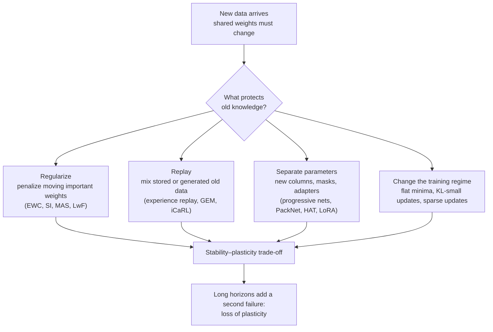

# Continual learning and catastrophic forgetting

People learn to drive without forgetting how to read. A neural network trained on one task and then on a second usually gets worse, often much worse, at the first. The effect was named **catastrophic interference** in 1989 and it is still the main reason that today's largest models are trained once, frozen, and then retrained or patched instead of simply learning as they go. This page covers why forgetting happens, what the main families of fixes actually buy, a second and less famous failure called **loss of plasticity**, and what continual learning looks like for large language models in 2025 and 2026.

> **The core idea.** A network stores everything it knows in one shared set of weights. Gradient descent on new data moves those weights in whatever direction helps the new data, and nothing in the update protects what the old data needed. Every fix either *protects* important weights, *revisits* old data, *separates* tasks into different parameters, or *changes how training is done* so that updates interfere less. Each one trades remembering against learning: this is the **stability–plasticity dilemma**.



## 1. The problem, and why it was surprising (established)

McCloskey and Cohen (1989) trained a network on the "ones" addition facts and then on the "twos", and found that learning the new facts rapidly disrupted the old ones. Ratcliff (1990) found the same in connectionist models of recognition memory: learning new items severely disrupted memory for earlier ones, in ways human forgetting does not show. French (1999) reviewed a decade of work and framed the cause as overlap: when many items share the same distributed weights, there is no place to put a new item that does not disturb the old ones.

Two decades later, Goodfellow et al. (2013) checked whether modern training had made the problem go away. It had not. Networks trained with dropout gave the best trade-off between learning the new task and keeping the old one in their experiments, but every method forgot, and which activation function forgot least depended on how the two tasks were related.

### The three scenarios

Results in this field are only comparable when the setting is pinned down. Van de Ven and Tolias (2019; journal version van de Ven, Tuytelaars & Tolias, 2022) separated three cases:

| Scenario | At test time the model must… | Example | Difficulty |
|---|---|---|---|
| Task-incremental | solve the task it is told it is on | separate output heads per task | easiest |
| Domain-incremental | solve the same kind of problem as inputs shift | the same digits in new rotations | middle |
| Class-incremental | tell apart all classes ever seen, without being told the task | learn digits 0–1, then 2–3, then classify any of 0–9 | hardest |

Their key finding was that regularization methods such as EWC (section 3) failed in the class-incremental setting, and that some form of replay appeared to be required. Farquhar and Gal (2018) made a related point: evaluations that quietly give the model the task label, or use tasks that barely interfere, can make almost any method look good.

### How forgetting is measured

Lopez-Paz and Ranzato (2017) introduced the metrics most papers still report. Let $R_{t,j}$ be the score on task $j$ after training through task $t$, for $T$ tasks:

$$
\text{ACC} = \frac{1}{T}\sum_{j=1}^{T} R_{T,j},
\qquad
\text{BWT} = \frac{1}{T-1}\sum_{j=1}^{T-1}\bigl(R_{T,j} - R_{j,j}\bigr).
$$

Average accuracy (ACC) is what is left at the end. Backward transfer (BWT) is how much later training changed earlier tasks: negative means forgetting, positive means later tasks helped earlier ones. Forward transfer measures the reverse, whether earlier tasks make later ones faster to learn.

## 2. Why it happens: interference in a shared space (established)

Take one gradient step of size $\eta$ on task B. To first order, the change in task A's loss is

$$
L_A(\theta - \eta\,\nabla L_B) \;\approx\; L_A(\theta) \;-\; \eta\,\nabla L_A(\theta)\cdot\nabla L_B(\theta).
$$

If the two gradients point in similar directions, learning B also helps A. If they conflict, every step on B undoes part of A. If they are orthogonal, B is learned without touching A to first order. Forgetting is therefore a geometric question about how the tasks' gradients, and the features they use, overlap.

Several lines of theory make this precise:

- **Linear regression.** Evron et al. (2022) derived exact expressions for forgetting when an overparameterized linear model is fitted to a sequence of tasks, and connected the process to alternating projections and the Kaczmarz method. When $T$ tasks in $d$ dimensions are revisited cyclically $k$ times, forgetting is bounded by $T^2 \min\{1/\sqrt{k},\, d/k\}$, and the $T^2$ factor can be removed by presenting the tasks in random order.
- **Wide networks.** Doan et al. (2021) analysed forgetting in the neural tangent kernel regime, introduced an NTK overlap matrix between tasks as the measure of similarity at the core of forgetting, and showed that its impact grows as two tasks increasingly align.
- **Teacher–student models.** Lee, Goldt and Saxe (2021) studied two-layer networks learning from a sequence of teacher networks. When tasks depend on similar features, intermediate similarity produced the most forgetting; separating similarity in the features from similarity in the readout weights revealed a more complex interplay between the two.
- **Where in the network.** Ramasesh, Dyer and Raghu (2020) found that deeper layers are disproportionately the source of forgetting, that methods which reduce forgetting act by stabilizing those layers, and that forgetting is worst for tasks of *intermediate* similarity. Very different tasks use different features; nearly identical tasks want the same answer.

The tested sketch in section 5 reproduces that last pattern in a linear model, where everything can be computed exactly.

## 3. Four families of fixes (established)

| Family | Idea | Representative methods | What it costs |
|---|---|---|---|
| Regularization | Penalize moving weights that mattered for old tasks, or changing old outputs | EWC (Kirkpatrick et al. 2017), Synaptic Intelligence (Zenke, Poole & Ganguli 2017), Memory Aware Synapses (Aljundi et al. 2018), Learning without Forgetting (Li & Hoiem 2016) | Less plasticity; weak in class-incremental settings |
| Replay | Keep training on a little old data, real or generated | Pseudorehearsal (Robins 1995), iCaRL (Rebuffi et al. 2017), deep generative replay (Shin et al. 2017), GEM and A-GEM (Lopez-Paz & Ranzato 2017; Chaudhry et al. 2019), experience replay (Rolnick et al. 2019) | Memory, privacy, extra compute |
| Parameter isolation | Give each task its own parameters or masks | Progressive networks (Rusu et al. 2016), PackNet (Mallya & Lazebnik 2018), Hard Attention to the Task (Serrà et al. 2018), learned prompts (Wang et al. 2022) | Growing size, or a need to know which task is active |
| Training regime | Train so that updates interfere less | Dropout, learning-rate decay and batch size choices that widen minima (Mirzadeh et al. 2020) | Usually cheap; partial |

Surveys by Parisi et al. (2018), De Lange et al. (2019), Hadsell et al. (2020) and Wang et al. (2023) cover the hundreds of variants.

### Elastic weight consolidation, derived

EWC starts from Bayes' rule. After task A, everything known about the weights is the posterior $p(\theta \mid A)$, and learning B should maximize

$$
\log p(\theta \mid A, B) = \log p(B \mid \theta) + \log p(\theta \mid A) - \log p(B).
$$

The posterior over A is intractable, so EWC replaces it with a Gaussian centred on A's solution $\theta_A$ whose precision is the Fisher information $F_A$ (a Laplace approximation), and keeps only its diagonal. The loss for B becomes

$$
\mathcal{L}(\theta) = L_B(\theta) + \frac{\lambda}{2}\sum_i F_{A,i}\,\bigl(\theta_i - \theta_{A,i}\bigr)^2 .
$$

Weights with large Fisher, those A's predictions are most sensitive to, are held near their old values; weights A does not care about are free. Kirkpatrick et al. (2017) showed this on sequences of MNIST tasks and on learning several Atari 2600 games one after another. The Fisher is the same object that defines the [natural gradient](../00-foundations/information-geometry-natural-gradient.md).

Two refinements matter in practice. For a quadratic loss the Laplace approximation is exact: with $w_A$ the least-squares solution of task A, $\lVert X_A w - y_A\rVert^2 = \lVert X_A (w - w_A)\rVert^2 + \text{const}$, so EWC with the *full* Fisher recovers joint training exactly (checked numerically in section 5). The approximation error comes from non-quadratic losses and from dropping off-diagonal terms. And Huszár (2017) extended the derivation to more than two tasks and showed that keeping a separate quadratic penalty for every past task is inconsistent with it and can double-count earlier data. The "online EWC" used in Progress & Compress (Schwarz et al. 2018) keeps a single running penalty instead.

Synaptic Intelligence estimates each weight's importance online, from how much it contributed to reducing the loss along the training path. Memory Aware Synapses uses how sensitive the network's outputs are to each weight, which needs no labels. Learning without Forgetting protects *outputs* rather than weights: it distils the old model's predictions on the new data.

### Replay, and the surprisingly strong baseline

Gradient Episodic Memory keeps a small buffer per task and only accepts update directions that do not increase the loss on any buffer:

$$
\min_{\tilde g}\ \tfrac12\lVert g - \tilde g\rVert^2 \quad \text{s.t.}\quad \langle \tilde g, g_k\rangle \ge 0 \ \text{ for every past task } k.
$$

A-GEM replaces the many constraints with one, built from the average gradient on the whole buffer: if $g \cdot g_{\text{ref}} < 0$, use $\tilde g = g - \frac{g\cdot g_{\text{ref}}}{\lVert g_{\text{ref}}\rVert^2}\,g_{\text{ref}}$, which is much cheaper.

The humbling result came next. Chaudhry et al. (2019, *On tiny episodic memories*) found that simply training on the current batch together with a batch from a very small memory beat purpose-built continual-learning methods on four benchmarks, and that repeatedly training on even one stored example per class *improved* generalization, by between 7% and 17%. Experience replay has been a default baseline ever since, and Rolnick et al. (2019) showed the same idea working in reinforcement learning.

## 4. Loss of plasticity: the second failure (established, mechanisms active research)

Forgetting is the famous failure. Over long horizons there is a second one: a network that keeps training can gradually lose the ability to learn *anything new*.

- **Warm starts.** Ash and Adams (2020) found that a network trained on part of a dataset and then on all of it generalizes worse than one trained from scratch on all of it, even though it reaches similar training loss.
- **Primacy bias in reinforcement learning.** Nikishin et al. (2022) showed that deep RL agents overfit to their earliest experience and ignore later evidence, and that periodically resetting part of the network consistently helped on Atari 100k and the DeepMind Control Suite.
- **Direct demonstrations.** Dohare et al. (2024, *Nature*) ran networks through thousands of tasks built from MNIST and ImageNet. On the ImageNet sequence, binary classification accuracy fell from 89% on an early task to 77%, about the level of a linear network, by the 2,000th task. The loss happened across architectures, optimizers, activation functions, batch normalization and dropout. L2 regularization, especially with small random weight perturbations, eased it, and their **continual backpropagation**, which reinitializes a small fraction of the least-used units as training goes, appeared to maintain plasticity indefinitely.
- **Mechanisms.** Lyle et al. (2023) linked plasticity loss to changes in the curvature of the loss landscape and found that it often happens *without* saturated units, so "dead neurons" are not the whole story. Kumar, Marklund and Van Roy (2023) proposed regularizing toward the initial weights (L2 Init); Elsayed and Mahmood (2024) proposed utility-based perturbed gradient descent, which perturbs low-utility weights and protects useful ones, to address both failures at once.

Forgetting and loss of plasticity pull in opposite directions. Anchoring weights limits forgetting but can starve plasticity; resetting units restores plasticity but erases whatever they stored. A practical continual learner needs both stability and a supply of fresh capacity.

## 5. A tested sketch: interference, EWC and replay

Two small NumPy experiments, both run before publication. The first uses linear regression, where gradient descent's end point can be written in closed form. Task A lives in a random 20-dimensional subspace of $\mathbb{R}^{60}$; task B's subspace and teacher are both rotated toward A by a similarity $s$, so $s = 0$ means orthogonal tasks and $s = 1$ means the same task.

```python
import numpy as np
d, k, n = 60, 20, 200
def experiment(s, seed):
    r = np.random.default_rng(seed)
    Q = np.linalg.qr(r.standard_normal((d, d)))[0]
    A = Q[:, :k]; B = s * A + np.sqrt(1 - s**2) * Q[:, k:2*k]       # subspace overlap set by s
    wA = r.standard_normal(d); wB = s * wA + np.sqrt(1 - s**2) * r.standard_normal(d)   # teacher similarity too
    XA = r.standard_normal((n, k)) @ A.T; XB = r.standard_normal((n, k)) @ B.T
    yA, yB = XA @ wA, XB @ wB
    w1 = np.linalg.lstsq(XA, yA, rcond=None)[0]            # gradient descent from zero ends at the min-norm fit
    w2 = w1 + np.linalg.pinv(XB) @ (yB - XB @ w1)          # gradient descent on B started at w1 ends here
    return np.mean((XA @ w2 - yA)**2) / np.mean(yA**2)      # forgetting on A, normalized
for s in [0.0, 0.2, 0.4, 0.6, 0.8, 0.9, 0.95, 1.0]:
    print(s, round(np.mean([experiment(s, q) for q in range(20)]), 3))

# EWC is exact for quadratic losses (full Fisher), approximate with the diagonal
r = np.random.default_rng(7); D = 30
XA = r.standard_normal((100, D)) @ np.diag(np.linspace(0.2, 3, D))
XB = r.standard_normal((100, D)) @ np.diag(np.linspace(3, 0.2, D)) + 0.5 * XA
yA = XA @ r.standard_normal(D) + 0.1 * r.standard_normal(100); yB = XB @ r.standard_normal(D) + 0.1 * r.standard_normal(100)
wA = np.linalg.solve(XA.T @ XA, XA.T @ yA); F = XA.T @ XA; Fd = np.diag(np.diag(F))
joint = np.linalg.solve(F + XB.T @ XB, XA.T @ yA + XB.T @ yB)
ewc_full = np.linalg.solve(XB.T @ XB + F, XB.T @ yB + F @ wA)
ewc_diag = np.linalg.solve(XB.T @ XB + Fd, XB.T @ yB + Fd @ wA)
naive = np.linalg.solve(XB.T @ XB, XB.T @ yB)
total = lambda w: np.sum((XA @ w - yA)**2) + np.sum((XB @ w - yB)**2)
print(total(joint), total(ewc_full), np.linalg.norm(ewc_full - joint), total(ewc_diag), total(naive))
```

Output, averaged over 20 seeds:

| Similarity $s$ | 0.00 | 0.20 | 0.40 | 0.60 | 0.80 | 0.90 | 0.95 | 1.00 |
|---|---|---|---|---|---|---|---|---|
| Forgetting on A (normalized MSE) | 0.000 | 0.041 | 0.171 | 0.368 | **0.460** | 0.342 | 0.206 | 0.000 |

Forgetting is zero for orthogonal tasks, zero for identical ones, and peaks at intermediate similarity, the same shape Ramasesh, Dyer and Raghu reported for deep networks. On the second check, EWC with the full Fisher lands on the joint-training solution to within $1.6 \times 10^{-15}$ (total loss 2458.01 for both). Keeping only the diagonal raises the total loss by 11.2% (2733.42), and training on B with no penalty raises it by 158% (6351.80).

The second experiment trains a one-hidden-layer tanh network (64 units) on five regression tasks in sequence. Each task draws inputs from its own random 8-dimensional subspace of $\mathbb{R}^{20}$ and targets from its own random teacher network, scaled so that always predicting zero scores a mean squared error of about 1.0. Each task gets 3,000 SGD steps; EWC uses the diagonal Fisher with a proximal update so that large $\lambda$ stays stable; replay mixes an equal-sized batch from a buffer holding a fixed number of examples per past task. The [full script](#appendix-the-five-task-network-script) is at the end of this page. Results, mean over five seeds (test MSE, lower is better):

| Method | Final mean MSE over all 5 tasks | Forgetting (rise in MSE on tasks 1–4) | MSE just after learning each task |
|---|---|---|---|
| Plain fine-tuning | 1.167 ± 0.203 | 1.446 | 0.010 |
| EWC, $\lambda = 1$ | 0.841 ± 0.063 | 1.020 | 0.025 |
| EWC, $\lambda = 10$ | **0.759** ± 0.053 | 0.870 | 0.062 |
| EWC, $\lambda = 100$ | 0.817 ± 0.088 | 0.425 | 0.477 |
| EWC, $\lambda = 1000$ | 1.266 ± 0.231 | 0.088 | 1.196 |
| EWC, $\lambda = 10^4$ | 1.418 ± 0.292 | 0.010 | 1.410 |
| Replay, 5 examples per task | 1.152 ± 0.206 | 1.419 | 0.017 |
| Replay, 20 examples per task | 0.549 ± 0.095 | 0.656 | 0.024 |
| Replay, 100 examples per task | **0.182** ± 0.032 | 0.185 | 0.034 |
| Joint training on all data so far (upper bound) | 0.106 ± 0.012 | 0.056 | 0.062 |

What the numbers show:

- **Plain fine-tuning learns each task almost perfectly (0.010) and ends worse than predicting zero (1.167).** The network does not degrade gracefully; it overwrites.
- **EWC's $\lambda$ walks the stability–plasticity curve.** Forgetting falls monotonically from 1.020 to 0.010 as $\lambda$ grows, but the ability to learn the new task collapses from 0.025 to 1.410. The best setting ($\lambda = 10$) still leaves a final error about seven times that of joint training.
- **Replay is the strongest lever here, but only past a threshold.** Five stored examples per task did almost nothing in this setup, 20 halved the final error, and 100 (a quarter of each task's data) came within 0.08 of joint training. This toy has unrelated teachers on overlapping inputs, which is harsh for weight-anchoring methods; it is a picture of the trade-offs, not a benchmark ranking.

## 6. Continual learning for large models (active research)

Foundation models changed the question. Pre-training gives broad, reusable features, so "forgetting" now usually means losing general abilities during fine-tuning, or failing to absorb new facts without damage.

- **Forgetting is real at scale.** Luo et al. (2023) observed catastrophic forgetting during continual instruction tuning in models from 1B to 7B parameters, with forgetting growing with model size in that range, and found that a prior round of general instruction tuning reduced it. Scialom, Chakrabarty and Muresan (2022) found the opposite picture for an instruction-tuned T5-family model: Continual-T0 learned diverse new tasks while keeping good performance on earlier ones across 70 datasets, which they attributed to self-supervised pre-training.
- **Continual pre-training can match retraining.** Ibrahim et al. (2024) found that re-warming and re-decaying the learning rate, plus replaying some previous data, matched full retraining from scratch on all data at 405M parameters, for both a mild (English to English) and a strong (English to German) shift, and matched it at 10B parameters on the mild shift, at a fraction of the compute. Gupta et al. (2023) studied how the re-warming step itself causes forgetting.
- **Low-rank updates learn less and forget less.** Biderman et al. (2024) compared LoRA with full fine-tuning on code and mathematics. LoRA underperformed on the target domain but kept more of the base model's other abilities, mitigated forgetting more than weight decay or dropout, and full fine-tuning learned perturbations of 10 to 100 times higher rank than typical LoRA settings.
- **Some forgetting is not forgetting.** Zheng et al. (2025) argued that many drops in continual LLM training reflect lost *task alignment*, how the model maps a request to its knowledge, rather than lost knowledge, traced it to the first optimization steps on a new task, and found that freezing the bottom layers helped substantially.
- **How you fine-tune matters.** Shenfeld, Pari and Agrawal (2025) found that reinforcement-learning fine-tuning preserved prior capabilities better than supervised fine-tuning at similar new-task performance, and that the amount of forgetting tracked the KL divergence between the fine-tuned and base model on the new task. Their explanation, "RL's Razor", is that on-policy RL is implicitly biased toward the solution closest in KL to the starting model.
- **Sparse updates.** Lin et al. (2025) fine-tuned only the slots of a memory layer (Berges et al. 2024) that a new fact activated much more than pre-training data did. At matched learning of new facts, NaturalQuestions F1 fell by 89% after full fine-tuning and 71% with LoRA, but only 11% with sparse memory fine-tuning.
- **Models that edit themselves.** SEAL (Zweiger et al. 2025) trains a model with reinforcement learning to write its own fine-tuning data and update settings, so that new information becomes a persistent weight change. Nested Learning (Behrouz et al. 2025) recasts architectures and optimizers as nested optimization problems running at different speeds, and its Hope model combines a self-modifying sequence model with a "continuum" of memories updated at different frequencies. Both connect directly to [fast-weight programmers](fast-weight-programmers.md) and to [recursion and self-improvement](recursion-and-self-improvement.md); both are early.

Parameter isolation is also the shape of modern practice: adapters, LoRA modules and [mixture-of-experts](../02-deep-learning/mixture-of-experts.md) routing give new skills their own parameters, at the cost of having to choose the right ones at inference time.

## 7. How brains seem to manage it (established neuroscience, contested mapping)

Biology does not solve the problem for free, but it suggests mechanisms that machine learning has borrowed.

- **Complementary learning systems.** McClelland, McNaughton and O'Reilly (1995) argued that the brain uses a fast-learning hippocampus to store new episodes and a slow-learning neocortex that absorbs them gradually, interleaved with old knowledge, precisely because fast learning in a single distributed network would cause catastrophic interference. Replay methods are the machine-learning version of this idea.
- **Replay during sleep.** Wilson and McNaughton (1994) recorded hippocampal place cells in rats and found that cells active together during a task were reactivated together during subsequent sleep.
- **Stable synapses.** Yang, Pan and Gan (2009) found in mice that a small fraction of dendritic spines formed during learning persist for the animal's life and are associated with lasting memories, a biological counterpart to protecting important weights.
- **Synapses with many timescales.** Fusi, Drew and Abbott (2005) and Benna and Fusi (2016) showed theoretically that synapses with internal states spanning several timescales can store memories far longer than simple bounded synapses while still learning new ones, an idea close in spirit to Nested Learning's multi-frequency memories.

Kudithipudi et al. (2022) review these and other biological mechanisms as design principles for lifelong-learning machines. How literally any of them maps onto gradient-trained networks is open.

## 8. Status at a glance

| Claim | Status |
|---|---|
| Sequential gradient training on shared weights causes catastrophic forgetting | Established since 1989; reconfirmed for modern networks and LLMs |
| Forgetting depends on task overlap and is worst at intermediate similarity | Established in linear and teacher–student theory and in deep-network experiments |
| EWC-style regularization reduces forgetting | Established in task- and domain-incremental settings; weak in class-incremental |
| Small replay buffers are a strong, simple baseline | Established |
| Long training sequences cause loss of plasticity | Established (Nature, 2024); mechanisms still debated |
| Continual pre-training with re-warming, re-decay and replay matches retraining | Shown up to 10B parameters on a mild shift |
| Sparse or low-rank updates reduce forgetting in LLMs | Promising, early evidence |
| A model can safely keep learning in deployment indefinitely | Open |

## 9. Speculative: continual learning on physical hardware

> **Speculative.** The ideas in this section are hypotheses for discussion, not established results.

On analog substrates such as [memristive crossbars](memristive-crossbars-in-memory-computing.md) and [photonic meshes](photonic-computing.md), writing a weight is slow, costs energy, and wears the device, while the stored value drifts on its own. That changes the economics of every method above.

1. **Drift is enforced forgetting.** Conductance drift slowly moves weights no matter what the learner does. A testable question is whether the importance scores used by EWC or Synaptic Intelligence also predict which weights' drift hurts accuracy most, so that a fixed refresh budget could be spent on the weights that matter, the same way the regularizer protects them.
2. **Sparse updates may fit write-limited devices.** Sparse memory fine-tuning changes only a few slots per new fact. If continual learning can be done mostly by sparse, rarely-written updates on top of a frozen, densely-programmed base, device endurance limits stop being a barrier. Whether accuracy holds when those sparse writes are themselves noisy has, as far as we know, not been measured.
3. **Replay has a physical cost.** On digital hardware replay costs memory and compute. On an analog accelerator it also costs writes, if training happens in place. Comparing forgetting per joule, rather than per stored example, might rank the method families differently.
4. **Plasticity budgets.** Continual backpropagation keeps learning alive by reinitializing a small fraction of units. On hardware, that would mean reprogramming a small rotating fraction of devices, which could double as calibration. This is a guess about a useful coincidence, not a known result.

## Appendix: the five-task network script

```python
import numpy as np
d, h, T, n = 20, 64, 5, 400   # input dim, hidden units, tasks, training examples per task

def make_tasks(seed):
    """Each task: inputs in its own random 8-dim subspace, targets from its own random teacher net."""
    r = np.random.default_rng(seed); out = []
    for t in range(T):
        B = np.linalg.qr(r.standard_normal((d, 8)))[0]
        W1t, w2t = r.standard_normal((d, 16)) / np.sqrt(d), r.standard_normal(16)
        def gen(m):
            X = r.standard_normal((m, 8)) @ B.T
            return X, np.tanh(X @ W1t) @ w2t
        Xtr, ytr = gen(n); Xte, yte = gen(1000); s = ytr.std()
        out.append((Xtr, ytr / s, Xte, yte / s))          # predicting 0 scores about 1.0
    return out

def init(r): return [r.standard_normal((d, h)) / np.sqrt(d), np.zeros(h), r.standard_normal(h) / np.sqrt(h), 0.0]
def fwd(p, X):
    H = np.tanh(X @ p[0] + p[1]); return H, H @ p[2] + p[3]
def grads(p, X, y):
    H, out = fwd(p, X); e = (out - y) / len(y); dH = np.outer(e, p[2]) * (1 - H**2)
    return [X.T @ dH, dH.sum(0), H.T @ e, e.sum()]
def mse(p, X, y): return float(np.mean((fwd(p, X)[1] - y) ** 2))
def fisher_diag(p, X):
    """Diagonal Fisher for a unit-variance Gaussian likelihood: mean squared per-example output gradient."""
    H, _ = fwd(p, X); dH = p[2] * (1 - H**2)
    return [np.einsum('ni,nj->ij', X**2, dH**2) / len(X), (dH**2).mean(0), (H**2).mean(0), 1.0]

def train(p, X, y, r, anchors=(), lam=0.0, replay=None, steps=3000, lr=0.05, bs=50):
    p = [np.array(q, dtype=float) for q in p]
    for _ in range(steps):
        i = r.integers(0, len(y), bs); Xb, yb = X[i], y[i]
        if replay is not None:                            # mix an equal-sized batch from the buffer
            j = r.integers(0, len(replay[1]), bs)
            Xb, yb = np.vstack([Xb, replay[0][j]]), np.concatenate([yb, replay[1][j]])
        g = grads(p, Xb, yb)
        for k in range(4):                                # proximal step on the EWC quadratics (stable for any lambda)
            num, den = p[k] - lr * g[k], 1.0
            for pa, F in anchors:
                num = num + lr * lam * F[k] * pa[k]; den = den + lr * lam * F[k]
            p[k] = num / den
    return p

def run(method, seed, lam=100.0, buf=20):
    data = make_tasks(seed); r = np.random.default_rng(seed + 1); p = init(r)
    R = np.zeros((T, T)); anchors, mem = [], ([], [])
    for t in range(T):
        X, y = data[t][0], data[t][1]
        if method == 'joint':
            X = np.vstack([data[k][0] for k in range(t + 1)]); y = np.concatenate([data[k][1] for k in range(t + 1)])
        replay = (np.vstack(mem[0]), np.concatenate(mem[1])) if method == 'replay' and t > 0 else None
        p = train(p, X, y, r, anchors if method == 'ewc' else (), lam, replay)
        if method == 'ewc': anchors.append(([np.array(q) for q in p], fisher_diag(p, data[t][0])))
        if method == 'replay':
            k = r.choice(n, buf, replace=False); mem[0].append(data[t][0][k]); mem[1].append(data[t][1][k])
        R[t] = [mse(p, data[j][2], data[j][3]) for j in range(T)]   # R[t, j]: test MSE on task j after task t
    return R[-1].mean(), np.mean([R[-1, j] - R[j, j] for j in range(T - 1)]), np.mean(np.diag(R))

def show(name, res):
    f = np.array(res)
    print(f"{name:16s} final mean MSE {f[:,0].mean():.3f} ± {f[:,0].std():.3f} | forgetting {f[:,1].mean():.3f} | MSE just after learning {f[:,2].mean():.3f}")

S = range(5)
show('fine-tune', [run('naive', s) for s in S])
for lam in [1, 10, 100, 1000, 10000]: show(f'EWC λ={lam}', [run('ewc', s, lam=lam) for s in S])
for b in [5, 20, 100]: show(f'replay {b}/task', [run('replay', s, buf=b) for s in S])
show('joint (oracle)', [run('joint', s) for s in S])
```

## Further reading

- Aljundi, R., Babiloni, F., Elhoseiny, M., Rohrbach, M., Tuytelaars, T. (2018). *Memory aware synapses: Learning what (not) to forget*. ECCV 2018. [arXiv:1711.09601](https://arxiv.org/abs/1711.09601)
- Ash, J. T., Adams, R. P. (2020). *On warm-starting neural network training*. NeurIPS 2020. [arXiv:1910.08475](https://arxiv.org/abs/1910.08475)
- Behrouz, A., Razaviyayn, M., Zhong, P., Mirrokni, V. (2025). *Nested learning: The illusion of deep learning architectures*. A version appears at NeurIPS. [arXiv:2512.24695](https://arxiv.org/abs/2512.24695)
- Benna, M. K., Fusi, S. (2016). *Computational principles of synaptic memory consolidation*. Nature Neuroscience 19, 1697–1706. [doi:10.1038/nn.4401](https://doi.org/10.1038/nn.4401)
- Berges, V.-P., Oğuz, B., Haziza, D., Yih, W., Zettlemoyer, L., Ghosh, G. (2024). *Memory layers at scale*. [arXiv:2412.09764](https://arxiv.org/abs/2412.09764)
- Biderman, D., Portes, J., Gonzalez Ortiz, J. J., Paul, M., Greengard, P., Jennings, C., King, D., Havens, S., et al. (2024). *LoRA learns less and forgets less*. TMLR. [arXiv:2405.09673](https://arxiv.org/abs/2405.09673)
- Chaudhry, A., Ranzato, M., Rohrbach, M., Elhoseiny, M. (2019). *Efficient lifelong learning with A-GEM*. ICLR 2019. [arXiv:1812.00420](https://arxiv.org/abs/1812.00420)
- Chaudhry, A., Rohrbach, M., Elhoseiny, M., Ajanthan, T., Dokania, P. K., Torr, P. H. S., Ranzato, M. (2019). *On tiny episodic memories in continual learning*. [arXiv:1902.10486](https://arxiv.org/abs/1902.10486)
- De Lange, M., Aljundi, R., Masana, M., Parisot, S., Jia, X., Leonardis, A., Slabaugh, G., Tuytelaars, T. (2019). *A continual learning survey: Defying forgetting in classification tasks*. IEEE TPAMI. [arXiv:1909.08383](https://arxiv.org/abs/1909.08383)
- Doan, T., Bennani, M., Mazoure, B., Rabusseau, G., Alquier, P. (2021). *A theoretical analysis of catastrophic forgetting through the NTK overlap matrix*. AISTATS 2021. [arXiv:2010.04003](https://arxiv.org/abs/2010.04003)
- Dohare, S., Hernandez-Garcia, J. F., Lan, Q., Rahman, P., Mahmood, A. R., Sutton, R. S. (2024). *Loss of plasticity in deep continual learning*. Nature 632, 768–774. [doi:10.1038/s41586-024-07711-7](https://doi.org/10.1038/s41586-024-07711-7) (preprint: [arXiv:2306.13812](https://arxiv.org/abs/2306.13812))
- Elsayed, M., Mahmood, A. R. (2024). *Addressing loss of plasticity and catastrophic forgetting in continual learning*. ICLR 2024. [arXiv:2404.00781](https://arxiv.org/abs/2404.00781)
- Evron, I., Moroshko, E., Ward, R., Srebro, N., Soudry, D. (2022). *How catastrophic can catastrophic forgetting be in linear regression?* COLT 2022. [arXiv:2205.09588](https://arxiv.org/abs/2205.09588)
- Farquhar, S., Gal, Y. (2018). *Towards robust evaluations of continual learning*. [arXiv:1805.09733](https://arxiv.org/abs/1805.09733)
- French, R. M. (1999). *Catastrophic forgetting in connectionist networks*. Trends in Cognitive Sciences 3(4), 128–135. [doi:10.1016/S1364-6613(99)01294-2](https://doi.org/10.1016/S1364-6613(99)01294-2)
- Fusi, S., Drew, P. J., Abbott, L. F. (2005). *Cascade models of synaptically stored memories*. Neuron 45(4), 599–611. [doi:10.1016/j.neuron.2005.02.001](https://doi.org/10.1016/j.neuron.2005.02.001)
- Goodfellow, I. J., Mirza, M., Xiao, D., Courville, A., Bengio, Y. (2013). *An empirical investigation of catastrophic forgetting in gradient-based neural networks*. [arXiv:1312.6211](https://arxiv.org/abs/1312.6211)
- Gupta, K., Thérien, B., Ibrahim, A., Richter, M. L., Anthony, Q., Belilovsky, E., Rish, I., Lesort, T. (2023). *Continual pre-training of large language models: How to (re)warm your model?* [arXiv:2308.04014](https://arxiv.org/abs/2308.04014)
- Hadsell, R., Rao, D., Rusu, A. A., Pascanu, R. (2020). *Embracing change: Continual learning in deep neural networks*. Trends in Cognitive Sciences 24(12), 1028–1040. [doi:10.1016/j.tics.2020.09.004](https://doi.org/10.1016/j.tics.2020.09.004)
- Huszár, F. (2017). *On quadratic penalties in elastic weight consolidation*. [arXiv:1712.03847](https://arxiv.org/abs/1712.03847)
- Ibrahim, A., Thérien, B., Gupta, K., Richter, M. L., Anthony, Q., Lesort, T., Belilovsky, E., Rish, I. (2024). *Simple and scalable strategies to continually pre-train large language models*. [arXiv:2403.08763](https://arxiv.org/abs/2403.08763)
- Kirkpatrick, J., Pascanu, R., Rabinowitz, N., et al. (2017). *Overcoming catastrophic forgetting in neural networks*. PNAS 114(13), 3521–3526. [doi:10.1073/pnas.1611835114](https://doi.org/10.1073/pnas.1611835114)
- Kudithipudi, D., Aguilar-Simon, M., Babb, J., et al. (2022). *Biological underpinnings for lifelong learning machines*. Nature Machine Intelligence 4, 196–210. [doi:10.1038/s42256-022-00452-0](https://doi.org/10.1038/s42256-022-00452-0)
- Kumar, S., Marklund, H., Van Roy, B. (2023). *Maintaining plasticity in continual learning via regenerative regularization*. [arXiv:2308.11958](https://arxiv.org/abs/2308.11958)
- Lee, S., Goldt, S., Saxe, A. (2021). *Continual learning in the teacher-student setup: Impact of task similarity*. ICML 2021. [arXiv:2107.04384](https://arxiv.org/abs/2107.04384)
- Li, Z., Hoiem, D. (2016). *Learning without forgetting*. ECCV 2016. [arXiv:1606.09282](https://arxiv.org/abs/1606.09282)
- Lin, J., Zettlemoyer, L., Ghosh, G., Yih, W., Markosyan, A., Berges, V.-P., Oğuz, B. (2025). *Continual learning via sparse memory finetuning*. [arXiv:2510.15103](https://arxiv.org/abs/2510.15103)
- Lopez-Paz, D., Ranzato, M. (2017). *Gradient episodic memory for continual learning*. NIPS 2017. [arXiv:1706.08840](https://arxiv.org/abs/1706.08840)
- Luo, Y., Yang, Z., Meng, F., Li, Y., Zhou, J., Zhang, Y. (2023). *An empirical study of catastrophic forgetting in large language models during continual fine-tuning*. [arXiv:2308.08747](https://arxiv.org/abs/2308.08747)
- Lyle, C., Zheng, Z., Nikishin, E., Avila Pires, B., Pascanu, R., Dabney, W. (2023). *Understanding plasticity in neural networks*. ICML 2023. [arXiv:2303.01486](https://arxiv.org/abs/2303.01486)
- Mallya, A., Lazebnik, S. (2018). *PackNet: Adding multiple tasks to a single network by iterative pruning*. [arXiv:1711.05769](https://arxiv.org/abs/1711.05769)
- McClelland, J. L., McNaughton, B. L., O'Reilly, R. C. (1995). *Why there are complementary learning systems in the hippocampus and neocortex*. Psychological Review 102(3), 419–457. [doi:10.1037/0033-295X.102.3.419](https://doi.org/10.1037/0033-295X.102.3.419)
- McCloskey, M., Cohen, N. J. (1989). *Catastrophic interference in connectionist networks: The sequential learning problem*. Psychology of Learning and Motivation 24, 109–165. [doi:10.1016/S0079-7421(08)60536-8](https://doi.org/10.1016/S0079-7421(08)60536-8)
- Mirzadeh, S. I., Farajtabar, M., Pascanu, R., Ghasemzadeh, H. (2020). *Understanding the role of training regimes in continual learning*. [arXiv:2006.06958](https://arxiv.org/abs/2006.06958)
- Nikishin, E., Schwarzer, M., D'Oro, P., Bacon, P.-L., Courville, A. (2022). *The primacy bias in deep reinforcement learning*. ICML 2022. [arXiv:2205.07802](https://arxiv.org/abs/2205.07802)
- Parisi, G. I., Kemker, R., Part, J. L., Kanan, C., Wermter, S. (2018). *Continual lifelong learning with neural networks: A review*. [arXiv:1802.07569](https://arxiv.org/abs/1802.07569)
- Ramasesh, V. V., Dyer, E., Raghu, M. (2020). *Anatomy of catastrophic forgetting: Hidden representations and task semantics*. [arXiv:2007.07400](https://arxiv.org/abs/2007.07400)
- Ratcliff, R. (1990). *Connectionist models of recognition memory: Constraints imposed by learning and forgetting functions*. Psychological Review 97(2), 285–308. [doi:10.1037/0033-295X.97.2.285](https://doi.org/10.1037/0033-295X.97.2.285)
- Rebuffi, S.-A., Kolesnikov, A., Sperl, G., Lampert, C. H. (2017). *iCaRL: Incremental classifier and representation learning*. CVPR 2017. [arXiv:1611.07725](https://arxiv.org/abs/1611.07725)
- Robins, A. (1995). *Catastrophic forgetting, rehearsal and pseudorehearsal*. Connection Science 7(2), 123–146. [doi:10.1080/09540099550039318](https://doi.org/10.1080/09540099550039318)
- Rolnick, D., Ahuja, A., Schwarz, J., Lillicrap, T. P., Wayne, G. (2019). *Experience replay for continual learning*. NeurIPS 2019. [arXiv:1811.11682](https://arxiv.org/abs/1811.11682)
- Rusu, A. A., Rabinowitz, N. C., Desjardins, G., Soyer, H., Kirkpatrick, J., Kavukcuoglu, K., Pascanu, R., Hadsell, R. (2016). *Progressive neural networks*. [arXiv:1606.04671](https://arxiv.org/abs/1606.04671)
- Schwarz, J., Luketina, J., Czarnecki, W. M., Grabska-Barwinska, A., Teh, Y. W., Pascanu, R., Hadsell, R. (2018). *Progress & compress: A scalable framework for continual learning*. ICML 2018. [arXiv:1805.06370](https://arxiv.org/abs/1805.06370)
- Scialom, T., Chakrabarty, T., Muresan, S. (2022). *Fine-tuned language models are continual learners*. [arXiv:2205.12393](https://arxiv.org/abs/2205.12393)
- Serrà, J., Surís, D., Miron, M., Karatzoglou, A. (2018). *Overcoming catastrophic forgetting with hard attention to the task*. ICML 2018. [arXiv:1801.01423](https://arxiv.org/abs/1801.01423)
- Shenfeld, I., Pari, J., Agrawal, P. (2025). *RL's razor: Why online reinforcement learning forgets less*. [arXiv:2509.04259](https://arxiv.org/abs/2509.04259)
- Shin, H., Lee, J. K., Kim, J., Kim, J. (2017). *Continual learning with deep generative replay*. NIPS 2017. [arXiv:1705.08690](https://arxiv.org/abs/1705.08690)
- van de Ven, G. M., Tolias, A. S. (2019). *Three scenarios for continual learning*. [arXiv:1904.07734](https://arxiv.org/abs/1904.07734)
- van de Ven, G. M., Tuytelaars, T., Tolias, A. S. (2022). *Three types of incremental learning*. Nature Machine Intelligence 4, 1185–1197. [doi:10.1038/s42256-022-00568-3](https://doi.org/10.1038/s42256-022-00568-3)
- Wang, L., Zhang, X., Su, H., Zhu, J. (2023). *A comprehensive survey of continual learning: Theory, method and application*. [arXiv:2302.00487](https://arxiv.org/abs/2302.00487)
- Wang, Z., Zhang, Z., Lee, C.-Y., Zhang, H., Sun, R., Ren, X., Su, G., Perot, V., et al. (2022). *Learning to prompt for continual learning*. CVPR 2022. [arXiv:2112.08654](https://arxiv.org/abs/2112.08654)
- Wilson, M. A., McNaughton, B. L. (1994). *Reactivation of hippocampal ensemble memories during sleep*. Science 265(5172), 676–679. [doi:10.1126/science.8036517](https://doi.org/10.1126/science.8036517)
- Yang, G., Pan, F., Gan, W.-B. (2009). *Stably maintained dendritic spines are associated with lifelong memories*. Nature 462, 920–924. [doi:10.1038/nature08577](https://doi.org/10.1038/nature08577)
- Zenke, F., Poole, B., Ganguli, S. (2017). *Continual learning through synaptic intelligence*. ICML 2017. [arXiv:1703.04200](https://arxiv.org/abs/1703.04200)
- Zheng, J., Cai, X., Qiu, S., Ma, Q. (2025). *Spurious forgetting in continual learning of language models*. ICLR 2025. [arXiv:2501.13453](https://arxiv.org/abs/2501.13453)
- Zweiger, A., Pari, J., Guo, H., Akyürek, E., Kim, Y., Agrawal, P. (2025). *Self-adapting language models*. [arXiv:2506.10943](https://arxiv.org/abs/2506.10943)
