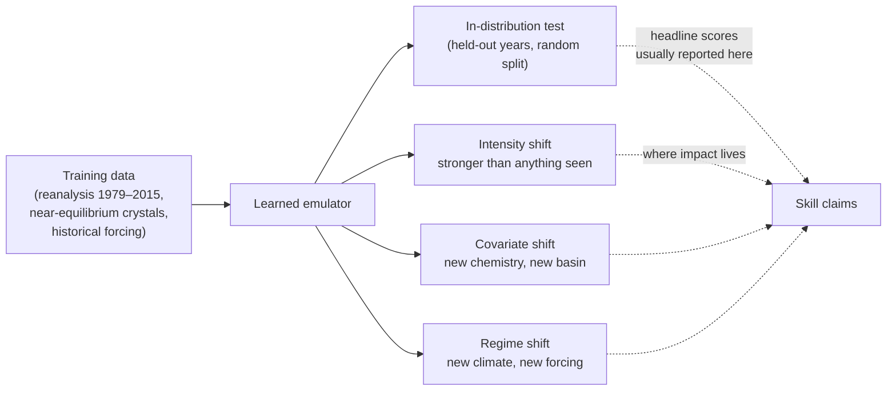

# Evaluating scientific ML emulators under distribution shift

A learned weather model that beats the world's best physics-based forecast on a decade of test days can still fail on the one day that matters: a hurricane stronger than any it saw in training, or a heatwave that breaks the record by four degrees. A universal interatomic potential that predicts crystal energies well can still systematically underestimate how stiff a surface or a defect is. **Scientific emulators**, fast learned stand-ins for slow simulators or for nature itself, are trained on the past and deployed on a future that is, by design or by climate change, partly outside it. This page is about how to tell whether an emulator can be trusted there: the kinds of shift that matter, the evidence from weather, climate and materials, why the way you score a forecast can manufacture or hide a failure, and what tools exist for honest uncertainty when the test data no longer looks like the training data.

> **The core idea.** An emulator is only tested where it is evaluated. Average skill on held-out data from the training distribution says little about *extrapolation* in intensity (stronger storms, record heat), *covariates* (new chemistry, new forcing) or *regime* (a warmer climate). Honest evaluation needs three things: test sets that are deliberately out of distribution, **proper** probabilistic scores that cannot be gamed by conditioning on outcomes, and baselines strong enough that "beats the simulator" means something.



It extends the weather and materials case studies in [AI for science](../03-modern-ai/ai-for-science.md), uses the vocabulary of invariance and environments from [causal representation learning](causal-representation-learning.md), and connects to [nonlinearity and dynamical systems](nonlinearity-and-dynamical-systems.md) (why long autoregressive rollouts drift) and [evaluation and benchmarks](../03-modern-ai/evaluation-and-benchmarks.md) (how benchmarks mislead in general).

## 1. Three kinds of shift (established)

Write the training distribution as $p_{\text{train}}(x, y)$ and the deployment distribution as $p_{\text{test}}(x, y)$. Standard ML vocabulary distinguishes:

- **Covariate shift**: $p(x)$ changes but $p(y \mid x)$ does not. A materials model is applied to new elements or to surfaces when it was trained mostly on bulk crystals; a weather model is run over a basin whose storms it saw less often.
- **Label or target shift**: the frequency of outcomes changes, for example more frequent heat extremes in a warming climate.
- **Concept or regime shift**: $p(y \mid x)$ itself changes, for example when a forcing that was constant in training (greenhouse-gas concentration, sea-surface temperature) moves the dynamics.

Scientific emulators add a fourth, which is really a special case of covariate shift but deserves its own name: **intensity extrapolation**, where the test input lies beyond the *range* of the training inputs, not merely in a rarer part of it. Physicists call such events **gray swans**: physically possible, but absent from the observational record (Sun et al., 2024). The WILDS benchmark (Koh et al., 2020) showed, across ten real datasets, that models with high in-distribution accuracy can lose a large fraction of it under realistic shifts; scientific domains inherit that problem with higher stakes and fewer test cases.

## 2. The weather evidence: gray swans and record-breaking extremes (established; active debate)

**Gray swan cyclones.** Sun, Hassanzadeh, Zand, Chattopadhyay, Weare and Abbot (2024) ran the cleanest test so far. They trained separate copies of FourCastNet on ERA5 reanalysis from 1979 to 2015, either with all data or with every Category 3–5 tropical cyclone removed (globally, or only in the North Atlantic or Western Pacific), and then forecast the Category 5 storms of 2018–2023. All versions had similar skill on global weather. The version trained without strong storms anywhere could not forecast Category 5 cyclones: it did not extrapolate from weaker storms. The versions trained without strong storms in one basin did show some skill there, which suggests the model can transfer what it learned about intense storms from one basin to another. In other words, it can generalize across *location* but not across *intensity*.

**Making gray swans on purpose.** Hakim and Agrawal (2026) turn the problem around. Using gradient descent through a differentiable weather model, they search for small perturbations of real initial conditions that produce a chosen extreme outcome. Starting from Hurricane Fiona (2022), they produce a Sandy-like track with a minimum sea-level pressure more than 20 hPa lower than Sandy's, and find similar gray swans for four other Atlantic hurricanes. They note two limits themselves: the optimization model does not resolve the hurricane core, and the method shows what is *possible* without saying how *likely* it is. Gray swans built this way could serve as stress tests or synthetic training data for exactly the cases that the observational record lacks.

**Record-breaking extremes, and a verification fight.** Zhang, Fischer, Zscheischler and Engelke (2025) compared ECMWF's deterministic high-resolution forecast (HRES) with GraphCast, Pangu-Weather and FuXi on record-breaking heat, cold and wind. HRES had smaller errors at nearly all lead times; the AI models underestimated both the frequency and the intensity of records, underpredicted hot records and overpredicted cold ones, with errors growing as the record exceedance grew. Their conclusion was that these models struggle to extrapolate beyond their training domain.

A year later, Wessel, Spuler, Ferro, Kretschmer and Sippel (2026) evaluated *probabilistic* AI models on heat extremes over global land and reported the opposite: they outperformed the ECMWF IFS ensemble, raw and post-processed, including on record-breaking events, in every region and at every lead time considered, with better tail calibration and fewer missed records, confirmed against station observations. They argue that many reported limitations come from comparing deterministic forecasts that target different quantities, and that extremes need probabilistic verification. Both papers can be right about what they measured: a deterministic model trained toward the conditional mean is *expected* to underpredict records (section 4, experiment 3), while a calibrated ensemble can assign them real probability. What remains open is whether probabilistic AI models extrapolate in intensity beyond their training range, which is the gray-swan question, or mostly benefit from records that are unusual locally but not globally unprecedented.

**Physical consistency.** Bonavita (2023) examined Pangu-Weather forecasts and concluded they lack the fidelity and physical consistency of physics-based models, and that part of their advantage on deterministic scores may come from those very peculiarities, such as smoothing. A model can score well and still produce states the atmosphere would not.

## 3. Climate and materials: shift by construction (established; active research)

**Climate emulation is extrapolation.** A climate projection asks what happens under forcing that has never occurred. ACE (Watt-Meyer et al., 2023), a 200-million-parameter autoregressive emulator of a 100-km atmospheric model, ran stably for 100 years, nearly conserved column moisture without explicit constraints, beat a strong baseline on over 90% of tracked variables, and generalized without fine-tuning to a previously unseen historical sea-surface temperature dataset. That is a real shift test, but a mild one. ClimateBench v1 (Watson-Parris et al., 2022) framed the harder task: predict the climate response to future emission scenarios held out from training. **ClimateBench v2** (Watson-Parris et al., 2026) makes shift the centrepiece. Its three tiers are physical credibility checks (energy conservation, coupled variability, basic forced responses); probabilistic scoring with fair CRPS against observations after 2015, which every current-generation model must treat as out of sample; and out-of-distribution tests on paleoclimates (Last Interglacial, Last Glacial Maximum, Mid-Holocene) plus "perfect-model" experiments where a data-driven model must predict the future of an existing Earth system model from its historical period alone. Submissions must include multiple ensemble members.

**Materials: soft where data was thin.** Deng et al. (2024) found that three universal interatomic potentials, M3GNet, CHGNet and MACE-MP-0, systematically *underpredict* energies and forces on surfaces, defects, solid-solution energetics, phonons, ion-migration barriers and other high-energy states. They traced this "softening" to underpredicted curvature of the potential energy surface, caused by training sets dominated by near-equilibrium structures, and showed it could be corrected by fine-tuning on a single additional data point, so much of the error is systematic rather than random. Kreiman and Krishnapriyan (2025) characterized common distribution shifts for machine-learning force fields, found them hard even for large foundation models, and proposed cheap test-time refinements (aligning test graph structure with training graphs, and gradient steps on an inexpensive physical prior) that significantly reduce out-of-distribution error without new quantum-mechanical labels. **Matbench Discovery** (Riebesell et al., 2023) made the evaluation itself prospective: it asks models to pre-screen genuinely new candidate crystals for thermodynamic stability, the task the models are used for, instead of scoring a random split of known materials.

**Baselines.** McGreivy and Hakim (2024) reviewed ML methods for fluid-related PDEs and found that 79% (60 of 76) of articles claiming to beat a standard numerical method compared against a weak baseline, along with evidence of outcome-reporting and publication bias. Under shift this matters twice: the numerical solver does not care whether the input resembles training data, so a fair comparison should also include the regimes where the emulator was never trained.

## 4. Scoring under shift: proper scores and the forecaster's dilemma (established)

A **scoring rule** $S(F, y)$ assigns a penalty to forecast distribution $F$ when $y$ happens. It is **proper** if the expected score is minimized by forecasting the true distribution (Gneiting and Raftery, 2007). The continuous ranked probability score is the workhorse:

$$
\mathrm{CRPS}(F, y) = \int_{-\infty}^{\infty} \big(F(z) - \mathbf{1}\{y \le z\}\big)^2\,dz = \mathbb{E}|X - y| - \tfrac12\,\mathbb{E}|X - X'|,
$$

with $X, X'$ independent draws from $F$. For a finite ensemble the second term is biased; Ferro (2014) gives the *fair* version that ClimateBench v2 uses.

The trap is **conditioning on outcomes**. Lerch, Thorarinsdottir, Ravazzolo and Gneiting (2017) named it the **forecaster's dilemma**: if you score forecasts only on the cases where an extreme was observed, a forecaster who always predicts extremes looks best, and skilful forecasts are discredited, especially when predictability is low. The proper alternative weights the *scoring function*, not the *test set*. The threshold-weighted CRPS

$$
\mathrm{twCRPS}(F, y) = \int_{-\infty}^{\infty} \big(F(z) - \mathbf{1}\{y \le z\}\big)^2\,w(z)\,dz,\qquad w(z) = \mathbf{1}\{z > t\},
$$

focuses on the tail above $t$ but is still evaluated on every case, so it stays proper.

**Deterministic forecasts of extremes.** If a model outputs (an approximation of) the conditional mean $\mathbb{E}[Y \mid x]$, then on days when $Y$ was extreme the forecast is low *on average*, even if the model is perfect: that is regression to the mean, not a failure to extrapolate. This is one reason the record-breaking debate in section 2 split along deterministic and probabilistic lines.

## 5. Uncertainty that survives shift: conformal prediction and its limits (established; active research)

**Split conformal prediction** wraps any model with intervals that contain the truth with a chosen probability, say 90%, using only a held-out calibration set and the assumption that calibration and test points are exchangeable (Angelopoulos and Bates, 2021). With calibration residuals $s_i = |y_i - \hat f(x_i)|$, the interval is $\hat f(x) \pm \hat q$, where $\hat q$ is the $\lceil (n+1)(1-\alpha)\rceil / n$ empirical quantile of the $s_i$.

Under covariate shift exchangeability fails and coverage drops. **Weighted conformal prediction** (Tibshirani, Barber, Candès and Ramdas, 2019) restores the guarantee when the likelihood ratio $w(x) = p_{\text{test}}(x)/p_{\text{train}}(x)$ is known or can be estimated from unlabeled test inputs: each calibration residual is weighted by $w(x_i)$, the test point by $w(x)$, and $\hat q$ becomes a weighted quantile. Two limits matter for science. First, the ratio must exist: for pure *intensity extrapolation* (test inputs outside the training support), $p_{\text{train}}(x) = 0$ there and no reweighting can help. Second, when the weights are very uneven, the effective calibration sample is small and intervals widen or become infinite, which is an honest signal rather than a bug.

## 6. A tested sketch: four small demonstrations

Four NumPy experiments, run before publication with the script in the appendix (fixed seed; under two seconds on a laptop CPU). All data are synthetic.

**(1) Flexible models do not extrapolate in intensity.** The true response is $y = x + 0.15x^2$ (it steepens with intensity, like many physical impacts), observed with small noise for $x \in [0, 3]$ only. Three models are fitted: a 256-unit random-feature tanh network with a ridge readout, 20-nearest-neighbour regression, and a quadratic least-squares fit (the correct functional form).

| $x$ | Truth | tanh random features | 20-NN | Quadratic |
|---|---|---|---|---|
| 2.5 (inside) | 3.438 | 3.437 (−0.0%) | 3.434 (−0.1%) | 3.438 |
| 3.0 (edge) | 4.350 | 4.362 (+0.3%) | 4.342 (−0.2%) | 4.345 |
| 3.5 | 5.338 | 5.394 (+1.1%) | 4.342 (−18.6%) | 5.325 |
| 4.0 | 6.400 | 6.212 (−2.9%) | 4.342 (−32.2%) | 6.377 |
| 5.0 | 8.750 | 6.993 (−20.1%) | 4.342 (−50.4%) | 8.700 |
| 6.0 | 11.400 | 7.219 (−36.7%) | 4.342 (−61.9%) | 11.314 |

Inside the training range all three agree to within a fraction of a percent, so no in-distribution test could tell them apart. Beyond it, the neighbour model freezes at the largest value it has seen and the saturating network underpredicts by a growing margin, the same signature (underestimation that grows with exceedance) that Zhang et al. report for records and Deng et al. for softened potentials. Only a model with the right structure extrapolates, which is the case for building physics into emulators.

**(2) The forecaster's dilemma.** Outcomes are $Y = \mu + \varepsilon$ with $\mu, \varepsilon \sim \mathcal N(0,1)$, over 40,000 cases. Three forecasters: the ideal $\mathcal N(\mu, 1)$, climatology $\mathcal N(0, \sqrt2)$, and an alarmist $\mathcal N(\mu + 1, 1)$ that always leans high. 7.8% of cases exceed $y > 2$.

| Forecaster | CRPS, all cases | CRPS, only cases with $y > 2$ | twCRPS ($t = 2$), all cases |
|---|---|---|---|
| Ideal | **0.564** | 0.938 | **0.0396** |
| Climatological | 0.797 | 1.892 | 0.0483 |
| Alarmist | 0.836 | **0.467** | 0.0704 |

Scored only on the extreme days, the alarmist halves the ideal forecaster's penalty and looks like the best extreme-event model. Scored properly, whether on everything or with tail weighting over everything, it is the worst of the three.

**(3) Why a perfect deterministic forecast misses records.** A predictable signal $s \sim \mathcal N(0,1)$ plus unpredictable noise $\mathcal N(0,1)$ gives the observation; a 50-member ensemble is perfectly calibrated by construction, and the prior record is 2.5. Over 20,000 cases, 803 (4.01%) break the record.

| Forecast | On record-breaking cases |
|---|---|
| Ensemble mean above the record | 11.7% of records |
| Mean error of the ensemble mean | −1.519 |
| Ensemble probability of exceedance ≥ 0.1 | catches 68.1% of records (false-alarm ratio 78.8%) |
| Probability ≥ 0.2 | catches 45.2% (false-alarm ratio 67.6%) |
| Probability ≥ 0.3 | catches 31.6% (false-alarm ratio 58.3%) |

The ensemble mean, which is the best possible deterministic forecast under squared error, misses 88% of records and is 1.5 units low on them on average. The same ensemble, read as probabilities, is reliable in the tail: when it forecasts between 0.2 and 0.4, the mean forecast probability is 0.269 and the observed frequency 0.243. Nothing here extrapolates; the "record underprediction" in the first row is pure regression to the mean.

**(4) Conformal coverage under covariate shift.** A degree-5 polynomial is fitted to $y = \sin x + (0.1 + 0.3|x|)\,\varepsilon$ with $x \sim \mathcal N(0,1)$, then wrapped in split conformal intervals targeting 90%.

| Test set | Coverage | Interval width |
|---|---|---|
| Same distribution | 89.5% | 1.199 |
| Shifted, $x \sim \mathcal N(1.5, 1)$ | **72.9%** | 1.199 |
| Shifted, weighted conformal with the true likelihood ratio | 86.7% | median 1.828; 0.2% infinite |

The unweighted guarantee quietly breaks under shift because noise grows with $|x|$ and the shifted inputs sit where it is larger. Reweighting recovers most of the coverage by widening the intervals; it stays a few points short here because the shifted test set reaches inputs that the 2,000 calibration points barely cover, shrinking the effective sample. Under true intensity extrapolation the likelihood ratio would not exist at all.

## 7. A practical checklist for evaluating an emulator (established practice, synthesized)

1. **Hold out by mechanism, not at random.** Remove the strongest events, a basin, a chemistry family, a forcing scenario or a later period, as Sun et al. and ClimateBench do, and test there.
2. **Report proper probabilistic scores** (CRPS, fair CRPS for ensembles, twCRPS for tails) on all cases; never rank forecasters on outcome-selected subsets.
3. **Compare like with like.** Deterministic against deterministic, ensemble against ensemble, and against a strong, tuned numerical baseline (McGreivy and Hakim).
4. **Check physics, not only skill.** Conservation, spectra, long-rollout stability and physically plausible states (Bonavita; ACE; ClimateBench Tier I).
5. **Quantify uncertainty with stated assumptions.** Conformal intervals are valid only under exchangeability or a known shift; say which.
6. **Stress-test with synthetic extremes** where data are absent, such as optimized gray swans, while remembering they are possible, not probable.

## 8. Status at a glance (November 2026)

| Claim | Status |
|---|---|
| AI weather models trained without strong cyclones cannot forecast Category 5 storms | Established for FourCastNet (Sun et al.); expected but untested for others |
| AI weather models transfer intense-storm skill across basins | Some evidence (one model) |
| Deterministic AI models underpredict record-breaking extremes relative to HRES | Established (Zhang et al.) |
| Probabilistic AI models beat the IFS ensemble on record heat | Reported over global land (Wessel et al., 2026); not yet shown for wind, precipitation or cyclones |
| Universal interatomic potentials soften away from equilibrium | Established for M3GNet, CHGNet, MACE-MP-0; largely fixable by fine-tuning |
| Many ML-for-PDE speedup claims rest on weak baselines | Established for fluid-related PDEs (79% of 76 papers) |
| Weighted conformal prediction restores coverage under covariate shift | Established when the likelihood ratio is known and the supports overlap |
| Any current emulator reliably extrapolates beyond its training intensity range | Not shown |

## 9. Speculative: what a trustworthy emulator might look like

> [!WARNING]
> **Speculative.** The ideas in this section are hypotheses for discussion, not established results.

1. **Emulators that know their range.** Experiment (1) shows in-distribution tests cannot separate a model that extrapolates from one that does not. A falsifiable proposal: every emulator ships with a calibrated out-of-range detector, and benchmark scores are reported separately inside and outside the training support, with abstention counted.
2. **Hybrid fallback.** If the detector fires, hand the case to the physics model. The measurable question is how much of the emulator's speed survives when the fraction of fallbacks is set by the detector rather than chosen in advance.
3. **Adversarial gray swans as a training curriculum.** Gradient-optimized extremes (Hakim and Agrawal) could augment training data where the record is short. The risk is teaching the model the optimizer's own model errors; a test is whether storms generated by one model improve another model's Category 5 forecasts on real held-out storms.
4. **Physics as the extrapolation prior.** Experiment (1) suggests the structure that extrapolates is the correct functional form. Whether conservation laws and symmetries are enough structure for atmospheric extremes, or whether intensity physics such as the thermodynamic limits on storm strength must be imposed, is open.

## Appendix: the sketch script

```python
import numpy as np
from math import erf, sqrt
rng = np.random.default_rng(0)

# (1) Extrapolation: an emulator trained only on "ordinary" inputs
def truth(x):            # response that steepens with intensity (e.g. damage or rain vs wind)
    return x + 0.15 * x**2
x_tr = rng.uniform(0, 3, 4000); y_tr = truth(x_tr) + rng.normal(0, 0.1, x_tr.size)
x_te = np.array([2.5, 3.0, 3.5, 4.0, 5.0, 6.0])
# (a) random-feature tanh network with ridge readout
W = rng.normal(0, 1.5, 256); b = rng.uniform(-4, 4, 256)
phi = lambda x: np.tanh(np.outer(x, W) + b)
P = phi(x_tr); A = P.T @ P + 1e-3 * np.eye(256)
w = np.linalg.solve(A, P.T @ y_tr)
rf = phi(x_te) @ w
# (b) k-nearest-neighbour regression (k=20)
def knn(x, k=20):
    return np.array([y_tr[np.argsort(np.abs(x_tr - xi))[:k]].mean() for xi in x])
kn = knn(x_te)
# (c) correct-form model: quadratic least squares
c = np.polyfit(x_tr, y_tr, 2); qd = np.polyval(c, x_te)
print("(1) extrapolation, training range x in [0,3]")
for xi, t, r, k, q in zip(x_te, truth(x_te), rf, kn, qd):
    print(f"x={xi:.1f} truth={t:.3f} tanhRF={r:.3f} ({100*(r-t)/t:+.1f}%) kNN={k:.3f} ({100*(k-t)/t:+.1f}%) quad={q:.3f}")

# (2) Forecaster's dilemma: evaluating only on extremes rewards the alarmist
n = 200000
mu = rng.normal(0, 1, n); y = mu + rng.normal(0, 1, n)       # truth: Y | mu ~ N(mu, 1)
Phi = lambda z: 0.5 * (1 + np.vectorize(erf)(z / sqrt(2)))
def crps_normal(m, s, y):
    z = (y - m) / s
    pdf = np.exp(-z**2 / 2) / np.sqrt(2 * np.pi)
    cdf = 0.5 * (1 + np.array([erf(v / sqrt(2)) for v in z]))
    return s * (z * (2 * cdf - 1) + 2 * pdf - 1 / np.sqrt(np.pi))
sub = rng.choice(n, 40000, replace=False); mu, y = mu[sub], y[sub]
fc = {"ideal N(mu,1)": (mu, 1.0), "climatological N(0,sqrt2)": (0*mu, np.sqrt(2)), "alarmist N(mu+1,1)": (mu + 1, 1.0)}
ext = y > 2.0
print(f"\n(2) forecaster's dilemma; {ext.mean()*100:.1f}% of cases exceed y>2")
# threshold-weighted CRPS with weight 1{z>t}: twCRPS = CRPS of chained forecasts at max(.,t)
def twcrps(m, s, y, t=2.0, ens=400):
    X = m[:, None] + s * rng.normal(0, 1, (m.size, ens)) if np.ndim(s)==0 else None
    Xv = np.maximum(X, t); yv = np.maximum(y, t)
    return (np.abs(Xv - yv[:, None]).mean(1) - 0.5 * np.abs(Xv[:, :ens//2] - Xv[:, ens//2:]).mean(1)).mean()
for k, (m, s) in fc.items():
    m = np.broadcast_to(m, y.shape).astype(float)
    c_all = crps_normal(m, s, y)
    print(f"{k:28s} CRPS all={c_all.mean():.3f}  CRPS on y>2 only={c_all[ext].mean():.3f}  twCRPS(t=2) all={twcrps(m, s, y):.4f}")

# (3) Records: ensemble mean versus the probabilistic ensemble
n, M = 20000, 50
signal = rng.normal(0, 1, n); obs = signal + rng.normal(0, 1, n)
ens = signal[:, None] + rng.normal(0, 1, (n, M))           # perfectly calibrated ensemble
record = 2.5                                                 # prior record value
hit = obs > record
emean = ens.mean(1); pexc = (ens > record).mean(1)
print(f"\n(3) record exceedance {hit.mean()*100:.2f}% of cases (n={hit.sum()})")
print(f"ensemble mean > record on record days: {(emean[hit] > record).mean()*100:.1f}%")
print(f"mean error of ensemble mean on record days: {(emean[hit]-obs[hit]).mean():+.3f}")
for p in (0.1, 0.2, 0.3):
    print(f"P(exceed) >= {p:.1f}: catches {(pexc[hit] >= p).mean()*100:.1f}% of records, false alarm ratio {((pexc >= p) & ~hit).sum()/max(1,(pexc>=p).sum())*100:.1f}%")
# reliability in the tail: mean forecast prob vs observed freq when p in [0.2,0.4)
sel = (pexc >= 0.2) & (pexc < 0.4)
print(f"reliability bin p in [0.2,0.4): mean p={pexc[sel].mean():.3f}, observed freq={hit[sel].mean():.3f}")

# (4) Split conformal intervals under covariate shift, and weighted conformal
def gen(n, shift):
    x = rng.normal(shift, 1, n); y = np.sin(x) + (0.1 + 0.3 * np.abs(x)) * rng.normal(0, 1, n)
    return x, y
xtr, ytr = gen(4000, 0.0); xc, yc = gen(2000, 0.0); xs, ys = gen(4000, 1.5)
cf = np.polyfit(xtr, ytr, 5); f = lambda x: np.polyval(cf, x)
sc = np.abs(yc - f(xc)); alpha = 0.1
q = np.quantile(sc, np.ceil((sc.size + 1) * (1 - alpha)) / sc.size)
xi, yi = gen(4000, 0.0)
print("\n(4) conformal, target 90% coverage")
print(f"split conformal, in-distribution test: {(np.abs(yi - f(xi)) <= q).mean()*100:.1f}%  width {2*q:.3f}")
print(f"split conformal, shifted test (mean 1.5): {(np.abs(ys - f(xs)) <= q).mean()*100:.1f}%")
# weighted conformal (Tibshirani et al. 2019) with known likelihood ratio N(1.5,1)/N(0,1)
lr = lambda x: np.exp(1.5 * x - 1.125)
cov = []; widths = []
order = np.argsort(sc); scs = sc[order]; wc = lr(xc)[order]
for x0, y0 in zip(xs[:2000], ys[:2000]):
    wts = np.append(wc, lr(x0)); wts = wts / wts.sum()
    cum = np.cumsum(wts[:-1])
    idx = np.searchsorted(cum, 1 - alpha)
    qw = scs[idx] if idx < scs.size else np.inf
    cov.append(abs(y0 - f(x0)) <= qw); widths.append(2 * qw)
widths = np.array(widths)
print(f"weighted conformal, shifted test: {np.mean(cov)*100:.1f}%  median width {np.median(widths[np.isfinite(widths)]):.3f}, infinite intervals {np.mean(~np.isfinite(widths))*100:.1f}%")
```

## Further reading

- Angelopoulos, A. N., Bates, S. (2021). *A Gentle Introduction to Conformal Prediction and Distribution-Free Uncertainty Quantification*. [arXiv:2107.07511](https://arxiv.org/abs/2107.07511)
- Bonavita, M. (2023). *On some limitations of data-driven weather forecasting models*. [arXiv:2309.08473](https://arxiv.org/abs/2309.08473)
- Deng, B., Choi, Y., Zhong, P., Riebesell, J., Anand, S., Li, Z., Jun, K., Persson, K. A., Ceder, G. (2024). *Overcoming systematic softening in universal machine learning interatomic potentials by fine-tuning*. [arXiv:2405.07105](https://arxiv.org/abs/2405.07105)
- Ferro, C. A. T. (2014). *Fair scores for ensemble forecasts*. Quarterly Journal of the Royal Meteorological Society 140, 1917–1923. [doi:10.1002/qj.2270](https://doi.org/10.1002/qj.2270)
- Gneiting, T., Raftery, A. E. (2007). *Strictly Proper Scoring Rules, Prediction, and Estimation*. Journal of the American Statistical Association 102, 359–378. [doi:10.1198/016214506000001437](https://doi.org/10.1198/016214506000001437)
- Hakim, G. J., Agrawal, A. (2026). *Gray Swan Factory: Making Extreme Events from Ordinary Cyclones*. [arXiv:2604.00348](https://arxiv.org/abs/2604.00348)
- Koh, P. W., Sagawa, S., Marklund, H., Xie, S. M., et al. (2020). *WILDS: A Benchmark of in-the-Wild Distribution Shifts*. ICML 2021. [arXiv:2012.07421](https://arxiv.org/abs/2012.07421)
- Kreiman, T., Krishnapriyan, A. S. (2025). *Understanding and Mitigating Distribution Shifts For Machine Learning Force Fields*. [arXiv:2503.08674](https://arxiv.org/abs/2503.08674)
- Lerch, S., Thorarinsdottir, T. L., Ravazzolo, F., Gneiting, T. (2017). *Forecaster's Dilemma: Extreme Events and Forecast Evaluation*. Statistical Science 32(1). [arXiv:1512.09244](https://arxiv.org/abs/1512.09244)
- McGreivy, N., Hakim, A. (2024). *Weak baselines and reporting biases lead to overoptimism in machine learning for fluid-related partial differential equations*. [arXiv:2407.07218](https://arxiv.org/abs/2407.07218)
- Riebesell, J., Goodall, R. E. A., Benner, P., Chiang, Y., Deng, B., Ceder, G., Asta, M., Lee, A. A., Jain, A., Persson, K. A. (2023). *Matbench Discovery: A framework to evaluate machine learning crystal stability predictions*. [arXiv:2308.14920](https://arxiv.org/abs/2308.14920)
- Sun, Y. Q., Hassanzadeh, P., Zand, M., Chattopadhyay, A., Weare, J., Abbot, D. S. (2024). *Can AI weather models predict out-of-distribution gray swan tropical cyclones?* [arXiv:2410.14932](https://arxiv.org/abs/2410.14932)
- Tibshirani, R. J., Barber, R. F., Candès, E. J., Ramdas, A. (2019). *Conformal Prediction Under Covariate Shift*. NeurIPS 2019. [arXiv:1904.06019](https://arxiv.org/abs/1904.06019)
- Watson-Parris, D., Rao, Y., Olivié, D., Seland, Ø., Nowack, P., et al. (2022). *ClimateBench v1.0: A Benchmark for Data-Driven Climate Projections*. Journal of Advances in Modeling Earth Systems 14. [doi:10.1029/2021MS002954](https://doi.org/10.1029/2021MS002954)
- Watson-Parris, D., Tobin, W., Paçal, A., Schlund, M., Balaji, V., et al. (2026). *ClimateBench v2.0: Probabilistic Climate Model Benchmarking*. [arXiv:2610.04558](https://arxiv.org/abs/2610.04558)
- Watt-Meyer, O., Dresdner, G., McGibbon, J., Clark, S. K., Henn, B., et al. (2023). *ACE: A fast, skillful learned global atmospheric model for climate prediction*. [arXiv:2310.02074](https://arxiv.org/abs/2310.02074)
- Wessel, J. B., Spuler, F., Ferro, C. A. T., Kretschmer, M., Sippel, S. (2026). *Probabilistic AI models outperform numerical weather prediction models on record breaking heat extremes*. [arXiv:2610.20519](https://arxiv.org/abs/2610.20519)
- Zhang, Z., Fischer, E., Zscheischler, J., Engelke, S. (2025). *Numerical models outperform AI weather forecasts of record-breaking extremes*. [arXiv:2508.15724](https://arxiv.org/abs/2508.15724)

FourCastNet, GraphCast, Pangu-Weather, GenCast and WeatherBench 2 are listed under [AI for science](../../REFERENCES.md#ai-for-science) in REFERENCES.md; the sources above are collected under [Frontiers: distribution shift in scientific emulators](../../REFERENCES.md#frontiers-distribution-shift-in-scientific-emulators).
