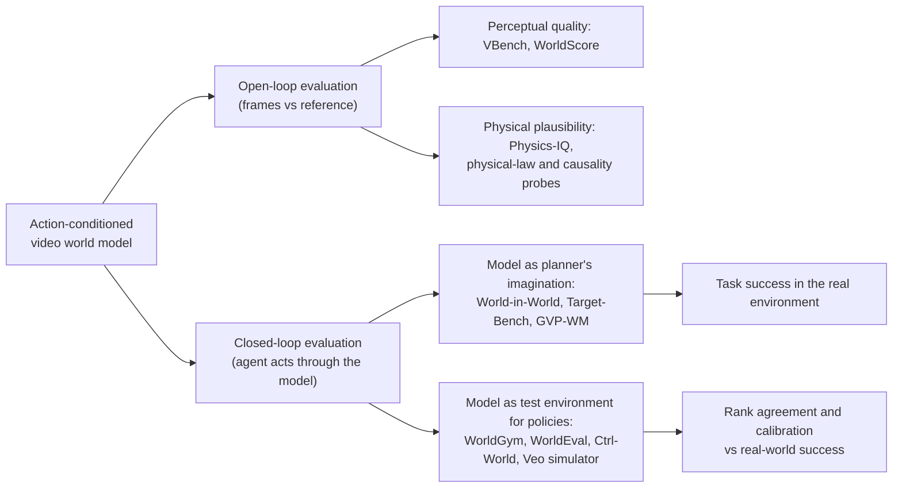

# Judging video world models by what they let agents do

Video generators can now produce minutes of footage that looks like the real world, and many of them accept actions: move the camera, push the arm, open the gripper. That makes them candidate **world models**, simulators an agent could imagine with, plan inside, or be tested in. But a model that looks right is not necessarily a model you can act with. A frame can be photorealistic while the arm in it ignores the command it was given; a clip can be smooth while the cup quietly passes through the table. The question that matters for an agent is not *does this look real?* but *does planning or evaluating inside this model lead to the right decisions in the real world?*

This page is about that shift in evaluation, from open-loop visual plausibility to **closed-loop task success**. It covers why perceptual metrics and physics checks are not enough, the new closed-loop benchmarks, the rapidly growing use of action-conditioned video models as stand-ins for real robots when evaluating policies, the statistics of trusting such a stand-in, and what is still open. A tested NumPy sketch reproduces, in miniature, a sharp-looking model that cannot be steered, a noisy-looking one that can, why ranking policies is easier than predicting their success rates, and how extra imagined candidates buy success.

> The core idea in one sentence: **a world model is an instrument for decisions, so score it by the decisions it produces (task success when an agent plans inside it, or how faithfully it ranks policies against real outcomes), and treat visual quality as a diagnostic, not the target.**



## 1. Two kinds of evaluation (established)

Call a world model $\hat p(o_{t+1:t+H} \mid o_{\le t}, a_{t:t+H-1})$: given past observations and a sequence of actions, it generates future observations. There are two very different ways to grade it.

**Open-loop evaluation** fixes the actions in advance, usually from a logged dataset or a text prompt, generates video, and compares it to a reference or scores it on its own. The metric is a function of the frames alone, $m(\hat o_{1:H})$ or $m(\hat o_{1:H}, o_{1:H})$.

**Closed-loop evaluation** lets an agent choose actions that depend on what the model shows it, and grades the *outcome*. If $\pi$ plans by imagining with $\hat p$, the score is the real-world success rate

```math
J(\hat p) \;=\; \Pr_{\text{real}}\big[\,\text{task solved} \;\big|\; a_t = \pi(o_{\le t};\, \hat p)\,\big],
```

and if the model is used as a test environment, the score is how well success *inside* it predicts success outside, across a set of policies $\pi_1,\dots,\pi_K$:

```math
\hat J_k = \Pr_{\hat p}[\text{success} \mid \pi_k], \qquad \text{agreement} = \operatorname{corr}\big(\hat J_{1:K},\, J_{1:K}\big).
```

The difference is not cosmetic. In closed loop the agent drives the model into states the logged data never visited, and a planner that searches over many imagined futures will find exactly the ones where the model is optimistically wrong, the *model exploitation* described on the [compounding-error page](model-based-rl-compounding-error.md#the-planner-makes-it-worse). An open-loop metric never sees either effect.

## 2. What open-loop metrics measure, and what they miss (established)

**Perceptual quality.** VBench (Huang et al. 2023) broke "video generation quality" into 16 disentangled dimensions, such as subject identity consistency, motion smoothness, temporal flickering and spatial relationships, each with its own prompts and an evaluation method checked against human preference annotations. WorldScore (Duan et al. 2025) unified world generation as a sequence of next-scene tasks with explicit camera trajectories, 3,000 test examples, and metrics for controllability, quality and dynamics across 19 models. These are valuable for what they are built for: telling whether a generator produces coherent, controllable-by-camera, good-looking worlds.

**Physical plausibility.** A second family asks whether generated video obeys physics. Kang et al. (2024) trained diffusion video models on a 2-D simulator of moving and colliding objects and found perfect in-distribution generalization, measurable scaling for combinatorial generalization, and failure out of distribution; the models behaved in a *case-based* way, copying the nearest training example, and when matching they prioritized colour over size over velocity over shape. Physics-IQ (Motamed et al. 2025) tested Sora, Runway, Pika, Lumiere, Stable Video Diffusion and VideoPoet on fluid dynamics, optics, solid mechanics, magnetism and thermodynamics, and found physical understanding severely limited and *unrelated to visual realism*. VBench-2.0 (Zheng et al. 2025) moved from "superficial" to "intrinsic" faithfulness, adding human fidelity, controllability, creativity, physics and commonsense. YoCausal (Xie et al. 2026) reverses real videos to create free counterfactuals and finds, across 13 video diffusion models, that perceiving the arrow of time does not imply understanding causality.

**What both miss.** None of these metrics asks whether the model responds correctly to *the actions an agent would actually choose*, whether the details an agent needs (the gripper's exact position, whether contact happened) are right even when the scene looks wrong elsewhere, or whether errors that are harmless for a viewer are fatal for a planner. A model can score well by producing beautiful, typical motion while ignoring its action input, which is the worst possible world model for control. Part 1 of the sketch builds exactly that case.

## 3. Closed-loop benchmarks (active research)

**WorldSimBench** (Qin et al. 2024) was an early dual design: an *explicit perceptual* evaluation scored by a human-preference evaluator trained on fine-grained feedback, and an *implicit manipulative* evaluation that asks whether generated, situation-aware video can be translated into correct control signals in open-ended embodied environments, autonomous driving and robot manipulation.

**World-in-World** (Zhang et al. 2025) is the clearest statement of the closed-loop principle. It gives heterogeneous world models a standardized action API and a unified online planning strategy, curates four closed-loop environments, and makes task success the primary metric. One environment, for example, is active recognition in Habitat-Sim over 551 episodes across 29 Matterport3D scenes, where synthetic views help the agent reason about occluded or extreme-viewpoint targets. It reports three findings: visual quality alone does not guarantee task success, and controllability matters more; scaling post-training with action-observation data is more effective than upgrading the pretrained video generator; and allocating more inference-time compute lets world models substantially improve closed-loop performance. It also presents what it calls the first data scaling law for world models in embodied settings.

**Target-Bench** (Wang et al. 2025) tests whether video world models can plan mapless paths to semantic targets: 450 robot-collected scenarios across 47 semantic categories, SLAM trajectories as references, and motion reconstructed from the generated video with metric-scale recovery. The best off-the-shelf model scored only 0.341 overall, and fine-tuning on a relatively small real robot dataset significantly improved planning.

**Grounding video plans.** Rather than trusting a video plan directly, GVP-WM (Ziakas, Bar and Russo 2026) treats a zero-shot generated video as guidance and projects it onto dynamically feasible latent trajectories of a learned action-conditioned world model, a goal-conditioned trajectory optimization over latent states and actions. It recovers feasible long-horizon plans from generated and motion-blurred videos that violate physical constraints, in navigation and manipulation simulation tasks. The lesson generalizes: a video model's output is a *proposal*, and something with correct dynamics must check it.

**Latent models that skip pixels.** V-JEPA 2 (Assran et al. 2025) pre-trains an action-free joint-embedding predictive model on over 1 million hours of internet video, then post-trains an action-conditioned version, V-JEPA 2-AC, on less than 62 hours of unlabeled robot video from DROID. Planned towards image goals, it picked and placed objects zero-shot on Franka arms in two labs without collecting data in those environments and without task-specific reward. A model like this is never judged on how its frames look, because it does not produce frames; closed-loop success is the only meaningful test.

## 4. World models as test environments for policies (active research)

Evaluating a generalist robot policy properly takes hundreds of real trials, resets and supervision, and grows worse as policies cover more tasks. Handcrafted simulators help but carry control and visual gaps. SIMPLER (Li et al. 2024) showed that mitigating those gaps, without full digital twins, gives simulated scores that correlate strongly with real ones and reflect real sensitivity to distribution shifts. It also introduced the **mean maximum rank violation** (MMRV) alongside Pearson correlation: for each policy, find the largest real-performance gap among the policies it is misordered with, and average,

```math
\mathrm{MMRV} = \frac{1}{K}\sum_{i=1}^{K} \max_{j}\; \lvert J_i - J_j\rvert \cdot \mathbb{1}\big[(\hat J_i - \hat J_j)(J_i - J_j) < 0\big],
```

so that swapping two nearly identical policies costs little while swapping a strong and a weak one costs a lot. Lower is better.

Action-conditioned video models promise the same thing without building any simulator:

- **WorldGym** (Quevedo et al. 2025) is an autoregressive, action-conditioned video model used as an environment; policies are evaluated by Monte Carlo rollouts from a single real start frame, with a vision-language model providing rewards. Success rates inside it correlate highly with real-world success, and it preserves relative rankings across policy versions, sizes and checkpoints. It also surfaced real weaknesses: VLA policies struggled to distinguish object shapes and were distracted by adversarial facades. The authors note that generating realistic object interaction remains hard while robot motion is emulated faithfully.
- **WorldEval** (Li et al. 2025) found that feeding raw robot actions, or high-dimensional encodings of them, into a video model often fails to produce action-following video, and proposed *Policy2Vec*, which conditions the generator on a latent action instead. The resulting pipeline ranks policies and checkpoints, works as a safety detector for dangerous actions, correlates strongly with paired real evaluations, and outperforms a real-to-sim approach. Its successor **dWorldEval** (Li et al. 2026) maps vision, language and actions into one token space for a discrete diffusion transformer, adds sparse keyframe memory and a *progress token* that declares success when it reaches 1, and reports outperforming WorldEval, Ctrl-World and WorldGym on LIBERO, RoboTwin and real-robot tasks.
- **Ctrl-World** (Guo, Shi, Chen and Finn 2025) is a multi-view world model trained on DROID (95k trajectories, 564 scenes) with pose-conditioned memory retrieval and frame-level action conditioning. It stays consistent for over 20 seconds under novel scenarios and camera placements, ranks policies without real rollouts, and, by synthesizing successful trajectories in imagination for supervised fine-tuning, improved policy success by 44.7%.
- **Tseng et al. (2025)** add action conditioning to pre-trained video generators so that internet-scale video does most of the work and little paired video-action data is needed, and study how dataset diversity, pre-trained weights and failure cases affect policy ranking and the correlation between predicted and actual policy values.
- **The Veo world simulator** (Gemini Robotics Team 2025) builds on a frontier video model with action conditioning and multi-view consistency, plus generative image editing to create novel objects, backgrounds and distractors. It predicted the relative performance of policies in nominal and out-of-distribution conditions, the relative impact of each axis of generalization, and was used to red-team policies for physical and semantic safety violations, validated against more than 1,600 real-world evaluations of eight policy checkpoints on five bimanual tasks.

A pattern runs through these results: **rankings transfer better than absolute numbers.** Most papers lead with rank agreement, and the honest caveats concern contact-rich interaction. That makes statistical sense, as Part 3 of the sketch shows: a world model that is uniformly optimistic keeps the order and only shifts the level, while an error that depends on *what kind* of policy is being tested (for instance, one that relies on contact the model renders too forgivingly) reorders them.

## 5. Why closed loop changes the answer (established mechanisms)

Three mechanisms explain why open-loop and closed-loop scores diverge.

1. **Controllability is a separate axis from appearance.** Let a model respond to an action with the wrong gain or ignore part of it. Every frame can still be perfect; the agent's plan will be wrong by the gain error, compounded over the horizon. World-in-World's first finding is this, at scale.
2. **Agents visit the model's weak spots.** A policy or planner is an optimizer. If the model has optimistic errors anywhere reachable, search finds them, so the closed-loop error is closer to a worst case over reachable states than an average over logged ones (see [compounding error](model-based-rl-compounding-error.md)).
3. **What matters is task-relevant state.** The agent needs a small set of quantities to be right, such as where the gripper is, whether contact happened, or whether the target is in view. Pixel-level or perceptual errors elsewhere in the frame are irrelevant, and pixel-level correctness says nothing about whether those quantities are right. This is the value-equivalence argument of [model-based RL](model-based-rl-compounding-error.md#2-the-training-objective-is-not-the-use-established) applied to evaluation.

## 6. A tested sketch

The code below is a deliberately small set of experiments. All systems and numbers are synthetic; the point is the mechanisms of Sections 1–5.

- A 2-D point mass on the unit square is "filmed" as a 32 × 32 image with a Gaussian blob at its position. A world model predicts the frames for a sequence of actions and can be wrong in four ways: action **gain** (controllability), pixel **noise**, **blur**, and a constant **drift**. A planner reads positions back from frames and picks, among random constant-action candidates, the one whose imagined final frame is closest to the goal; open loop it executes the whole 6-step plan, with replanning it executes one action of a 3-step plan and repeats 12 times. Success means ending within 0.08 of the goal.
- The **visual score** is a no-reference realism measure, $1/(1+d)$, where $d$ is the relative distance between frame statistics (peak brightness, blob area, high-frequency energy) of generated and real frames under logged random actions; 1 means indistinguishable statistics. The **control error** is the mean distance between the position decoded from generated frames and the true position under the same logged actions.
- **Part 1** compares a perfect model with three flawed ones. **Part 2** draws 30 random models and computes the Spearman rank correlation of each metric with closed-loop success. **Part 3** ranks eight policies with true success rates 0.30 to 0.65 using 10 real trials each, or rollouts in a world model that is optimistic by $+0.6$ in logit, with and without an extra $+1.0$ logit optimism for the four policies that rely on contact (500 repeats). **Part 4** varies the number of imagined candidates per decision for a model with gain 0.8 and noise 0.10.

```python
import numpy as np
rng = np.random.default_rng(0)

# A 2-D point mass on the unit square, rendered as a 32x32 image with a Gaussian blob.
G = 32
yy, xx = np.mgrid[0:G, 0:G] / (G - 1)
def render(p, blur=0.04):
    return np.exp(-((xx - p[0])**2 + (yy - p[1])**2) / (2 * blur**2))
def decode(img):                      # the planner reads positions back from frames
    w = np.where(img > 0.5 * img.max(), img, 0.0); w = w / (w.sum() + 1e-9)
    return np.array([(w * xx).sum(), (w * yy).sum()])
def step(p, a, gain=1.0, drift=0.0):  # true dynamics: gain 1, no drift
    return np.clip(p + gain * a + drift, 0, 1)

def make_model(gain, noise, blur, drift):
    def predict(p, actions):          # action-conditioned "video" rollout
        frames = []
        for a in actions:
            p = step(p, a, gain, drift)
            frames.append(render(p, blur) + noise * rng.standard_normal((G, G)))
        return frames
    return predict

real_frames = [render(rng.uniform(0.1, 0.9, 2)) for _ in range(200)]
def frame_stats(f):  # no-reference "visual quality" features: peak, spread, high-frequency energy
    return np.array([f.max(), (f > 0.5).mean(), np.abs(np.diff(f, axis=0)).mean()])
real_mu = np.mean([frame_stats(f) for f in real_frames], axis=0)
def visual_score(model, n=40):        # open-loop, logged random actions; higher = more realistic
    d = []
    for _ in range(n):
        p0 = rng.uniform(0.1, 0.9, 2)
        frames = model(p0, rng.uniform(-0.1, 0.1, (8, 2)))
        d.append(np.mean([np.linalg.norm((frame_stats(f) - real_mu) / real_mu) for f in frames]))
    return float(1 / (1 + np.mean(d)))   # 1 = frame statistics match real frames
def control_error(model, n=40):       # mean decoded-position error under the same logged actions
    e = []
    for _ in range(n):
        p0 = rng.uniform(0.1, 0.9, 2); acts = rng.uniform(-0.1, 0.1, (8, 2))
        p = p0.copy(); frames = model(p0, acts)
        for a, f in zip(acts, frames):
            p = step(p, a); e.append(np.linalg.norm(decode(f) - p))
    return float(np.mean(e))
def closed_loop_success(model, n_tasks=60, n_cand=64, replan=False):
    # Random-shooting planner: candidates repeat one action; open loop executes the whole
    # 6-step imagined plan, replanning executes the first action of a 3-step plan, 12 times.
    wins = 0
    for _ in range(n_tasks):
        p = rng.uniform(0.15, 0.85, 2); goal = rng.uniform(0.15, 0.85, 2)
        H, T = (3, 12) if replan else (6, 1)
        for t in range(T):
            r = 0.15 * np.sqrt(rng.uniform(0, 1, n_cand)); th = rng.uniform(0, 2 * np.pi, n_cand)
            acts = np.stack([r * np.cos(th), r * np.sin(th)], 1)
            scores = [-np.linalg.norm(decode(model(p, [a] * H)[-1]) - goal) for a in acts]
            a = acts[int(np.argmax(scores))]
            for _ in range(1 if replan else H): p = step(p, a)
        wins += np.linalg.norm(p - goal) < 0.08
    return wins / n_tasks

print("Part 1: a perfect model and three flawed ones, visual score vs closed-loop success")
named = {"perfect model (reference)": make_model(1.0, 0.00, 0.04, 0.0),
         "sharp, weak action response (gain 0.4)": make_model(0.4, 0.00, 0.04, 0.0),
         "noisy frames, correct dynamics (noise 0.15)": make_model(1.0, 0.15, 0.04, 0.0),
         "blurry, drifting (blur 0.08, drift 0.01)": make_model(1.0, 0.00, 0.08, 0.01)}
for k, m in named.items():
    print(f"  {k:46s} visual {visual_score(m):.3f}  control err {control_error(m):.3f}  success {closed_loop_success(m, 60, 128):.2f}")

print("Part 2: 30 random world models, Spearman rank correlation with closed-loop success")
def spearman(a, b):
    ra = np.argsort(np.argsort(a)); rb = np.argsort(np.argsort(b))
    return float(np.corrcoef(ra, rb)[0, 1])
vis, ctl, suc = [], [], []
for _ in range(30):
    m = make_model(rng.uniform(0.3, 1.3), rng.uniform(0, 0.2), rng.uniform(0.03, 0.08), rng.uniform(-0.02, 0.02))
    vis.append(visual_score(m, 20)); ctl.append(-control_error(m, 20)); suc.append(closed_loop_success(m, 30, 128))
print(f"  visual score vs success: {spearman(vis, suc):+.2f}   (negative) control error vs success: {spearman(ctl, suc):+.2f}")

print("Part 3: ranking 8 policies inside a world model")
true_p = np.linspace(0.30, 0.65, 8)                  # real success rates, policy 7 best
logit = lambda p: np.log(p / (1 - p)); sig = lambda z: 1 / (1 + np.exp(-z))
contact = np.array([0, 1, 0, 1, 0, 1, 0, 1])         # policies that rely on contact-rich moves
def wm_rate(bias_contact):                            # optimistic overall; extra optimism on contact
    return sig(logit(true_p) + 0.6 + bias_contact * contact)
def mmrv(est, true):  # mean max rank violation (SIMPLER-style): worst true-gap among misordered pairs
    v = []
    for i in range(len(true)):
        v.append(max([abs(true[i] - true[j]) for j in range(len(true))
                      if (est[i] - est[j]) * (true[i] - true[j]) < 0] or [0.0]))
    return float(np.mean(v))
for label, n, rates in [("real robot, 10 trials/policy", 10, true_p),
                        ("world model, 10 rollouts/policy", 10, wm_rate(0.0)),
                        ("world model, 200 rollouts/policy", 200, wm_rate(0.0)),
                        ("world model, contact bias +1.0, 200 rollouts", 200, wm_rate(1.0))]:
    rs, ms, ab = [], [], []
    for _ in range(500):
        est = rng.binomial(n, rates) / n
        rs.append(spearman(est + 1e-9 * rng.standard_normal(8), true_p)); ms.append(mmrv(est, true_p))
        ab.append(np.mean(est - true_p))
    print(f"  {label:46s} Spearman {np.mean(rs):.2f}  MMRV {np.mean(ms):.3f}  mean bias {np.mean(ab):+.3f}")

print("Part 4: more imagined candidates per decision (gain 0.8, noise 0.10)")
m = make_model(0.8, 0.10, 0.04, 0.0)
for nc in (4, 16, 64, 256):
    print(f"  candidates {nc:4d}: open-loop success {closed_loop_success(m, 60, nc):.2f}"
          f"   with replanning {closed_loop_success(m, 40, nc, replan=True):.2f}")
```

Output:

```text
Part 1: a perfect model and three flawed ones, visual score vs closed-loop success
  perfect model (reference)                      visual 0.879  control err 0.005  success 0.65
  sharp, weak action response (gain 0.4)         visual 0.898  control err 0.081  success 0.00
  noisy frames, correct dynamics (noise 0.15)    visual 0.036  control err 0.029  success 0.35
  blurry, drifting (blur 0.08, drift 0.01)       visual 0.250  control err 0.062  success 0.33
Part 2: 30 random world models, Spearman rank correlation with closed-loop success
  visual score vs success: +0.11   (negative) control error vs success: +0.77
Part 3: ranking 8 policies inside a world model
  real robot, 10 trials/policy                   Spearman 0.61  MMRV 0.093  mean bias +0.001
  world model, 10 rollouts/policy                Spearman 0.58  MMRV 0.094  mean bias +0.142
  world model, 200 rollouts/policy               Spearman 0.97  MMRV 0.016  mean bias +0.140
  world model, contact bias +1.0, 200 rollouts   Spearman 0.73  MMRV 0.097  mean bias +0.232
Part 4: more imagined candidates per decision (gain 0.8, noise 0.10)
  candidates    4: open-loop success 0.00   with replanning 0.42
  candidates   16: open-loop success 0.15   with replanning 0.97
  candidates   64: open-loop success 0.28   with replanning 1.00
  candidates  256: open-loop success 0.33   with replanning 1.00
```

### Reading the results

**Part 1: the best-looking model is the worst one to plan with.** The sharp model with a weak action response (gain 0.4) has the *highest* visual score, 0.898, slightly above the perfect model's 0.879, yet its open-loop success is 0.00: believing actions are 2.5 times weaker than they are, the planner picks actions that overshoot nearby goals by that factor and cannot imagine reaching distant ones. The noisy model has the worst visual score, 0.036, but correct dynamics and a control error of 0.029, and succeeds 0.35 of the time. The blurry, drifting model sits between them. (The perfect model's 0.65 reflects the limits of a 128-candidate random planner, not of the model.) This is World-in-World's "controllability matters more" in miniature.

**Part 2: across many models, the control metric predicts success and the visual one barely does.** Over 30 random models the visual score has Spearman correlation **+0.11** with closed-loop success while (negative) control error has **+0.77**. Visual score is not useless, since very blurry or noisy frames do hurt decoding, but it is dominated by errors that do not matter for the task.

**Part 3: rankings survive uniform bias, not structured bias.** Ten real trials per policy give rank correlation 0.61 and MMRV 0.093 with the true success rates, limited purely by binomial noise. Ten world-model rollouts per policy are no better (0.58) and are optimistic by 0.142 on average. But world-model rollouts are cheap: 200 per policy lift rank correlation to **0.97** and cut MMRV to **0.016**, while the bias stays at +0.140. The ranking is trustworthy; the success rates are not. When the model's optimism depends on the policy type (contact-reliant policies get an extra +1.0 logit), 200 rollouts give only 0.73 and MMRV 0.097, no better than ten real trials, and no amount of extra sampling fixes it.

**Part 4: inference-time compute helps, and closing the loop helps more.** With open-loop execution, success climbs from 0.00 at 4 candidates to 0.15, 0.28 and 0.33 at 16, 64 and 256, then flattens because the model's 20% gain error caps what an open-loop plan can achieve. Replanning through the same flawed model climbs from 0.42 to 0.97 at 16 candidates and **1.00** at 64. This echoes World-in-World's third finding (more inference-time compute improves closed-loop performance) and the replanning result on the [compounding-error page](model-based-rl-compounding-error.md#5-close-the-loop-replanning-established).

## 7. How to evaluate a world model for agents (practical checklist)

These are recommendations distilled from the papers above, not a standard.

- **Name the use.** A model for imagination-based planning should be scored by real task success under a fixed planner; a model for policy evaluation by rank agreement (Spearman, Pearson, MMRV) and calibration against paired real trials.
- **Report controllability separately.** Measure how well the model follows the actions it is given (World-in-World's finding; WorldEval's action-following problem), on actions from the policies you care about, not only logged ones.
- **Separate ranking from calibration.** Report both rank metrics and the mean bias of predicted success rates; expect the first to transfer better.
- **Look for structured bias.** Break agreement down by task type, especially contact-rich interaction, deformable objects and out-of-distribution scenes, where several papers note the models are weakest.
- **Keep a real-world anchor.** Even the strongest results here are validated on paired real trials, from SIMPLER's paired evaluations to the Veo simulator's 1,600-plus. A world-model score without such an anchor is a hypothesis.
- **Fix the success judge.** When a vision-language model or a progress token decides success, its errors are part of the evaluation; check it against human labels on a sample.

## 8. Status at a glance

| Claim | Status |
|---|---|
| Visual realism of generated video does not imply physical understanding | Established empirically across several benchmarks (Physics-IQ; Kang et al. 2024; VBench-2.0) |
| Video models trained on simulated physics generalize in a case-based way and fail out of distribution | Established in a controlled 2-D setting (Kang et al. 2024) |
| In closed loop, controllability matters more than visual quality for task success | Strong evidence on four environments (World-in-World) |
| Action-observation post-training helps more than a better base video generator | Reported by one benchmark study (World-in-World); not yet widely replicated |
| Action-conditioned video world models rank real robot policies faithfully | Active research, consistent evidence from several groups (WorldGym, WorldEval, Ctrl-World, Tseng et al., Veo simulator, dWorldEval) |
| Absolute success rates inside a world model match real ones | Not established; papers emphasize rankings and correlations, and note weaknesses on object interaction |
| Imagined trajectories can improve policies by fine-tuning | Early evidence (Ctrl-World, +44.7%) |
| Latent, decoder-free world models can plan real manipulation zero-shot | Early evidence (V-JEPA 2-AC, pick-and-place in two labs) |

## 9. Speculative: what a decision-grade world model score might look like

> [!WARNING]
> **Speculative.** These are open hypotheses, not established results.

- **Regret instead of realism.** The natural single number for a planning model is the regret of acting on it, $J(\pi^\ast) - J(\pi_{\hat p})$, measured on real tasks. Benchmarks might converge on regret curves as a function of planning compute, which would show at once whether a model is exploitable (regret grows with search) or merely noisy (regret shrinks).
- **Adversarial closed-loop tests.** Since planners find model errors, a benchmark could deliberately include a strong search-based agent whose job is to find imagined successes that fail in reality, the world-model analogue of red-teaming. The Veo simulator's safety red-teaming points in this direction for policies; doing it for the model itself is open.
- **Task-relevant fidelity probes.** If only a few quantities matter, a world model could be scored on decoded state (contact, pose, visibility) rather than on pixels, much as the sketch's control error outperforms its visual score. Which quantities matter, and whether they can be decoded generically, is unknown.
- **Physical hardware as a world model.** Analogue, optical or neuromorphic systems that run dynamics natively (see [non-linearity and dynamical systems](nonlinearity-and-dynamical-systems.md) and [photonic computing](photonic-computing.md)) would be judged the same way: by the decisions they support under their own noise and drift, not by how closely each step matches a reference.

## Further reading

- Zhang et al. (2025), *World-in-World*, for the clearest closed-loop benchmark and its three findings.
- Li et al. (2024), *SIMPLER*, for the paired real/simulated methodology and the MMRV metric that world-model evaluators now inherit.
- Motamed et al. (2025) and Kang et al. (2024) for why visual realism is not physical understanding.
- Quevedo et al. (2025), Guo et al. (2025) and the Gemini Robotics Team (2025) for world models as policy test environments.

Full citations are in [REFERENCES.md](../../REFERENCES.md#frontiers-evaluating-video-world-models-in-closed-loop).
