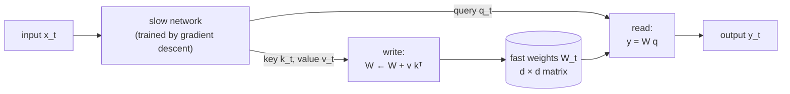
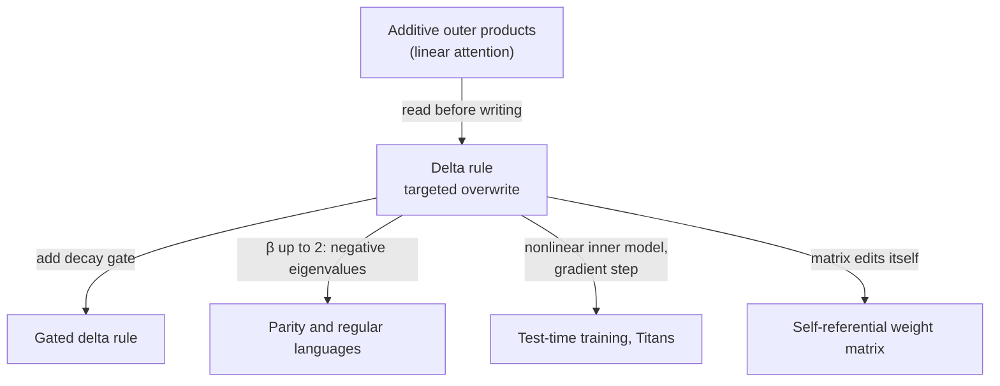

# Fast-weight programmers and self-referential networks

An ordinary neural network has two kinds of numbers. **Activations** change with every input and are forgotten a moment later. **Weights** change slowly, during training, and then freeze. Since the late 1980s a minority tradition has asked why there should be only two timescales. What if one network could *write* the weights of another while it runs, and what if a network could rewrite *its own* weights?

That tradition turned out to be hiding in plain sight. Linear attention, the delta-rule recurrent layers now shipping inside production language models, and "test-time training" layers can all be read as **fast-weight programmers**: a slow network, trained by gradient descent, that learns to program a fast weight matrix one outer product at a time.

> The core idea in one sentence: **a sequence model's memory can be a weight matrix that is edited while the model runs, and the choice of editing rule (add, overwrite, decay, or take a gradient step) decides what that memory can store, forget, and compute.**

This page deepens one thread of [recursion and self-improvement](recursion-and-self-improvement.md) and connects it to [transformers](../02-deep-learning/transformers.md), [architectures](../02-deep-learning/architectures.md) (state-space models), and [inference efficiency](../04-systems/inference-and-efficiency.md).

## 1. Slow weights that program fast weights (established)

Hinton and Plaut (1987) first proposed adding weights that change faster than ordinary ones, to help recover old memories. Schmidhuber (1992) gave the idea its programmable form: a **slow** network reads the input and emits instructions that modify a **fast** network's weights, as an alternative to storing a sequence in recurrent activations. The elementary instruction is an outer product of two patterns the slow network invents:

```math
W_t = W_{t-1} + \mathbf{v}_t \mathbf{k}_t^{\top}, \qquad \mathbf{y}_t = W_t\, \mathbf{q}_t,
```

where $\mathbf{k}_t$, $\mathbf{v}_t$, $\mathbf{q}_t$ are linear projections of the input $\mathbf{x}_t$ made with the slow weights. Only the slow weights are trained by backpropagation; the fast matrix $W_t$ is rebuilt from zero on every sequence. Ba, Hinton and colleagues (2016) revived the idea under the name **fast weights**, arguing that synapses have dynamics on many timescales and that fast weights give "a neurally plausible way of implementing the type of attention to the past" used in sequence-to-sequence models, without storing copies of past activity.



## 2. Linear attention is a fast-weight programmer (established)

Softmax attention computes $\mathbf{y}_t = \sum_{i \le t} \mathbf{v}_i\, \mathrm{softmax}_i(\mathbf{k}_i^\top \mathbf{q}_t)$, which needs every past key and value (the KV cache) and costs $O(t)$ per step. Katharopoulos et al. (2020) replaced the softmax with a kernel feature map $\phi$ and observed that the sum can then be regrouped:

```math
\mathbf{y}_t = \sum_{i \le t} \mathbf{v}_i\, \phi(\mathbf{k}_i)^\top \phi(\mathbf{q}_t)
= \Big(\underbrace{\textstyle\sum_{i \le t} \mathbf{v}_i\, \phi(\mathbf{k}_i)^\top}_{W_t}\Big)\, \phi(\mathbf{q}_t).
```

The bracketed matrix is updated by one outer product per token, so the transformer becomes an RNN with a constant-size matrix state ("Transformers are RNNs"). Schlag, Irie and Schmidhuber (2021) pointed out that this is *exactly* the 1992 fast-weight programmer, with keys and values as the self-invented patterns. They used the equivalence to infer a **capacity limit**: a $d \times d$ sum of outer products can hold at most $d$ mutually orthogonal keys without interference, and every further write adds crosstalk that purely additive updates can never remove.

## 3. The delta rule: memory that can correct itself (established)

Schlag et al. (2021) replaced the additive write with a **delta-rule** write, in which the network first reads what is currently stored under the key and then writes only the correction:

```math
W_t = W_{t-1} + \beta_t\,\big(\mathbf{v}_t - W_{t-1}\mathbf{k}_t\big)\,\mathbf{k}_t^{\top}
= W_{t-1}\big(I - \beta_t\,\mathbf{k}_t\mathbf{k}_t^{\top}\big) + \beta_t\,\mathbf{v}_t\mathbf{k}_t^{\top},
```

with a learning rate $\beta_t \in (0,1)$ that the slow network also outputs. The update is one step of gradient descent on the regression loss $\tfrac12\lVert W\mathbf{k}_t - \mathbf{v}_t\rVert^2$, so the memory is literally **learning online inside the forward pass**. With a unit-norm key and $\beta_t = 1$, rebinding a key to a new value overwrites the old value exactly.

The catch was speed: the delta rule is not a simple running sum, so it did not parallelize over sequence length. Yang et al. (2024) found a hardware-efficient algorithm based on a compact representation of products of Householder-like matrices, scaled **DeltaNet** to a 1.3B-parameter model trained on 100B tokens, and reported that it beat Mamba and GLA on perplexity and zero-shot tasks, with hybrids (adding a few softmax-attention layers) beating strong transformer baselines.

### A tested sketch

The code below checks the equivalence numerically and shows the two weaknesses of the additive rule. It runs as written with NumPy.

```python
import numpy as np

rng = np.random.default_rng(0)
d, T = 16, 40
K = rng.standard_normal((T, d)); K /= np.linalg.norm(K, axis=1, keepdims=True)
V = rng.standard_normal((T, d))
Q = K.copy()                          # query with the keys we stored

# 1. Causal linear attention vs. an additive fast-weight memory
y_attn = np.stack([sum(V[i] * (K[i] @ Q[t]) for i in range(t + 1)) for t in range(T)])
W = np.zeros((d, d)); y_fwp = []
for t in range(T):
    W += np.outer(V[t], K[t])         # write: rank-1 outer product
    y_fwp.append(W @ Q[t])            # read: matrix-vector product
print("max |attention - fast weights| =", np.abs(y_attn - np.array(y_fwp)).max())

# 2. Rebinding a key: the additive rule accumulates, the delta rule overwrites
k = K[0]; v_old, v_new = V[0], V[1]
W_add = np.outer(v_old, k) + np.outer(v_new, k)
W_del = np.outer(v_old, k)
W_del += 1.0 * np.outer(v_new - W_del @ k, k)   # beta = 1, unit-norm key
print("additive error:", np.linalg.norm(W_add @ k - v_new).round(3),
      " delta error:", np.linalg.norm(W_del @ k - v_new).round(3))

# 3. Capacity: write 40 pairs into a 16 x 16 memory, then read back the last 4
def recent_recall_error(rule, beta=1.0, n=4):
    W = np.zeros((d, d))
    for k, v in zip(K, V):
        W += np.outer(v, k) if rule == "add" else beta * np.outer(v - W @ k, k)
    err = np.linalg.norm(K[-n:] @ W.T - V[-n:], axis=1) / np.linalg.norm(V[-n:], axis=1)
    return err.mean().round(2)
print("recent-recall error  additive:", recent_recall_error("add"),
      " delta:", recent_recall_error("delta"))
```

Output:

```text
max |attention - fast weights| = 2.4424906541753444e-15
additive error: 3.776  delta error: 0.0
recent-recall error  additive: 1.46  delta: 0.4
```

The first line confirms that causal linear attention and the outer-product memory are the same computation. The second shows rebinding: the additive memory returns the sum of the old and new values, the delta memory returns the new one. The third writes 40 random pairs into a memory with room for 16 and reads back the most recent four; the additive memory is swamped by crosstalk from everything ever written, while the delta memory has partly overwritten the old pairs and recalls recent ones far better. These numbers come from one random seed and a toy setup and are illustrations, not benchmarks.

## 4. A family tree of editing rules (established, rapidly developing)

Once the state is seen as a matrix being edited, many recent architectures differ mainly in **how they edit it**.

| Rule | Update of the matrix state | What it adds | Source |
|---|---|---|---|
| Additive (linear attention) | $W_t = W_{t-1} + \mathbf{v}_t\mathbf{k}_t^\top$ | Constant-size state; equals attention without softmax | Katharopoulos et al. 2020; Schlag et al. 2021 |
| Delta rule (DeltaNet) | $W_t = W_{t-1}(I - \beta_t\mathbf{k}_t\mathbf{k}_t^\top) + \beta_t\mathbf{v}_t\mathbf{k}_t^\top$ | Targeted overwrite of a key's value | Schlag et al. 2021; Yang et al. 2024 |
| Gated delta rule | $W_t = \alpha_t W_{t-1}(I - \beta_t\mathbf{k}_t\mathbf{k}_t^\top) + \beta_t\mathbf{v}_t\mathbf{k}_t^\top$ | A decay gate $\alpha_t \in (0,1)$ for fast erasure, combined with targeted updates | Yang, Kautz & Hatamizadeh 2024 |
| Kimi Delta Attention | Gated delta rule with finer-grained (per-channel) gating | More selective use of the finite state | Kimi Team 2025 |
| Test-time training (TTT) | $W_t = W_{t-1} - \eta\,\nabla_W \ell(W_{t-1}; \mathbf{x}_t)$, where the state can be a whole MLP | The hidden state is itself a model trained by self-supervision | Sun et al. 2024 |
| Titans neural memory | Gradient-based writes to a deep memory network, with a forgetting mechanism | Long-term memory alongside attention as short-term memory | Behrouz, Zhong & Mirrokni 2024 |

The last two rows generalize the delta rule: with a linear inner model and the squared loss above, one online gradient step *is* the delta rule. Sun et al. (2024) describe their layers as making "the hidden state a machine learning model itself, and the update rule a step of self-supervised learning," and report that TTT layers keep reducing perplexity with more context where Mamba stopped improving after 16k tokens. Behrouz et al. (2024) report that Titans scale to context windows larger than 2M tokens with higher needle-in-a-haystack accuracy than their baselines.

These rules are no longer only research prototypes. The Qwen3-Next model card describes a hybrid layout in which three **Gated DeltaNet** blocks alternate with one gated-attention block, and Kimi Linear (Kimi Team 2025), a 48B-total, 3B-active model mixing Kimi Delta Attention with latent attention, reports outperforming full attention under an identical training recipe while cutting KV-cache use by up to 75% and reaching up to 6 times the decoding throughput at 1M tokens of context.

A related line of work runs the analogy in the other direction: von Oswald et al. (2023) showed that a linear self-attention layer can implement a step of gradient descent on an in-context regression problem, and found trained transformers doing something close to it.

## 5. What the editing rule lets a model compute (active research)

The rule matters for expressiveness, not just memory. A delta-rule step multiplies the state by $I - \beta_t\mathbf{k}_t\mathbf{k}_t^\top$, whose eigenvalue along $\mathbf{k}_t$ is $1 - \beta_t\lVert\mathbf{k}_t\rVert^2$ and whose other eigenvalues are 1.

- Merrill, Petty and Sabharwal (2024) argued that common state-space models, like transformers, cannot express inherently sequential **state tracking** (such as composing permutations), despite their recurrent form.
- Grazzi et al. (2024) proved that finite-precision linear RNNs whose state-transition matrices have only positive eigenvalues cannot solve **parity**, and that products of identity-minus-outer-product matrices with eigenvalues in $[-1, 1]$ can recognize any regular language. In practice that means letting $\beta_t$ range up to 2 so the delta step can *reflect* the state rather than only shrink it; the authors report that this extended eigenvalue range improved state tracking and pretrained stably at 1.3B parameters.
- Irie, Csordás and Schmidhuber (2023) showed that many known results for standard transformers transfer to linear transformers, and that recurrent fast-weight programmers and self-referential weight matrices overcome some of their limits, for example generalizing on parity.



## 6. Networks that rewrite themselves (active research)

A fast-weight programmer still has two networks: a fixed programmer and a programmed memory. Schmidhuber (1993) proposed collapsing them into one: a **self-referential weight matrix** that can read and modify all of its own entries at runtime. Irie, Schlag, Csordás and Schmidhuber (2022) made the idea practical. In their modern SRWM, one matrix generates its own output, key, query, and learning rate from the input, then updates itself with a delta rule (with a feature map $\phi$ and sigmoid $\sigma$):

```math
[\mathbf{y}_t, \mathbf{k}_t, \mathbf{q}_t, \beta_t] = W_{t-1}\mathbf{x}_t,\quad
\mathbf{v}_t = W_{t-1}\phi(\mathbf{q}_t),\quad
\bar{\mathbf{v}}_t = W_{t-1}\phi(\mathbf{k}_t),
```

```math
W_t = W_{t-1} + \sigma(\beta_t)\,\big(\mathbf{v}_t - \bar{\mathbf{v}}_t\big)\,\phi(\mathbf{k}_t)^\top.
```

The value to write is itself produced by the matrix being written, so the matrix programs itself. The authors frame this as a route to meta-learning to learn, and in principle meta-meta-learning and so on, and they report competitive results in few-shot image classification and multi-task reinforcement learning on procedurally generated games. The evidence so far comes mostly from a single research group and modest scales.

Irie and Gershman (2025) review the whole family as RNNs with two-dimensional, matrix-form hidden states and connect the fast weights to models of synaptic plasticity in the brain. HyperNetworks (Ha, Dai & Le 2016), in which one network generates the weights of another, are a close relative that typically generates weights once per layer or step rather than editing a persistent matrix memory.

## 7. What we know and what we don't

| Claim | Status |
|---|---|
| Causal linear attention is mathematically identical to an additive fast-weight programmer | Established (an algebraic identity) |
| Additive outer-product memories suffer crosstalk beyond about $d$ keys | Established |
| Delta-rule and gated delta-rule layers beat earlier linear-time layers at the 1B scale | Supported by several groups; mostly from the architectures' authors |
| Hybrid linear-plus-full-attention models can match or beat full attention in production | Reported by Kimi Team (2025) under their own training recipe; independent replication is still limited |
| Negative eigenvalues in the state transition enable parity and state tracking | Proved for finite precision; confirmed experimentally |
| Self-referential weight matrices give useful recursive meta-learning | Early; demonstrated on modest benchmarks |

## 8. Outer products as a hardware primitive (speculative)

> [!WARNING]
> **Speculative.** This section is a hypothesis connecting fast-weight models to experimental hardware. We know of no published study that tests it on optical or analog accelerators.

Every rule in the table above is built from two operations: a matrix-vector product to read and a rank-1 outer-product update to write. Analog crossbars and [optical matrix processors](photonic-computing.md) are built to perform matrix-vector products, and the cost accounting on the [optical energy page](optical-energy-and-nonlinearity.md) is dominated by moving data in and out. A fast-weight layer keeps its whole context in one $d \times d$ matrix instead of a KV cache that grows with every token, which raises a testable question: could the state stay resident in a physical matrix, receiving rank-1 writes and serving reads, with digital hardware supplying only the keys, values, and gates? The obstacles are concrete. Writes must be fast and precise, the delta rule needs a read before every write, and noise in the stored matrix accumulates over a long sequence in a way that a freshly loaded weight matrix does not. The decay gate of the gated delta rule might help by bounding how long errors persist. Whether any physical device can do this better than a GPU running the chunked algorithms of Yang et al. is open.

## Further reading

- Hinton, G. E., Plaut, D. C. (1987). *Using fast weights to deblur old memories*. Proceedings of the 9th Annual Conference of the Cognitive Science Society.
- Schmidhuber, J. (1992). *Learning to control fast-weight memories: An alternative to dynamic recurrent networks*. Neural Computation 4(1), 131–139. [doi:10.1162/neco.1992.4.1.131](https://doi.org/10.1162/neco.1992.4.1.131)
- Schmidhuber, J. (1993). *A 'self-referential' weight matrix*. ICANN '93, 446–450. [doi:10.1007/978-1-4471-2063-6_107](https://doi.org/10.1007/978-1-4471-2063-6_107)
- Ba, J., Hinton, G., Mnih, V., Leibo, J. Z., Ionescu, C. (2016). *Using fast weights to attend to the recent past*. NeurIPS. [arXiv:1610.06258](https://arxiv.org/abs/1610.06258)
- Ha, D., Dai, A., Le, Q. V. (2016). *HyperNetworks*. ICLR 2017. [arXiv:1609.09106](https://arxiv.org/abs/1609.09106)
- Katharopoulos, A., Vyas, A., Pappas, N., Fleuret, F. (2020). *Transformers are RNNs: Fast autoregressive transformers with linear attention*. ICML. [arXiv:2006.16236](https://arxiv.org/abs/2006.16236)
- Schlag, I., Irie, K., Schmidhuber, J. (2021). *Linear transformers are secretly fast weight programmers*. ICML. [arXiv:2102.11174](https://arxiv.org/abs/2102.11174)
- Irie, K., Schlag, I., Csordás, R., Schmidhuber, J. (2021). *Going beyond linear transformers with recurrent fast weight programmers*. NeurIPS. [arXiv:2106.06295](https://arxiv.org/abs/2106.06295)
- Irie, K., Schlag, I., Csordás, R., Schmidhuber, J. (2022). *A modern self-referential weight matrix that learns to modify itself*. ICML. [arXiv:2202.05780](https://arxiv.org/abs/2202.05780)
- von Oswald, J., Niklasson, E., Randazzo, E., Sacramento, J., Mordvintsev, A., Zhmoginov, A., Vladymyrov, M. (2022). *Transformers learn in-context by gradient descent*. ICML 2023. [arXiv:2212.07677](https://arxiv.org/abs/2212.07677)
- Irie, K., Csordás, R., Schmidhuber, J. (2023). *Practical computational power of linear transformers and their recurrent and self-referential extensions*. EMNLP. [arXiv:2310.16076](https://arxiv.org/abs/2310.16076)
- Merrill, W., Petty, J., Sabharwal, A. (2024). *The illusion of state in state-space models*. ICML. [arXiv:2404.08819](https://arxiv.org/abs/2404.08819)
- Yang, S., Wang, B., Zhang, Y., Shen, Y., Kim, Y. (2024). *Parallelizing linear transformers with the delta rule over sequence length*. NeurIPS. [arXiv:2406.06484](https://arxiv.org/abs/2406.06484)
- Sun, Y., Li, X., Dalal, K., et al. (2024). *Learning to (learn at test time): RNNs with expressive hidden states*. [arXiv:2407.04620](https://arxiv.org/abs/2407.04620)
- Grazzi, R., Siems, J., Zela, A., Franke, J. K. H., Hutter, F., Pontil, M. (2024). *Unlocking state-tracking in linear RNNs through negative eigenvalues*. ICLR 2025. [arXiv:2411.12537](https://arxiv.org/abs/2411.12537)
- Yang, S., Kautz, J., Hatamizadeh, A. (2024). *Gated delta networks: Improving Mamba2 with delta rule*. ICLR 2025. [arXiv:2412.06464](https://arxiv.org/abs/2412.06464)
- Behrouz, A., Zhong, P., Mirrokni, V. (2024). *Titans: Learning to memorize at test time*. [arXiv:2501.00663](https://arxiv.org/abs/2501.00663)
- Irie, K., Gershman, S. J. (2025). *Fast weight programming and linear transformers: From machine learning to neurobiology*. [arXiv:2508.08435](https://arxiv.org/abs/2508.08435)
- Kimi Team, Zhang, Y., Lin, Z., et al. (2025). *Kimi Linear: An expressive, efficient attention architecture*. [arXiv:2510.26692](https://arxiv.org/abs/2510.26692)
- Qwen Team (2025). *Qwen3-Next-80B-A3B-Instruct* model card. [Hugging Face](https://huggingface.co/Qwen/Qwen3-Next-80B-A3B-Instruct)
