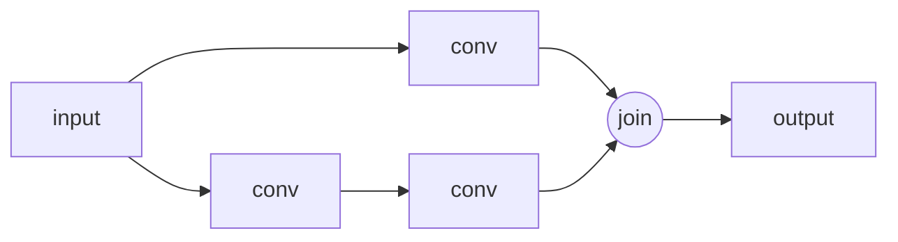

# Fractal and self-similar structure

A fractal looks similar at every scale: zoom into a coastline, a fern, or a Mandelbrot set and the pattern repeats. Such **self-similarity** is mathematically tied to **power laws**, and power laws appear across machine learning, from the statistics of data to scaling laws to the geometry of training itself. This page collects what is known and flags what is conjecture.

## Fractals and power laws: the basics

Mandelbrot (1967) asked "How long is the coast of Britain?" and observed that the measured length $L$ grows as the ruler length $\varepsilon$ shrinks, following $L(\varepsilon) \propto \varepsilon^{1-D}$, where $D$ is a non-integer **fractal dimension**. More generally, an object has **box-counting dimension**

```math
D = \lim_{\varepsilon \to 0} \frac{\log N(\varepsilon)}{\log (1/\varepsilon)}
```

where $N(\varepsilon)$ is the number of boxes of size $\varepsilon$ needed to cover it (Mandelbrot 1982).

The key link: a power law $f(x) = c\,x^{-\alpha}$ is **scale-invariant**. Rescaling $x \to \lambda x$ only multiplies $f$ by a constant, $f(\lambda x) = \lambda^{-\alpha} f(x)$. No characteristic scale exists. Whenever learning curves are straight lines on log–log axes, something scale-free is going on.

## 1. Self-similar statistics of data (established)

Natural data is full of heavy tails and scale invariance:

- **Word frequencies** follow approximately Zipf's law: the $r$-th most common word has frequency roughly proportional to $1/r$.
- **Natural images** have power spectra that fall off approximately as a power of spatial frequency, so they look statistically similar when zoomed.
- **Hierarchical, compositional structure** (letters → words → phrases → documents; pixels → edges → parts → objects) repeats a similar "parts make wholes" pattern across levels.

Lin, Tegmark & Rolnick (2017) argued that properties such as hierarchy, locality, and symmetry, which physics imposes on natural data, are why deep, cheap networks work so well.

## 2. Scaling laws as power laws (established empirically, origin open)

Neural [scaling laws](../02-deep-learning/scaling-laws.md) are power laws in parameters, data, and compute (Hestness et al. 2017; Kaplan et al. 2020). Proposed explanations tie the exponents to geometry:

- **Data-manifold dimension.** Sharma & Kaplan (2020) argued that if data lies on a manifold of intrinsic dimension $d$, the scaling exponent with model size should be roughly $\alpha \approx 4/d$ for their setting, and found approximate agreement by measuring intrinsic dimensions of learned representations.
- **Scaling regimes.** Bahri et al. (2021) distinguished *variance-limited* and *resolution-limited* regimes and connected the latter to the dimension of the data manifold.

So the slope of a learning curve may be a measurement of the **effective dimension of the world the model is learning**, a striking idea that remains under active investigation.

## 3. Renormalization and deep networks (active research)

In physics, the **renormalization group** (RG) coarse-grains a system scale by scale, keeping the relevant features at each level. Mehta & Schwab (2014) constructed an exact mapping between a variational RG procedure and deep networks built from stacked restricted Boltzmann machines. This formalizes an intuition: deep layers can act like successive coarse-grainings, each a zoomed-out view of the one below. How far the analogy extends to modern architectures is an open question.

## 4. Fractal geometry in training (established, recent)

**Sohl-Dickstein (2024)** examined which hyperparameter settings (for example, the learning rates of different layers) lead to successful versus divergent training. The boundary between the two regions turned out to be **fractal**, showing intricate structure over many orders of magnitude of zoom in every configuration tested. The intuition is the same as for the Mandelbrot set: training is an iterated function, and the boundary between bounded and divergent behaviour of iterated maps is often fractal.

Related observations:

- Loss-landscape visualizations (Li et al. 2018) show that architecture choices change the landscape from smooth and convex-looking to highly chaotic.
- Under the **edge-of-stability** phenomenon (Cohen et al. 2021), full-batch gradient descent operates at the threshold of instability, where iterated maps typically produce complex dynamics (see [Non-linearity and dynamical systems](nonlinearity-and-dynamical-systems.md)).

## 5. Fractal architectures (established)

**FractalNet** (Larsson, Maire & Shakhnarovich 2016) builds very deep networks by repeatedly applying a simple expansion rule, producing a self-similar layout of interacting subpaths of different depths, and trains without residual connections. It showed that what matters for training deep networks may be the presence of short effective paths, which residual networks also provide.



The expansion rule is $f_{C+1}(x) = \big(f_C \circ f_C\big)(x) \oplus \mathrm{conv}(x)$, where $\oplus$ is a join (elementwise mean). Each level contains two copies of the level below.

## 6. Self-similarity as a design principle (speculative)

> [!WARNING]
> **Speculative.** The ideas below are hypotheses and research directions, not established results.

- **Scale-free reasoning.** If problems decompose into similar subproblems at many scales, systems that apply one learned procedure recursively (see [Recursion](recursion-and-self-improvement.md)) might generalize to longer and harder instances than fixed-depth networks.
- **Fractal memory.** Hierarchical, multi-resolution memory (fine detail for recent context, coarser summaries further back) could manage very long contexts in a self-similar way.
- **Predicting capabilities.** If scaling exponents reflect the intrinsic dimension of tasks, measuring task dimension might predict how much scale a capability needs. This is untested at scale.

## Related page

- [Heavy-tailed weight spectra and generalization](heavy-tailed-weight-spectra.md): power-law eigenvalue spectra in trained weights, and a generalization bound in terms of the Hausdorff dimension of SGD trajectories.

## Next topics for this page

- Multifractal analysis of language and attention patterns
- Iterated function systems as generative models
