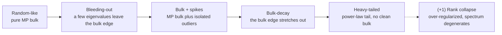
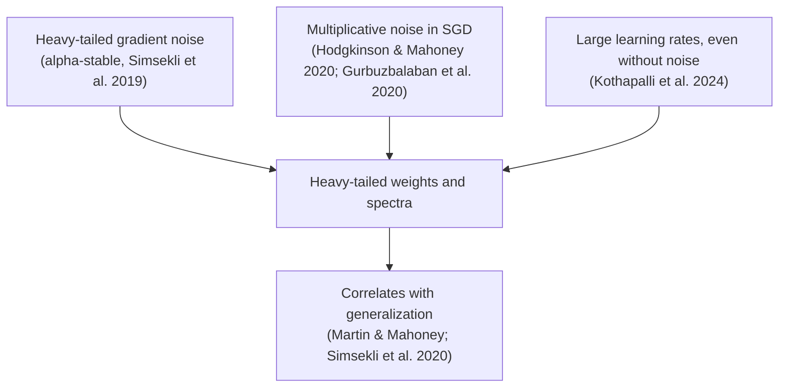

# Heavy-tailed weight spectra and generalization

Take any layer of a trained network, form the matrix $W^\top W$, and look at its eigenvalues. If the weights were random, the histogram would be a smooth, compact hump whose shape random matrix theory predicted in 1967. In a well-trained modern network it is something else: a long tail of large eigenvalues that thins out roughly like a **power law**, the signature of structure at every scale. Remarkably, the shape of that tail tracks how well the model was trained, and it can be read **without seeing a single training or test example.**

> The core idea in one sentence: **training leaves a fingerprint in the eigenvalue spectrum of every weight matrix, that fingerprint is heavy-tailed when training goes well, and its exponent is a cheap, data-free (but only correlational) diagnostic of model quality.**

This page belongs next to [fractal and self-similar structure](fractal-and-self-similar-structure.md): power laws are what scale invariance looks like in a histogram, and one line of theory links heavy tails directly to the *fractal dimension* of the path that SGD traces through weight space.

## 1. The random baseline: Marchenko–Pastur (established)

Let $W$ be an $N \times M$ matrix ($N \ge M$) with independent entries of mean zero and variance $\sigma^2$, and form the correlation matrix

```math
X = \frac{1}{N} W^\top W \in \mathbb{R}^{M \times M}.
```

Its **empirical spectral density (ESD)** is the histogram of the $M$ eigenvalues $\lambda_i$ of $X$ (equivalently, the squared singular values of $W$, rescaled). Marčenko and Pastur (1967) showed that as $N, M \to \infty$ with aspect ratio $Q = N/M$ fixed, the ESD converges to

```math
\rho_{\text{MP}}(\lambda) = \frac{Q}{2\pi\sigma^2}\,\frac{\sqrt{(\lambda_+ - \lambda)(\lambda - \lambda_-)}}{\lambda},
\qquad
\lambda_\pm = \sigma^2\left(1 \pm \frac{1}{\sqrt{Q}}\right)^2,
```

supported only on $[\lambda_-, \lambda_+]$. Two facts matter here. First, the support is **bounded**: pure noise produces no eigenvalues far above $\lambda_+$. Second, the shape depends only on $Q$ and $\sigma^2$, not on the fine details of the entry distribution (as long as it has finite variance). That universality makes Marchenko–Pastur the natural null hypothesis: anything a layer has *learned* shows up as a departure from it.

## 2. What trained networks look like (established, empirically)

Martin and Mahoney (2018) computed ESDs for the layers of production models (AlexNet, Inception and others) and of small models trained from scratch. They found that training moves the spectrum away from Marchenko–Pastur in a consistent sequence, which they organised into **5+1 phases of training**:



In smaller or older networks the learned signal appears as a handful of spikes on top of a noise bulk, which Martin and Mahoney liken to classical Tikhonov regularization: there is a single size scale separating signal from noise. In state-of-the-art networks they instead found **Heavy-Tailed Self-Regularization (HT-SR)**: correlations at all size scales, with a tail that is well fitted by

```math
\rho(\lambda) \;\propto\; \lambda^{-\alpha}, \qquad \lambda_{\min} \le \lambda \le \lambda_{\max}.
```

They described this as similar to the self-organization of disordered systems in statistical physics, and showed it arises from training itself, with no explicit regularizer. In the same paper they made a small model pass through all the phases simply by changing the **batch size**: larger batches gave less implicitly regularized spectra, offering one account of the large-batch generalization gap.

## 3. Reading the tail: estimating α honestly (established method)

Fitting a power law by drawing a straight line through a log–log histogram is a well-known trap. The standard method (Clauset, Shalizi & Newman 2009) is maximum likelihood. For the $n$ eigenvalues above a cutoff $\lambda_{\min}$, the continuous power-law estimate is

```math
\hat\alpha = 1 + n\left[\sum_{i=1}^{n} \ln\frac{\lambda_i}{\lambda_{\min}}\right]^{-1},
```

and $\lambda_{\min}$ itself is chosen to minimise the Kolmogorov–Smirnov distance between the fitted and empirical tails. A sketch in NumPy:

```python
import numpy as np

def esd(W):
    """Eigenvalues of X = W^T W / N for an N x M weight matrix (N >= M)."""
    N, M = W.shape if W.shape[0] >= W.shape[1] else W.T.shape
    s = np.linalg.svd(W, compute_uv=False)
    return np.sort(s**2 / N)

def fit_alpha(lams, min_tail=10):
    """Clauset-style MLE power-law fit; returns (alpha, lambda_min, ks)."""
    best = (np.nan, np.nan, np.inf)
    for i in range(len(lams) - min_tail):
        tail = lams[i:]
        lmin = tail[0]
        a = 1 + len(tail) / np.sum(np.log(tail / lmin))
        emp = np.arange(len(tail)) / len(tail)          # empirical CDF
        fit = 1 - (tail / lmin) ** (1 - a)              # fitted CDF
        ks = np.max(np.abs(emp - fit))
        if ks < best[2]:
            best = (a, lmin, ks)
    return best
```

On random Gaussian weights this procedure tends to return a large $\hat\alpha$ with a poor fit, because a bounded Marchenko–Pastur bulk is not a power law; on well-trained layers the tail fits far better and $\hat\alpha$ comes out smaller. The open-source **WeightWatcher** tool from the same authors packages these fits per layer.

From the per-layer exponents, Martin and Mahoney (2019) defined model-level metrics. The simplest is the average $\bar\alpha$ over layers; the **weighted alpha** scales each exponent by the log of that layer's largest eigenvalue,

```math
\hat\alpha_{\text{w}} = \frac{1}{L}\sum_{\ell=1}^{L} \alpha_\ell \log \lambda_{\max,\ell},
```

which combines tail shape with a norm-like measure of scale.

## 4. Does the exponent predict quality? (active research, mostly correlational)

The central empirical claim is that, **within a series of models of the same architecture**, heavier tails (smaller α-based metrics) go with better reported test accuracy.

- **Very large pretrained models.** Martin and Mahoney (2019, *Heavy-tailed universality*) showed that the weighted alpha tracks trends in test accuracy across series of pretrained computer-vision models.
- **Hundreds of public models.** Martin, Peng and Mahoney (2021, *Nature Communications*) ran a meta-analysis of hundreds of publicly available pretrained models. Norm-based metrics correlated well with test accuracy for well-trained models but often could not tell well-trained from poorly trained ones; power-law metrics did better on both counts, and could flag problems that train and test accuracy alone do not reveal.
- **Language models.** Yang et al. (2023) studied hundreds of Transformers trained under controlled variations plus 51 pretrained Hugging Face models from eight families, comparing 28 generalization metrics. Metrics from the heavy-tail perspective showed stronger correlations with test performance than more popular alternatives. They also found that exponential and truncated-power-law fits can describe some spectra better than a pure power law.

These are correlations, and the literature on generalization measures is a graveyard of correlations. Jiang et al. (2019) trained over 10,000 convolutional networks under controlled hyperparameter changes and found surprising failures among more than 40 proposed complexity measures. Any α-based metric deserves the same controlled scrutiny, and it is not a substitute for a held-out evaluation when one is available.

## 5. Where the heavy tails come from (active research)

Several mechanisms have been proposed. They are not mutually exclusive.



**Heavy-tailed gradient noise.** Analyses of SGD often model it as a stochastic differential equation driven by Brownian motion, which assumes the minibatch gradient noise is Gaussian. Şimşekli, Sagun and Gürbüzbalaban (2019) argued that the generalized central limit theorem points instead to heavy-tailed α-stable noise, measured highly non-Gaussian noise across architectures, and proposed modelling SGD as an SDE driven by a Lévy process, whose jumps help it leave narrow minima for wide ones. This is contested: Panigrahi et al. (2019) found that for batch sizes of 256 and above the noise is best described as Gaussian, at least early in training, and Xie, Sato and Sugiyama (2020) built a theory of flat-minimum selection on the Hessian-dependent covariance of Gaussian-like noise. (The SDE view of SGD is itself a backlog topic for the [dynamics page](nonlinearity-and-dynamical-systems.md).)

**Multiplicative noise.** A different route needs no heavy-tailed noise at all. Gürbüzbalaban, Şimşekli and Zhu (2020) proved that even in linear regression with light-tailed data, SGD iterates can converge to a heavy-tailed stationary distribution with **infinite variance**, with the tail controlled by step size $\eta$, batch size $b$, curvature and dimension. Hodgkinson and Mahoney (2020) showed that multiplicative noise, which arises naturally from variance in local rates of convergence, produces heavy-tailed stationary behaviour for a broad class of models and optimizers, including momentum and Adam. The flavour of the mechanism is a random linear recurrence:

```math
w_{t+1} = A_t\, w_t + b_t ,
```

where $A_t$ is a random matrix depending on the minibatch. When $A_t$ occasionally expands, those expansions compound multiplicatively, and products of random factors generically produce power-law tails, a classical result for such recurrences.

**No noise required.** Kothapalli et al. (2024) built a two-layer setting in which heavy-tailed ESDs emerge under full-batch gradient descent or Adam with no gradient noise, driven by large learning rates early in training, and passing through the bulk-plus-spike shape on the way.

## 6. The fractal connection: tails and Hausdorff dimension (active research)

Şimşekli, Sener, Deligiannidis and Erdogdu (2020) proved generalization bounds for SGD under the assumption that its trajectory is well approximated by a Feller process, a broad class of Markov processes that includes both Brownian and heavy-tailed SDEs. In their bounds the generalization error is controlled by the **Hausdorff dimension** of the trajectory, a [fractal dimension](fractal-and-self-similar-structure.md), which is tied to the tail behaviour of the driving process. Their results imply that heavier-tailed processes should generalize better, so the tail index can act as a capacity measure that, unlike parameter counts, need not grow with model size.

Two cautions. The tail index in this theory describes the *optimization process*, not the eigenvalue spectrum of the final weights, so the two α's are related in spirit but are different quantities. And the bound rests on the Feller-process approximation, which is an assumption about SGD rather than a proven fact.

## 7. From diagnostic to tool (active research, 2023–2025)

The most recent work uses layer-wise spectra not just to grade models but to **steer** them, on the premise that different layers are trained to different degrees.

| Method | What it does with the spectrum | Reported result | Source |
|---|---|---|---|
| **TempBalance** | Sets a per-layer learning rate ("temperature") from each layer's HT-SR metric during training | Outperformed ordinary SGD and tuned spectral-norm regularization on CIFAR-10/100, SVHN and TinyImageNet with ResNets, VGGs and WideResNets | Zhou et al. 2023 |
| **AlphaPruning** | Allocates layer-wise sparsity from ESD shape metrics, pruning better-trained layers less | Pruned LLaMA-7B to 80% sparsity while keeping reasonable perplexity, which the authors describe as a first for LLMs | Lu et al. 2024 |
| **Model balancing** | Applies TempBalance to low-data training and fine-tuning in NLP and scientific ML | Gains grew as the amount of tuning data shrank | Liu et al. 2024 |

On the theory side, Martin and Hinrichs (2025) proposed **SETOL**, a semi-empirical theory that aims to derive the HT-SR metrics α and $\hat\alpha$ from statistical mechanics and random matrix theory. It introduces a layer-quality metric, ERG, equivalent to one step of Wilson's exact renormalization group, the same family of ideas that connects deep learning to [renormalization](fractal-and-self-similar-structure.md). The authors report that ERG and α agree closely on a three-layer MLP and on state-of-the-art models. SETOL is recent and has not yet been widely tested by independent groups.

## 8. What we know and what we don't

| Claim | Status |
|---|---|
| Trained weight spectra depart from Marchenko–Pastur in systematic ways | Established, widely reproduced |
| Well-trained modern layers often have power-law-like tails | Established empirically; the exact functional form (pure, truncated or exponential tail) varies |
| Smaller α-based metrics track better test accuracy within a model family | Supported by large correlational studies; not causal |
| Heavy tails come from heavy-tailed gradient noise | Contested; noise can look Gaussian at large batch sizes |
| Heavy tails can arise from multiplicative noise or large learning rates alone | Proved in simplified settings |
| Layer-wise spectra are useful for setting learning rates and pruning ratios | Promising, from a small number of groups |

## 9. Spectra as a hardware budget (speculative)

> [!WARNING]
> **Speculative.** This section is a hypothesis connecting the results above to experimental hardware. We know of no published study that tests it.

On [analog and optical accelerators](photonic-computing.md), every matrix is applied with physical noise and limited precision, so not every layer deserves the same budget. AlphaPruning and TempBalance already treat layers unequally based on their spectra. A natural, testable extension is to use the same per-layer metrics to decide **which layers can tolerate noisier, lower-precision analog execution and which should stay in digital**, or how to allocate calibration effort. A heavy-tailed spectrum also concentrates much of a layer's action in a few large singular directions, which could matter for hardware that maps a matrix through its singular value decomposition, since errors on the dominant directions would cost far more than errors in the bulk. Whether α-based allocation beats simpler heuristics such as weight norms or sensitivity analysis on real noisy hardware is an open question.

## Further reading

- Marčenko, V. A., Pastur, L. A. (1967). *Distribution of eigenvalues for some sets of random matrices*. Mathematics of the USSR-Sbornik 1(4). [doi:10.1070/SM1967v001n04ABEH001994](https://doi.org/10.1070/SM1967v001n04ABEH001994)
- Clauset, A., Shalizi, C. R., Newman, M. E. J. (2009). *Power-law distributions in empirical data*. SIAM Review. [arXiv:0706.1062](https://arxiv.org/abs/0706.1062)
- Martin, C. H., Mahoney, M. W. (2018). *Implicit self-regularization in deep neural networks: Evidence from random matrix theory and implications for learning*. JMLR 2021. [arXiv:1810.01075](https://arxiv.org/abs/1810.01075)
- Martin, C. H., Mahoney, M. W. (2019). *Traditional and heavy-tailed self regularization in neural network models*. ICML. [arXiv:1901.08276](https://arxiv.org/abs/1901.08276)
- Martin, C. H., Mahoney, M. W. (2019). *Heavy-tailed universality predicts trends in test accuracies for very large pre-trained deep neural networks*. SDM 2020. [arXiv:1901.08278](https://arxiv.org/abs/1901.08278)
- Martin, C. H., Peng, T., Mahoney, M. W. (2021). *Predicting trends in the quality of state-of-the-art neural networks without access to training or testing data*. Nature Communications 12, 4122. [doi:10.1038/s41467-021-24025-8](https://doi.org/10.1038/s41467-021-24025-8)
- Yang, Y., Theisen, R., Hodgkinson, L., Gonzalez, J. E., Ramchandran, K., Martin, C. H., Mahoney, M. W. (2022). *Evaluating natural language processing models with generalization metrics that do not need access to any training or testing data*. KDD 2023. [arXiv:2202.02842](https://arxiv.org/abs/2202.02842)
- Jiang, Y., Neyshabur, B., Mobahi, H., Krishnan, D., Bengio, S. (2019). *Fantastic generalization measures and where to find them*. ICLR 2020. [arXiv:1912.02178](https://arxiv.org/abs/1912.02178)
- Şimşekli, U., Sagun, L., Gürbüzbalaban, M. (2019). *A tail-index analysis of stochastic gradient noise in deep neural networks*. ICML. [arXiv:1901.06053](https://arxiv.org/abs/1901.06053)
- Panigrahi, A., Somani, R., Goyal, N., Netrapalli, P. (2019). *Non-Gaussianity of stochastic gradient noise*. [arXiv:1910.09626](https://arxiv.org/abs/1910.09626)
- Xie, Z., Sato, I., Sugiyama, M. (2020). *A diffusion theory for deep learning dynamics: Stochastic gradient descent exponentially favors flat minima*. ICLR 2021. [arXiv:2002.03495](https://arxiv.org/abs/2002.03495)
- Gürbüzbalaban, M., Şimşekli, U., Zhu, L. (2020). *The heavy-tail phenomenon in SGD*. ICML 2021. [arXiv:2006.04740](https://arxiv.org/abs/2006.04740)
- Hodgkinson, L., Mahoney, M. W. (2020). *Multiplicative noise and heavy tails in stochastic optimization*. ICML 2021. [arXiv:2006.06293](https://arxiv.org/abs/2006.06293)
- Şimşekli, U., Sener, O., Deligiannidis, G., Erdogdu, M. A. (2020). *Hausdorff dimension, heavy tails, and generalization in neural networks*. NeurIPS. [arXiv:2006.09313](https://arxiv.org/abs/2006.09313)
- Zhou, Y., Pang, T., Liu, K., Martin, C. H., Mahoney, M. W., Yang, Y. (2023). *Temperature balancing, layer-wise weight analysis, and neural network training*. NeurIPS. [arXiv:2312.00359](https://arxiv.org/abs/2312.00359)
- Kothapalli, V., Pang, T., Deng, S., Liu, Z., Yang, Y. (2024). *From spikes to heavy tails: Unveiling the spectral evolution of neural networks*. [arXiv:2406.04657](https://arxiv.org/abs/2406.04657)
- Lu, H., Zhou, Y., Liu, S., Wang, Z., Mahoney, M. W., Yang, Y. (2024). *AlphaPruning: Using heavy-tailed self regularization theory for improved layer-wise pruning of large language models*. NeurIPS. [arXiv:2410.10912](https://arxiv.org/abs/2410.10912)
- Liu, Z., Hu, Y., Pang, T., Zhou, Y., Ren, P., Yang, Y. (2024). *Model balancing helps low-data training and fine-tuning*. EMNLP. [arXiv:2410.12178](https://arxiv.org/abs/2410.12178)
- Martin, C. H., Hinrichs, C. (2025). *SETOL: A semi-empirical theory of (deep) learning*. [arXiv:2507.17912](https://arxiv.org/abs/2507.17912)
- WeightWatcher (open-source tool for layer-wise spectral analysis). [GitHub](https://github.com/CalculatedContent/WeightWatcher)
