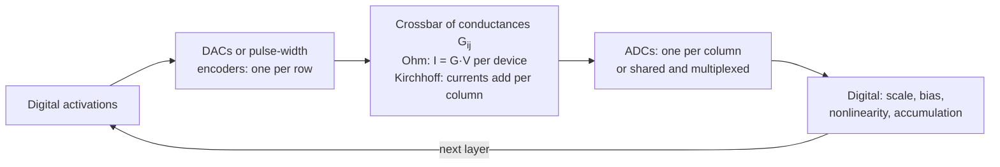

# Memristive crossbars and analog in-memory computing

Most of the energy a neural network spends is not spent multiplying. It is spent *moving* weights from memory to the place where the multiplication happens. Analog in-memory computing removes that trip. The weights are stored as the electrical conductances of tiny devices arranged in a grid, a voltage is applied, and the physics of the circuit performs the whole matrix-vector product in the same place the weights live, in one step.

This page explains how that works, which devices are used, why the result is always a little wrong, and what the field has learned about making "a little wrong" good enough for real networks.

> **In one sentence.** A crossbar of programmable resistors computes $y = Gx$ in place, because Ohm's law multiplies and Kirchhoff's current law adds; the hard part is that every stored conductance is imprecise, noisy and drifting, so the network, the circuit and the programming procedure all have to be designed around that imprecision.

## 1. Why compute where the weights are (established)

Horowitz's ISSCC 2014 energy table, discussed in detail on the [energy-per-MAC page](optical-energy-and-nonlinearity.md#1-what-digital-hardware-pays-established), makes the point: one 64-bit DRAM access costs as much energy as thousands of 8-bit multiplies. For the matrix-vector products that dominate inference, each weight is typically used once per input vector, so a conventional accelerator pays for a weight fetch for nearly every multiply-accumulate unless it can reuse weights across a large batch. This is the *memory wall*, and it is the motivation [shared](../04-systems/hardware-and-training.md) by in-memory, neuromorphic and optical computing.

Analog in-memory computing attacks it directly: weights are written once into non-volatile devices and never move again. Reviews by Ielmini and Wong (2018), Burr et al. (2017) and Sebastian et al. (2020) cover the field from the device, circuit and application sides.

## 2. The crossbar: Ohm multiplies, Kirchhoff adds (established)

Place a programmable conductance $G_{ij}$ at every crossing of row wire $i$ and column wire $j$. Apply a voltage $V_i$ to each row and hold the columns at virtual ground. By Ohm's law the device at $(i, j)$ passes a current $G_{ij} V_i$. By Kirchhoff's current law, the currents entering each column add:

```math
I_j \;=\; \sum_{i} G_{ij}\, V_i \qquad\text{that is,}\qquad \mathbf{I} = G^{\top}\mathbf{V}.
```

Every multiplication happens at once, in the time it takes the currents to settle. Conductances are non-negative, so a signed weight is usually stored as the difference of two devices, $w_{ij} \propto G^{+}_{ij} - G^{-}_{ij}$, read on two columns and subtracted.



The same accounting that governs [optical matrix multipliers](optical-energy-and-nonlinearity.md#3-the-scaling-argument-established) applies here. An $N \times N$ array converts $N$ inputs and $N$ outputs but performs $N^2$ multiply-accumulates, so the cost of the converters is shared by $N$ multiplications each. Unlike most optical schemes, the weights are already stationary, so the term that does not fall with $N$ in the optical analysis, fetching weights from memory, is absent. What remains are the converters, and in practice the **analog-to-digital converters** are often the largest single energy and area cost of an in-memory tile.

## 3. The devices (established)

In 1971 Leon Chua argued from symmetry that circuit theory was missing a fourth basic element, alongside the resistor, capacitor and inductor, one that relates charge and magnetic flux, and named it the **memristor**: a resistor whose resistance depends on the history of current through it. In 2008 Strukov, Snider, Stewart and Williams at HP Labs reported that a nanoscale titanium-dioxide device behaves this way, because the applied field moves oxygen vacancies and so changes its resistance. "Memristive" is now used loosely for any two-terminal device whose conductance can be set and then retained.

| Device family | How the conductance is stored | Typical strengths | Typical weaknesses |
|---|---|---|---|
| Resistive RAM (RRAM, metal-oxide memristors) | A conductive filament of defects formed and partly dissolved in an oxide | Dense, simple, CMOS-compatible | Device-to-device and cycle-to-cycle variability, random telegraph noise |
| Phase-change memory (PCM) | The fraction of a chalcogenide cell that is amorphous versus crystalline | Mature, many analog levels | Conductance **drift** over time, asymmetric programming |
| Flash and charge-trap memory | Charge stored on a floating gate or trap layer | Very mature, can be stacked in 3D | Slow, high-voltage writes; limited endurance |
| Gain cells (capacitor-based) | Charge on a small capacitor read through a transistor | Fast, cheap writes; suited to data that changes | Volatile: the charge leaks and must be refreshed or used quickly |

Rao et al. (2023) showed that careful device engineering and programming can give RRAM cells integrated on CMOS thousands of distinguishable conductance levels, far beyond the few bits once assumed. The gain-cell row matters for transformers: Leroux et al. (2025) used gain cells to hold the attention key-value cache, which changes with every generated token and so is a poor fit for slow-to-write non-volatile devices.

## 4. Why the answer is always a little wrong (established)

Every step of the analog path adds error, and the errors have different characters:

- **Finite levels.** A device can be set only to a limited number of reliably distinct states, so weights are quantized.
- **Programming error.** Writing a target conductance lands near it, not on it. Iterative *write-verify* (program, read, correct, repeat) narrows the error at the cost of time.
- **Read noise.** Each read fluctuates, so the same stored weights give slightly different outputs from one inference to the next.
- **Drift.** In PCM the conductance decays after programming, approximately as a power law, $G(t) = G(t_0)\,(t/t_0)^{-\nu}$, with a small exponent $\nu$ that itself varies from device to device.
- **Wire resistance (IR drop).** Row and column wires have resistance, so devices far from the drivers see less voltage than intended, an error that grows with array size and with conductance.
- **Nonlinear, asymmetric updates.** When training on the array, a "potentiate" pulse and a "depress" pulse rarely change the conductance by equal and opposite amounts, and the step size depends on the current state.
- **Converter precision.** The ADC has finite bits and a finite range, so large outputs clip and small ones round.

These are the reasons analog in-memory computing is most mature for **inference**, where weights are written once and the network can be made tolerant of noise, and hardest for **training**, where millions of small, precise, symmetric updates are needed.

### A tested sketch

The NumPy sketch below models one $256 \times 256$ layer stored on a differential pair of devices, with quantization to a given number of levels, programming noise, read noise, an 8-bit ADC, power-law drift, and a one-scalar-per-array drift correction. A final experiment represents one weight with several devices, each programmed to cancel the error left by the previous ones, following the idea of Song et al. (2024). **All device parameters are illustrative, not taken from any specific chip.**

```python
import numpy as np
rng = np.random.default_rng(0)
N_OUT, N_IN, G_MAX = 256, 256, 25.0           # G_MAX in microsiemens (illustrative)
W = rng.standard_normal((N_OUT, N_IN)) / np.sqrt(N_IN)
X = rng.standard_normal((N_IN, 512)); Y = W @ X

def to_conductance(W, levels):                 # signed weight -> G+ minus G-, quantized
    s = G_MAX / np.abs(W).max(); G = W * s
    Gp, Gm = np.clip(G, 0, None), np.clip(-G, 0, None)
    step = G_MAX / (levels - 1)
    return np.round(Gp / step) * step, np.round(Gm / step) * step, s

def program(G, sp):                            # programming error, fraction of G_MAX
    return np.clip(G + sp * G_MAX * rng.standard_normal(G.shape), 0, G_MAX)

def read(Gp, Gm, X, sr, t=None, nu=None):      # read noise and power-law drift
    if t is not None: Gp, Gm = Gp * t**-nu, Gm * t**-nu
    n = lambda G: G + sr * G_MAX * rng.standard_normal(G.shape)
    return n(Gp) @ X - n(Gm) @ X

def adc(Y, bits, fs):
    q = fs / 2**(bits - 1); return np.clip(np.round(Y / q) * q, -fs, fs)

rel = lambda Yh: np.linalg.norm(Yh - Y) / np.linalg.norm(Y)

# A. levels x programming noise (read noise 0.5%, 8-bit ADC)
for levels in [4, 16, 64, 256]:
    for sp in [0.0, 0.01, 0.03]:
        Gp, Gm, s = to_conductance(W, levels)
        Yh = adc(read(program(Gp, sp), program(Gm, sp), X, 0.005) / s, 8, 4 * Y.std())
        print(levels, sp, round(rel(Yh), 3))

# B. drift with nu = 0.05, raw versus one calibration scalar per array
Gp, Gm, s = to_conductance(W, 64); Gp, Gm = program(Gp, 0.01), program(Gm, 0.01)
xc = rng.standard_normal((N_IN, 64)); ref = Gp @ xc - Gm @ xc
for t in [1, 60, 3600, 86400, 86400 * 365]:
    Yh = read(Gp, Gm, X, 0.005, t, 0.05) / s
    alpha = np.abs(ref).sum() / np.abs(read(Gp, Gm, xc, 0.005, t, 0.05)).sum()
    print(t, round(rel(Yh), 3), round(rel(alpha * Yh), 3))

# C. one weight spread over K devices, each cancelling the previous error (3% per device)
w = rng.uniform(-1, 1, 20000)
for K in [1, 2, 3, 4]:
    est, err, gain = np.zeros_like(w), w.copy(), 1.0
    for _ in range(K):
        dev = np.clip(err / gain, -1, 1) + 0.03 * rng.standard_normal(w.shape)
        est += gain * dev; err = w - est; gain = np.abs(err).max()
    print(K, np.sqrt(np.mean((est - w) ** 2)))
```

What it prints (relative error of the layer output, $\lVert \hat y - y\rVert / \lVert y \rVert$):

| Conductance levels | No programming error | 1% programming error | 3% programming error |
|---|---|---|---|
| 4 | 0.456 | 0.454 | 0.465 |
| 16 | 0.097 | 0.111 | 0.192 |
| 64 | 0.041 | 0.070 | 0.173 |
| 256 | 0.035 | 0.068 | 0.172 |

| Time after programming | Drift factor $t^{-0.05}$ | Raw error | With one calibration scalar per array |
|---|---|---|---|
| 1 s | 1.000 | 0.070 | 0.070 |
| 1 minute | 0.815 | 0.206 | 0.074 |
| 1 hour | 0.664 | 0.350 | 0.079 |
| 1 day | 0.566 | 0.445 | 0.085 |
| 1 year | 0.422 | 0.586 | 0.100 |

| Devices per weight, $K$ | RMS weight error (weights in $[-1, 1]$) |
|---|---|
| 1 | $3.0 \times 10^{-2}$ |
| 2 | $3.7 \times 10^{-3}$ |
| 3 | $4.0 \times 10^{-4}$ |
| 4 | $6.7 \times 10^{-5}$ |

Four lessons come out of these numbers.

1. **Levels stop mattering quickly; noise does not.** With Gaussian-like weights scaled to the largest one, four levels round most weights to zero (46% error). By 64 levels quantization is no longer the bottleneck, and the error is set by programming noise, read noise and the ADC: going from 64 to 256 levels barely helps, while going from 1% to 3% programming error more than doubles the error.
2. **Drift is mostly a gain error, and a gain error is cheap to fix.** Uniform power-law drift shrinks every conductance by the same factor, so a single scalar measured on a few calibration inputs removes nearly all of it. This is the idea behind the global drift compensation used by Joshi et al. (2020).
3. **But correction cannot restore lost signal.** Even with perfect gain correction, the error creeps up from 0.070 to 0.100 over a year, because the conductances, and with them the signal, have shrunk while the read noise has not. Real drift is also not uniform across devices, which this sketch ignores, so in practice the remaining error is larger.
4. **Precision can be bought with devices.** Each extra device that programs the leftover error cuts the RMS weight error by roughly an order of magnitude here, from about 3% with one device to below $10^{-4}$ with four. This sketch is a simplified illustration of the principle, not a reproduction of the circuit and protocol in Song et al. (2024).

## 5. Making networks survive the analog path (established)

The field has converged on a layered defence:

- **Hardware-aware training.** Train in software, but inject the expected weight noise and quantization during training so the network learns to be insensitive to it. Joshi et al. (2020) combined noise injection with global drift compensation to keep phase-change-memory inference accurate over time, and Rasch et al. (2023) showed that hardware-aware training brings a wide range of models, including CNNs, recurrent networks and transformers, close to their digital accuracy under realistic in-memory noise. The open-source IBM Analog Hardware Acceleration Kit (Rasch et al. 2021) makes these simulations reproducible in PyTorch.
- **Careful programming.** Write-verify loops and optimized programming strategies narrow the gap between target and stored conductance.
- **More devices per weight.** Several devices per weight, used as more and less significant parts, or programmed to cancel each other's errors as in Song et al. (2024), trade area for precision.
- **Mixed precision.** Le Gallo et al. (2018) let an imprecise in-memory unit do the bulk of the work inside an iterative solver while a digital unit computes exact residuals, recovering full precision for solving linear systems.
- **Keep the sensitive parts digital.** Most chips leave normalization, softmax, nonlinearities and sometimes the first and last layers in digital logic.

## 6. Training on the array (active research)

Training needs each weight to move by small, signed steps many millions of times. Gokmen and Vlasov (2016) spelled out what a *resistive processing unit* device would have to provide for crossbar training to match software, above all nearly symmetric up and down steps and on the order of a thousand distinct steps across the range, together with a scheme to perform the rank-one weight update for a whole array in parallel by coincident pulses on rows and columns. Real devices fall short, especially on symmetry.

Three responses illustrate the range:

- **Train in situ on simple tasks.** Prezioso et al. (2015) trained a one-layer perceptron directly on a $12 \times 12$ metal-oxide memristor crossbar to classify small $3 \times 3$-pixel images, an early demonstration that learning can happen in the devices themselves.
- **Split the job between devices.** Ambrogio et al. (2018) paired phase-change memory for long-term storage with a faster, more linear capacitor-based cell that accumulates updates and periodically transfers them, and reached accuracy equivalent to software on MNIST and on CIFAR transfer-learning tasks in mixed hardware and software experiments.
- **Change the algorithm to fit the device.** The *Tiki-Taka* algorithm of Gokmen and Haensch (2020) accumulates gradients on one array and transfers them to another, which makes training tolerant of asymmetric updates that break plain SGD on crossbars.

## 7. Landmark chips and results (established)

| Year | Work | What it showed |
|---|---|---|
| 2015 | Prezioso et al. | In-situ training of a small perceptron on a $12 \times 12$ memristor crossbar |
| 2018 | Ambrogio et al. | Software-equivalent training accuracy with phase-change memory plus capacitor cells |
| 2018 | Li et al. | Large memristor crossbars for analog signal and image processing |
| 2020 | Yao et al. | A convolutional network implemented fully in memristor hardware across multiple arrays, with hybrid training to absorb device variation |
| 2022 | Wan et al. (NeuRRAM) | A 48-core RRAM compute-in-memory chip running image, speech and image-recovery models, with a reconfigurable architecture |
| 2023 | Le Gallo et al. | A 64-core phase-change-memory chip in 14 nm, each core a $256 \times 256$ crossbar, running ResNet and LSTM inference |
| 2023 | Ambrogio et al. | An analog-AI chip with 35 million phase-change memory devices across 34 tiles, running speech recognition and transcription |
| 2023 | Rao et al. | Thousands of distinguishable conductance levels in memristors on CMOS |
| 2024 | Song et al. | Arbitrarily high precision from imprecise devices, by programming each new device to compensate the previous ones |
| 2025 | Büchel et al. | A study showing that mixture-of-experts language models map well onto 3D-stacked analog in-memory hardware |
| 2025 | Leroux et al. | Self-attention computed in gain-cell memory, with reported attention latency and energy up to two and four orders of magnitude below GPUs, and GPT-2-level text performance without training from scratch |

The two 2025 papers are worth reading together. Mixture-of-experts models have very many parameters but use only a few experts per token (see [Mixture of experts](../02-deep-learning/mixture-of-experts.md)), which suits dense, stationary analog storage where parameters are cheap to hold and expensive to move. Attention, by contrast, multiplies by data that is rewritten every token, which is why Leroux et al. needed a device that writes quickly rather than one that holds its value for years.

## 8. Beyond neural networks (established)

A crossbar with feedback can solve equations, not only evaluate products. Sun et al. (2019) placed a resistive crossbar in the feedback loop of operational amplifiers so that the circuit settles to the solution of a linear system $Ax = b$, or to an eigenvector, in effectively one step. Li et al. (2018) used large memristor crossbars for analog signal and image processing, including transforms used in compression. Combined with mixed-precision refinement (Le Gallo et al. 2018), these show that the crossbar is a general linear-algebra primitive, not a neural-network gadget.

## 9. What we know and what we don't

| Claim | Status |
|---|---|
| Crossbars compute matrix-vector products in place by Ohm's and Kirchhoff's laws | Established, textbook circuit physics |
| Analog in-memory inference can approach digital accuracy for many networks with hardware-aware training | Established on chips and in large simulation studies |
| Drift can be largely corrected by global calibration | Established for the uniform component; device-to-device variation remains |
| High precision can be recovered from imprecise devices with more devices or iterative refinement | Established in experiments, at a cost in area, energy or time |
| Efficient, accurate training of large networks directly on crossbars | Active research; device asymmetry and endurance remain the obstacles |
| System-level energy advantage at data-centre scale for large language models | Open; promising chips and simulations, but whole-system comparisons are hard and depend on converters, digital periphery and workload |

## 10. One noise budget for every analog substrate (speculative)

> [!WARNING]
> **Speculative.** This section is a hypothesis connecting this page to optical and other analog hardware. It is not an established result.

Electronic crossbars and [optical matrix multipliers](photonic-computing.md) fail in strikingly similar ways: finite levels, programming error, read noise (Johnson and telegraph noise here, [shot noise](optical-energy-and-nonlinearity.md#4-the-physical-floor-shot-noise-established) there), slow drift (conductance decay here, thermal phase drift there), and an expensive analog-to-digital boundary. The sketch above suggests that these errors are not equally costly: gain-like errors are nearly free to remove by calibration, while additive noise sets a floor that only more signal or more devices can lower. A testable hypothesis follows. If each analog substrate were described by the same small set of physical noise parameters, separated into correctable (gain, offset, slow drift) and uncorrectable (read noise, quantization) parts, then a compiler could decide per layer whether to spend area on extra devices, energy on more signal, or time on recalibration, and the resulting accuracy should be predictable from those parameters alone, regardless of whether the multiply is done by electrons or photons. The experiment is to fit such a model on one substrate and check whether it predicts accuracy-versus-noise curves measured on another.

## Further reading

- Ielmini, D., Wong, H.-S. P. (2018). *In-memory computing with resistive switching devices*. Nature Electronics. [doi:10.1038/s41928-018-0092-2](https://doi.org/10.1038/s41928-018-0092-2)
- Sebastian, A., Le Gallo, M., Khaddam-Aljameh, R., Eleftheriou, E. (2020). *Memory devices and applications for in-memory computing*. Nature Nanotechnology. [doi:10.1038/s41565-020-0655-z](https://doi.org/10.1038/s41565-020-0655-z)
- Burr, G. W., et al. (2017). *Neuromorphic computing using non-volatile memory*. Advances in Physics: X. [doi:10.1080/23746149.2016.1259585](https://doi.org/10.1080/23746149.2016.1259585)
- Rasch, M. J., et al. (2023). *Hardware-aware training for large-scale and diverse deep learning inference workloads using in-memory computing-based accelerators*. Nature Communications. [doi:10.1038/s41467-023-40770-4](https://doi.org/10.1038/s41467-023-40770-4)
- Song, W., et al. (2024). *Programming memristor arrays with arbitrarily high precision for analog computing*. Science. [doi:10.1126/science.adi9405](https://doi.org/10.1126/science.adi9405)

All references for this page are collected in [REFERENCES.md](../../REFERENCES.md#frontiers-memristive-crossbars-and-in-memory-computing).
