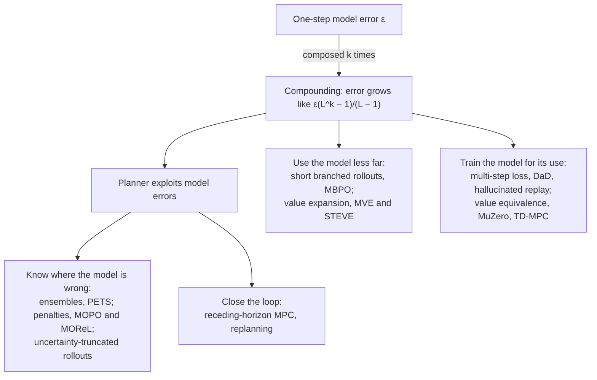

# Model-based RL: compounding error and how planners cope

A learned model of the world is only useful if you can *chain* it: predict the next state, feed that prediction back in, predict again, and plan over the result. But every link in that chain is slightly wrong, and the errors do not stay put. A model that is 99% accurate for one step can be useless after fifty, and a planner that searches hard over a flawed model will find the flaws and exploit them. This is the **compounding error problem**, and almost every design choice in modern model-based reinforcement learning is an answer to it.

The [world models](world-models.md) page introduces the idea of learning a simulator and planning inside it. This page goes into what goes wrong when you do: why errors grow, why the one-step training loss is not the thing you care about, and the families of fixes, from short branched rollouts and value expansion to uncertainty penalties, replanning, decoder-free latent models and the 2025–2026 push towards rollouts hundreds of steps long. A tested NumPy sketch reproduces, in miniature, how the true dynamics set the shape of the error curve, how training on a multi-step loss beats a better-looking one-step fit, why the best rollout length depends on how much you trust your value function, and why replanning rescues a badly wrong model.

> The core idea in one sentence: **a learned model is a function you will compose with itself, so judge it by the error of the composition and the decisions it supports, not by its one-step loss, and use it only as far ahead as its errors stay smaller than the errors of the alternatives.**



## 1. Why errors compound (established)

Let the true dynamics be $s_{t+1} = f(s_t, a_t)$ and the learned model $\hat f$, with one-step error at most $\varepsilon$ on the states it is used on, $\lVert \hat f(s,a) - f(s,a)\rVert \le \varepsilon$. Roll both forward from the same state under the same actions, and let $e_k = \hat s_k - s_k$. Adding and subtracting $\hat f(s_k, a_k)$,

```math
e_{k+1} = \underbrace{\hat f(\hat s_k, a_k) - \hat f(s_k, a_k)}_{\text{old error, pushed through the model}} + \underbrace{\hat f(s_k, a_k) - f(s_k, a_k)}_{\text{new one-step error}} .
```

If $\hat f$ is $L$-Lipschitz in the state, $\lVert e_{k+1}\rVert \le L\lVert e_k\rVert + \varepsilon$, so

```math
\lVert e_k \rVert \;\le\; \varepsilon\,\frac{L^k - 1}{L - 1} \qquad (L \ne 1), \qquad \lVert e_k\rVert \le k\,\varepsilon \quad (L = 1).
```

Three regimes follow. When the model contracts ($L < 1$) the error saturates at $\varepsilon/(1-L)$: old mistakes are forgotten. When it is marginal ($L = 1$) the error grows linearly. When it expands ($L > 1$), as in unstable or chaotic systems, the error grows geometrically and a model with a tiny one-step loss can be worthless within a few dozen steps. Asadi, Misra and Littman (2018) proved a version of this bound for stochastic models with the error measured in Wasserstein distance, extended it to the value function, and showed empirically that controlling the Lipschitz constant of a neural model helps.

The point is that **the system, not just the model, sets the shape of the error curve.** Lambert, Pister and Calandra (2022) studied compounding error across systems, data collection schemes and training choices on simulated and real robot data, and found that the underlying dynamics of the system were the strongest factor determining the shape and magnitude of long-horizon prediction error. Part 1 of the sketch reproduces this with three linear systems whose models have almost the same one-step error.

### From state error to value error

Planning cares about returns, not states. The classical way to connect the two is the **simulation lemma**, in the spirit of Kearns and Singh's (2002) analysis of near-optimal RL: if rewards lie in $[0, R_{\max}]$ and the model's next-state distribution is within $\varepsilon$ in total variation of the true one at every state and action, then for any policy $\pi$, one common form of the bound is

```math
\big| V^\pi_{M}(s) - V^\pi_{\hat M}(s) \big| \;\le\; \frac{\gamma\, \varepsilon\, R_{\max}}{(1-\gamma)^2}.
```

One factor of $1/(1-\gamma)$ is the effective horizon over which errors accumulate; the other is the size of the values being mis-propagated. With $\gamma = 0.99$ the multiplier is about $10^4$, which is why small per-step errors become large value errors and why most practical algorithms avoid using a model over its full effective horizon.

### The planner makes it worse

Errors are not just carried; they are *sought out*. An optimizer that maximizes predicted return over a flawed model will preferentially choose actions where the model is optimistically wrong, a form of Goodhart's law. This **model exploitation** is why open-loop optimization over a learned model often looks excellent in imagination and fails in the real environment, and why the uncertainty methods of Section 4 exist.

## 2. The training objective is not the use (established)

Most models are trained by maximum likelihood on *one-step* transitions from the data, then used *many steps ahead* on states the planner chooses. Two mismatches hide in that sentence.

**Horizon mismatch.** At step $k$ of a rollout the model is fed its own previous prediction $\hat s_{k}$, which may lie off the data distribution. This is the same train/test mismatch as exposure bias in sequence models. Three classical responses:

- **Data as Demonstrator (DaD).** Venkatraman, Hebert and Bagnell (2015) roll the model out on training trajectories, pair each *predicted* state with the *true* next state, add those pairs to the training set and refit, so the model learns to steer back towards the data. It is a no-regret, DAgger-style reduction that improves multi-step prediction of learned time-series models.
- **Hallucinated replay and self-correction.** Talvitie's hallucinated replay (introduced in 2014 and analysed in Talvitie 2017) trains the model to correct itself when it starts from its own erroneous predictions, and proves an error bound showing that a model's ability to self-correct is more tightly related to model-based RL performance than its one-step error.
- **Agnostic system identification.** Ross and Bagnell (2012) give an iterative method that collects data under the policies the model induces and, using any no-regret online learner, obtains a near-optimal policy guarantee even when the true system is not in the model class.

**Objective mismatch.** Even a model that predicts well over many steps may spend its capacity on the wrong things. Lambert, Amos, Yadan and Calandra (2020) named this the **objective mismatch** problem: the likelihood of one-step predictions is not always correlated with control performance, because a model useful for a task need not be globally accurate, and a globally accurate model may not be accurate enough where the task needs it. They proposed re-weighting model training towards task-relevant data as a first fix.

The most radical answer is to stop predicting observations at all. Grimm, Barreto, Singh and Silver (2020) formalized the **value equivalence principle**: two models are equivalent with respect to a set of policies and functions if they produce the same Bellman updates. As the set grows, the class of value-equivalent models shrinks to the true model; for a restricted set, much simpler models suffice. They argue that this principle underlies MuZero, which learns a latent model that predicts only reward, value and policy (Schrittwieser et al. 2020; see the [world models](world-models.md) page), as well as Value Iteration Networks, the Predictron, Value Prediction Networks and TreeQN.

## 3. Use the model only as far as you trust it (established)

If error grows with horizon, the simplest fix is to use short horizons and fill in the rest with something else.

**Model-based value expansion (MVE).** Feinberg et al. (2018) used a learned model for a fixed short horizon $H$ to improve the targets of a model-free critic:

```math
\hat Q_{\text{target}}(s_0, a_0) \;=\; \sum_{t=0}^{H-1} \gamma^t\, \hat r_t \;+\; \gamma^H\, \hat V(\hat s_H),
```

where the rewards and $\hat s_H$ come from the model. Larger $H$ reduces reliance on the (biased) critic, whose error is discounted by $\gamma^H$, but increases reliance on the (compounding) model. Part 3 of the sketch shows the trade: with a perfect critic the best $H$ is zero, with a biased critic it grows, and the noisier the model the sooner it should hand over to the critic.

**Stochastic ensemble value expansion (STEVE).** Buckman, Hafner, Tucker, Brevdo and Lee (2018) removed the fixed $H$: they compute targets for every horizon with an ensemble of models and critics and interpolate between them per example, weighting each horizon by the inverse of its ensemble variance, so the model is used only where it does not introduce significant error. They report an order-of-magnitude gain in sample efficiency over model-free baselines on continuous control, without the degradation in complex environments that hit earlier model-based methods.

**Short branched rollouts (MBPO).** Janner, Fu, Zhang and Levine (2019), "When to trust your model", analysed when model-generated data helps policy optimization. Their monotonic-improvement bound is too pessimistic in practice, suggesting real off-policy data always beats model data, but incorporating an empirical estimate of how the model's error generalizes justifies model use. The resulting recipe branches *short* model rollouts from states sampled out of the real replay buffer, rather than long rollouts from the start state, so that errors never compound far. MBPO surpassed the sample efficiency of prior model-based methods, matched the asymptotic performance of the best model-free algorithms, and scaled to horizons where other model-based methods failed. Branching from real states has since become a default; Zhang et al. (2026) adapt it to chunk-level branched rollouts when fine-tuning vision-language-action robot policies inside a pixel-space world model, where sparse rewards make small prediction errors flip outcomes.

## 4. Know where the model is wrong (established; active research)

Compounding error is dangerous because the planner cannot tell good predictions from bad ones. Epistemic uncertainty estimates let it.

**Probabilistic ensembles (PETS).** Chua, Calandra, McAllister and Levine (2018) trained an ensemble of probabilistic neural dynamics models, separating aleatoric noise (each model's predicted variance) from epistemic uncertainty (disagreement between models), and propagated both through planning by trajectory sampling. PETS matched the asymptotic performance of model-free algorithms on several benchmarks while needing, for example, 8 times fewer samples than Soft Actor-Critic and 125 times fewer than PPO on half-cheetah.

**Pessimism for offline RL.** When the model is learned from a fixed dataset and the agent can never collect more, exploitation of model error is the central failure. Two 2020 methods turned uncertainty into pessimism:

| Method | How uncertainty is used | Guarantee |
|---|---|---|
| **MOPO** (Yu et al. 2020) | Reward is penalized by an estimate of the model's uncertainty, $\tilde r(s,a) = \hat r(s,a) - \lambda\, u(s,a)$ | The policy maximizes a lower bound on its return in the true MDP |
| **MOReL** (Kidambi et al. 2020) | Builds a *pessimistic MDP* in which state-actions with high model disagreement lead to an absorbing low-reward halt state | Performance in the real environment is approximately lower-bounded by performance in the pessimistic MDP; minimax optimal up to log factors |

**Uncertainty as a stopping rule.** A newer use of the same estimates is to *truncate* rollouts adaptively once epistemic uncertainty crosses a threshold, instead of fixing a short horizon. Ni et al. (2025) argue that explicit conservatism is not universally right: with a posterior over world models and a history-dependent agent, they find that long rollouts are *needed* to control value overestimation once penalties are removed, and make them feasible with uncertainty-thresholded truncation and layer normalization inside a delta-predicting world model. Their algorithm, Neubay, is competitive with leading conservative methods on D4RL and NeoRL and sets a new state of the art on seven datasets, with rollout horizons of several hundred steps. Zymla, Thiele and Pitz (2026) apply uncertainty-driven truncation to world-model *training* itself, with a five-head ensemble or Monte Carlo dropout, and report on the ANYmal-D legged robot comparable final performance to fixed-horizon baselines with roughly 72% less rollout computation.

**Making the model provably stable.** A complementary 2026 line constrains the model so its rollouts cannot blow up. Maalberg, Neumann and Knobloch (2026) blend a provably contracting nominal model with a flexible "excursion" model, switching on calibrated epistemic uncertainty; under stated smoothness and boundedness assumptions, recursive rollouts stay Lyapunov-stable in the nominal region and grow at most affinely during excursions. Their experiments are on a nonlinear Duffing oscillator, so this is an early result. In the language of Section 1, it engineers $L \le 1$ where the model is used.

## 5. Close the loop: replanning (established)

A world model used *open loop*, planning a whole action sequence and executing it blind, pays for every error. **Receding-horizon model predictive control (MPC)** plans over a horizon, executes only the first action, observes the real next state and replans. Each real observation resets the rollout error to zero, so the model only needs to be right about the *direction* of improvement over a short window. PETS plans this way, and Part 4 of the sketch shows MPC hitting a target with a model whose control gain is 30% wrong, where the open-loop plan misses by a quarter of the distance.

**TD-MPC** (Hansen, Wang and Su 2022) and **TD-MPC2** (Hansen, Su and Wang 2023) combine the ideas: a decoder-free latent model trained for reward and value prediction rather than reconstruction (value equivalence in practice), short-horizon trajectory optimization in that latent space, and a learned terminal value beyond the horizon (value expansion in practice). TD-MPC2 improved significantly over baselines across 104 online RL tasks in four domains with a single set of hyperparameters, and a single 317M-parameter agent performed 80 tasks across domains, embodiments and action spaces, with capabilities increasing with model and data size.

## 6. Long imagination at scale (active research)

The opposite strategy is to make the model so good that long rollouts become safe. DreamerV3 (Hafner et al. 2023) learned behaviours entirely in imagined latent trajectories and collected diamonds in Minecraft from scratch (see [world models](world-models.md)). **Dreamer 4** (Hafner, Yan and Lillicrap 2025) trains a fast, accurate transformer world model with a *shortcut forcing* objective that runs interactively in real time on a single GPU, learns most of its knowledge from unlabelled video with action conditioning from a small amount of labelled data, and becomes the first agent to obtain diamonds in Minecraft *purely from offline data*, a task requiring sequences of over 20,000 mouse and keyboard actions from raw pixels. Video world models such as Genie (Bruce et al. 2024) push the same bet further. Whether these models avoid compounding error or merely push it to longer horizons than current tasks probe is an open question; the honest test is closed-loop task success, not how plausible imagined video looks.

## 7. A tested sketch

The code below is a deliberately small set of experiments. All systems and numbers are synthetic; the point is the mechanisms of Sections 1–5.

- **Part 1** fits a linear model by least squares to 200 noisy transitions of three 2-D rotation systems with spectral radius $\rho = 0.90, 1.00, 1.03$, and measures the error of $k$-step rollouts from 500 unit-norm starts.
- **Part 2** fits an affine model to a damped pendulum (swings up to 1.5 rad, where $\sin\theta \ne \theta$, so the model class is wrong), once by one-step least squares and once by minimizing the 30-step rollout error on the same training trajectories, and tests both on 200 new trajectories.
- **Part 3** estimates the value of a 1-D linear system, $x' = 0.98x$, reward $-x^2$, $\gamma = 0.99$, with $k$-step value expansion: a model whose coefficient is wrong by a random amount with standard deviation $\sigma$ (4,000 draws, standing in for epistemic error) and a critic that overstates cost by a fixed bias. It reports the root-mean-square relative error of the target.
- **Part 4** drives a 1-D point mass from rest at $x = 0$ to rest at $x = 1$ in 40 steps with a model whose control gain is 1.3 instead of 1.0, open loop versus replanning every step, with and without state noise.

```python
import numpy as np
rng = np.random.default_rng(0)

# ---- Part 1: the same one-step error, three different dynamics ----
print("Part 1: k-step error of a least-squares linear model, by spectral radius of the true system")
def rot(rho, th=0.3):
    return rho * np.array([[np.cos(th), -np.sin(th)], [np.sin(th), np.cos(th)]])
for rho in (0.90, 1.00, 1.03):
    A = rot(rho)
    X = rng.standard_normal((200, 2)); Y = X @ A.T + 0.05 * rng.standard_normal((200, 2))
    Ahat = np.linalg.lstsq(X, Y, rcond=None)[0].T
    x0 = rng.standard_normal((500, 2)); x0 /= np.linalg.norm(x0, axis=1, keepdims=True)
    xt, xh, errs = x0.copy(), x0.copy(), {}
    for k in range(1, 51):
        xt = xt @ A.T; xh = xh @ Ahat.T
        if k in (1, 10, 50):
            errs[k] = np.mean(np.linalg.norm(xh - xt, axis=1))
    print(f"  rho={rho:.2f}: one-step model error ||Ahat-A||={np.linalg.norm(Ahat-A,2):.4f}; mean error at k=1 {errs[1]:.4f}, k=10 {errs[10]:.4f}, k=50 {errs[50]:.4f}  (k50/k1 = {errs[50]/errs[1]:.1f}x)")

# ---- Part 2: misspecified model; one-step fit vs Data-as-Demonstrator (DaD) ----
print("Part 2: linear model of a damped pendulum, one-step least squares vs a multi-step rollout loss")
dt = 0.1
def f(s):  # true dynamics: damped pendulum, state (angle, velocity)
    th, w = s[..., 0], s[..., 1]
    return np.stack([th + dt * w, w + dt * (-9.8 * np.sin(th) - 0.3 * w)], -1)
AMP = 1.5
H, ntraj = 30, 40
S0 = np.column_stack([rng.uniform(-AMP, AMP, ntraj), rng.uniform(-1, 1, ntraj)])
traj = [S0]
for _ in range(H): traj.append(f(traj[-1]))
traj = np.stack(traj, 1)                         # (ntraj, H+1, 2)
Xin = traj[:, :-1].reshape(-1, 2); Yout = traj[:, 1:].reshape(-1, 2)
def fit(Xi, Yo):
    Z = np.column_stack([Xi, np.ones(len(Xi))]); return np.linalg.lstsq(Z, Yo, rcond=None)[0]
def step(W, s): return np.column_stack([s, np.ones(len(s))]) @ W
def rollout_err(W, T):
    s = T[:, 0]; e = []
    for t in range(1, T.shape[1]):
        s = step(W, s); e.append(np.mean(np.linalg.norm(s - T[:, t], axis=1)))
    return np.array(e)
S0te = np.column_stack([rng.uniform(-AMP, AMP, 200), rng.uniform(-1, 1, 200)])
te = [S0te]
for _ in range(H): te.append(f(te[-1]))
te = np.stack(te, 1)
W = fit(Xin, Yout)
def onestep(W, T): return np.mean(np.linalg.norm(step(W, T[:, :-1].reshape(-1, 2)) - T[:, 1:].reshape(-1, 2), axis=1))
e0 = rollout_err(W, te); print(f"  one-step LS : test one-step err {onestep(W, te):.4f}, {H}-step rollout mean err {e0.mean():.3f}, final {e0[-1]:.3f}")
# multi-step objective: mean H-step rollout error on the training trajectories, minimised from the
# one-step solution by finite-difference gradient descent with Adam (6 parameters)
def msloss(w): return np.mean(rollout_err(w.reshape(3, 2), traj) ** 2)
w = W.ravel().copy(); m = np.zeros_like(w); v2 = np.zeros_like(w); lr, h = 2e-3, 1e-5
for i in range(1, 3001):
    gr = np.array([(msloss(w + h * e) - msloss(w - h * e)) / (2 * h) for e in np.eye(6)])
    m = 0.9 * m + 0.1 * gr; v2 = 0.999 * v2 + 0.001 * gr**2
    w -= lr * (m / (1 - 0.9**i)) / (np.sqrt(v2 / (1 - 0.999**i)) + 1e-8)
Wm = w.reshape(3, 2); e1 = rollout_err(Wm, te)
print(f"  multi-step  : test one-step err {onestep(Wm, te):.4f}, {H}-step rollout mean err {e1.mean():.3f}, final {e1[-1]:.3f}")

# ---- Part 3: model-based value expansion, rollout length k vs critic bias ----
print("Part 3: k-step value expansion with an uncertain model and a biased critic (RMS relative error)")
g, a_true = 0.99, 0.98                      # true x' = a x, reward -x^2, start x0 = 1
Vtrue = lambda x: -x**2 / (1 - g * a_true**2)
ks = np.arange(0, 101)
for sig in (0.002, 0.005):                  # spread of the learned model's coefficient (epistemic error)
    a_model = a_true + sig * rng.standard_normal(4000)
    for vbias in (0.3, 0.1, 0.0):           # critic over-penalises by vbias
        E = []
        for k in ks:
            t = np.arange(k)[:, None]
            ret = -(g**t * a_model[None, :]**(2 * t)).sum(0) + g**k * (1 + vbias) * Vtrue(a_model**k)
            E.append(np.sqrt(np.mean((ret - Vtrue(1.0))**2)) / abs(Vtrue(1.0)))
        E = np.array(E); kb = int(E.argmin())
        print(f"  model sd {sig:.3f}, critic bias {vbias:4.0%}: k=0 {E[0]:.3f}, k=5 {E[5]:.3f}, k=20 {E[20]:.3f}, k=100 {E[100]:.3f}; best k={kb} ({E[kb]:.3f})")

# ---- Part 4: open-loop planning vs receding-horizon MPC under a wrong model ----
print("Part 4: drive a 1-D point mass to x=1 with a model whose control gain is 30% too high")
dtm, T = 0.1, 40
def sim(x, v, u, gain): return x + dtm * v, v + dtm * gain * u
def plan(x, v, steps, gain=1.3):
    # min sum u^2 * 1e-3 + terminal (x-1)^2 + v^2 for linear dynamics: build x_T, v_T = c + B u
    n = steps; Bx = np.array([dtm * dtm * gain * (n - 1 - i) for i in range(n)]); Bv = np.full(n, dtm * gain)
    cx, cv = x + n * dtm * v, v
    M = np.outer(Bx, Bx) + np.outer(Bv, Bv) + 1e-3 * np.eye(n)
    return np.linalg.solve(M, Bx * (1 - cx) - Bv * cv)
u = plan(0.0, 0.0, T); x = v = 0.0
for t in range(T): x, v = sim(x, v, u[t], 1.0)
print(f"  open loop : final position {x:.3f} (miss {abs(x-1):.3f}), velocity {v:.3f}")
for noise in (0.0, 0.02):
    x = v = 0.0
    for t in range(T):
        u = plan(x, v, T - t); x, v = sim(x, v, u[0], 1.0)
        x += noise * rng.standard_normal()
    print(f"  MPC replanning every step (state noise {noise}): final position {x:.3f} (miss {abs(x-1):.3f}), velocity {v:.3f}")
```

Output:

```text
Part 1: k-step error of a least-squares linear model, by spectral radius of the true system
  rho=0.90: one-step model error ||Ahat-A||=0.0084; mean error at k=1 0.0055, k=10 0.0189, k=50 0.0016  (k50/k1 = 0.3x)
  rho=1.00: one-step model error ||Ahat-A||=0.0041; mean error at k=1 0.0028, k=10 0.0149, k=50 0.0750  (k50/k1 = 26.5x)
  rho=1.03: one-step model error ||Ahat-A||=0.0062; mean error at k=1 0.0040, k=10 0.0423, k=50 0.6589  (k50/k1 = 165.2x)
Part 2: linear model of a damped pendulum, one-step least squares vs a multi-step rollout loss
  one-step LS : test one-step err 0.1447, 30-step rollout mean err 1.057, final 1.800
  multi-step  : test one-step err 0.1381, 30-step rollout mean err 0.777, final 1.589
Part 3: k-step value expansion with an uncertain model and a biased critic (RMS relative error)
  model sd 0.002, critic bias  30%: k=0 0.300, k=5 0.235, k=20 0.128, k=100 0.082; best k=100 (0.082)
  model sd 0.002, critic bias  10%: k=0 0.100, k=5 0.081, k=20 0.067, k=100 0.081; best k=18 (0.066)
  model sd 0.002, critic bias   0%: k=0 0.000, k=5 0.018, k=20 0.051, k=100 0.081; best k=0 (0.000)
  model sd 0.005, critic bias  30%: k=0 0.300, k=5 0.240, k=20 0.192, k=100 0.235; best k=19 (0.192)
  model sd 0.005, critic bias  10%: k=0 0.100, k=5 0.092, k=20 0.142, k=100 0.232; best k=4 (0.091)
  model sd 0.005, critic bias   0%: k=0 0.000, k=5 0.044, k=20 0.127, k=100 0.231; best k=0 (0.000)
Part 4: drive a 1-D point mass to x=1 with a model whose control gain is 30% too high
  open loop : final position 0.768 (miss 0.232), velocity 0.002
  MPC replanning every step (state noise 0.0): final position 1.008 (miss 0.008), velocity 0.014
  MPC replanning every step (state noise 0.02): final position 1.043 (miss 0.043), velocity -0.019
```

### Reading the results

**Part 1: the dynamics set the curve.** The three models have one-step operator errors of 0.0084, 0.0041 and 0.0062, all tiny. For the contracting system ($\rho = 0.90$) the rollout error rises to 0.0189 at $k = 10$ and then *falls* to 0.0016 at $k = 50$, below its one-step value, because both true and modelled states decay towards zero. The marginal system's error grows **26.5×** from $k = 1$ to $k = 50$, and the slightly expanding system's grows **165×**, to 0.659 on unit-norm states, even though its one-step error is smaller than the contracting model's. This is the Lambert et al. (2022) finding and the $L^k$ bound of Section 1 in two dimensions.

**Part 2: a worse-looking objective, a better model for rollouts.** Under the wrong model class, the one-step fit has a 30-step mean rollout error of 1.057 (Euclidean norm over angle and angular velocity) and a final error of 1.800. Optimizing the 30-step rollout loss directly cuts the mean rollout error by about **26%**, to 0.777, and the final error to 1.589. (Here the multi-step model's test one-step error, 0.1381, also came out slightly below the least-squares fit's 0.1447, because the test starts differ from the training ones; the one-step fit is optimal only on its own training transitions.) The lesson is the objective-mismatch one: the loss used to fit the model should match how it will be used.

**Part 3: how far to trust the model depends on the critic.** With an unbiased critic, $k = 0$ (no model) is best and every model step adds error. With a 10% critic bias and a good model ($\sigma = 0.002$), the best expansion is $k = 18$, cutting the error from 0.100 to 0.066; with a 30% bias it keeps improving to the end of the scan, $k = 100$ (0.082). With a noisier model ($\sigma = 0.005$) the optimum moves in: $k = 4$ for a 10% bias (0.091) and $k = 19$ for 30% (0.192). This is the trade MVE fixes by hand and STEVE resolves per example with ensemble variances.

**Part 4: replanning absorbs model error.** The open-loop plan, optimal for the wrong model, stops at 0.768, missing the target by 0.232, because every control was 30% weaker than the model believed. Replanning every step from the observed state reaches 1.008 (miss 0.008), and with state noise of 0.02 per step still reaches 1.043 (miss 0.043). The model was never corrected; only the loop was closed.

## 8. Status at a glance

| Claim | Status |
|---|---|
| Composing a learned one-step model compounds error, geometrically for expanding dynamics | Established (Asadi et al. 2018; Lambert et al. 2022) |
| One-step likelihood is not a reliable proxy for control performance | Established empirically (Lambert et al. 2020; Talvitie 2017) |
| Short branched rollouts and value expansion make model-based methods competitive with model-free ones asymptotically while using far fewer samples | Established on standard continuous-control benchmarks (MBPO, STEVE, PETS) |
| Uncertainty-based pessimism gives lower bounds on true return in offline RL | Established theoretically under the papers' assumptions (MOPO, MOReL) |
| Long (hundreds of steps) rollouts are usable and sometimes necessary if truncated by uncertainty | Active research (Ni et al. 2025; Zymla et al. 2026) |
| Decoder-free value-equivalent latent models scale with model and data size | Active research, strong evidence on 104 tasks (TD-MPC2) |
| Large video world models can support training long-horizon behaviour purely offline | Early evidence in one domain (Dreamer 4, Minecraft) |
| Provably bounded rollouts via contracting hybrid models | Early theory and a toy experiment (Maalberg et al. 2026) |

## 9. Speculative: compounding error as a design budget

> [!WARNING]
> **Speculative.** These are open hypotheses, not established results.

- **Error budgets instead of horizons.** Several of the methods above (STEVE, uncertainty truncation, MOReL's halt state) can be read as spending a fixed budget of tolerable error rather than choosing a fixed horizon. A planner that allocates that budget across branches, as a tree search allocates visits, might use a model further where it is reliable and not at all where it is not.
- **Contraction as an architectural prior.** If the Lipschitz constant of the composed model sets the error curve, architectures that are contracting by construction (or that learn a contracting latent space in which the real system's instability lives only in a decoder) may be a better default than unconstrained networks plus normalization tricks. The 2026 hybrid-dynamics result is a small step in this direction; whether it scales to pixel-based models is unknown.
- **Multi-timescale models.** Errors compound per *call*, not per second. Models that predict over several temporal resolutions, linked to the hierarchical ideas on the [world models](world-models.md) and [self-similar structure](fractal-and-self-similar-structure.md) pages, would take fewer composed steps over a long horizon. Whether coarse-step models stay accurate enough to plan with is the open question.
- **Physical simulators as noisy models.** Analogue and optical hardware that runs a dynamical system natively (see [non-linearity and dynamical systems](nonlinearity-and-dynamical-systems.md) and [photonic computing](photonic-computing.md)) would act as a fast world model with its own device noise and drift. The same compounding analysis would then apply to the hardware's error per step, which suggests measuring such devices by their composed-rollout error rather than per-operation precision.

## Further reading

- Moerland, Broekens, Plaat and Jonker (2020), *Model-based reinforcement learning: a survey*, for the wider landscape.
- Janner et al. (2019) for the clearest analysis of when model-generated data helps.
- Lambert, Pister and Calandra (2022) for an empirical study of compounding error itself.
- Hansen, Su and Wang (2023) and Hafner, Yan and Lillicrap (2025) for the current scaled-up recipes.

Full citations are in [REFERENCES.md](../../REFERENCES.md#frontiers-model-based-rl-and-compounding-error).
