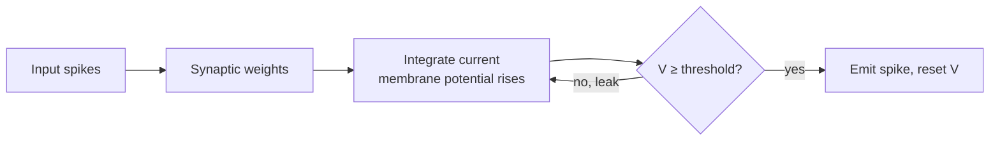

# Neuromorphic computing

The human brain runs on a tiny power budget compared with data-centre hardware, with memory and computation intertwined in the same tissue and communication through sparse, discrete **spikes**. Neuromorphic computing borrows those principles to build hardware and algorithms that compute differently from conventional processors.

## Origins (established)

Carver Mead (1990) coined *neuromorphic* for analog VLSI circuits that emulate neural and sensory systems, exploiting transistor physics directly rather than abstracting it into digital logic. Today the term covers any architecture built on brain-inspired principles:

| Principle | Conventional processor | Neuromorphic approach |
|---|---|---|
| Memory and compute | Separate (memory wall) | Co-located in each neuron/synapse |
| Communication | Dense numbers on a clock | Sparse spikes, often event-driven and asynchronous |
| Activity | Every unit computes every step | Only active units consume energy |
| Learning | Global backpropagation offline | Often local rules, potentially on chip |

## Spiking neural networks (SNNs)

Maass (1997) described spiking networks as the "third generation" of neural network models, after threshold units and continuous-activation units. The standard neuron model is the **leaky integrate-and-fire (LIF)** neuron:

```math
\tau_m \frac{dV(t)}{dt} = -\big(V(t) - V_{\text{rest}}\big) + R\, I(t)
```

When the membrane potential $V$ crosses a threshold $V_{\text{th}}$, the neuron emits a spike and $V$ resets. Information can be carried by spike rates, precise timing, or population patterns.



### Training SNNs

The spike function is a step, so its derivative is zero almost everywhere, which blocks backpropagation. Approaches include:

- **Surrogate gradients** (Neftci, Mostafa & Zenke 2019): use the true step function forward but a smooth approximation of its derivative backward.
- **ANN-to-SNN conversion**: train a conventional network and map its activations to spike rates.
- **Local plasticity rules** such as spike-timing-dependent plasticity (STDP), which strengthen a synapse when the presynaptic spike precedes the postsynaptic one.

## Hardware (established)

- **IBM TrueNorth** (Merolla et al. 2014): a chip with one million spiking neurons and 256 million synapses, using an asynchronous, event-driven design with very low power.
- **Intel Loihi** (Davies et al. 2018): a many-core neuromorphic research chip with programmable on-chip learning rules.
- **Analog in-memory computing**: crossbars of resistive or phase-change devices compute matrix–vector products in place via Ohm's and Kirchhoff's laws, avoiding weight movement. This sits between neuromorphic and conventional accelerators; devices, non-idealities and landmark chips are covered in [Memristive crossbars and in-memory computing](memristive-crossbars-in-memory-computing.md).
- **Neuromorphic photonics**: spiking and weighted networks built from lasers and microring resonators (Tait et al. 2017; Shastri et al. 2021); see [Photonic computing](photonic-computing.md).

A broad review is given by Roy, Jaiswal & Panda (2019).

## Where it shines (active research)

- **Event cameras and sensors**: sensors that output changes rather than frames pair naturally with spiking processors.
- **Always-on, low-power edge inference**: keyword spotting, gesture recognition, anomaly detection.
- **Temporal and sparse data**: problems where activity is naturally sparse in time.

## Open challenges

- **Accuracy gap**: on many standard benchmarks, SNNs still trail conventional deep networks of similar size, though the gap has narrowed with surrogate-gradient training.
- **Software ecosystem**: tools, compilers, and benchmarks are far less mature than for GPUs.
- **Fair comparisons**: energy claims depend heavily on workload, sparsity, and what is counted; like-for-like benchmarks are difficult.

## Speculative directions

> [!WARNING]
> **Speculative.** These are open hypotheses.

- **Spiking transformers and language models.** Whether large-scale sequence models can be made natively spiking without losing quality, and with large real energy savings, is unresolved.
- **Continual, on-chip learning.** Local learning rules on neuromorphic hardware might enable systems that keep learning after deployment, a capability conventional models handle poorly.
- **Brains as the scaling existence proof.** The brain shows that general intelligence is possible at very low power; how much of its efficiency comes from spikes specifically, versus sparsity, analog physics, or architecture, is not known.

## Next topics for this page

- Temporal coding schemes and their information capacity
- Benchmarks such as keyword spotting on neuromorphic hardware
