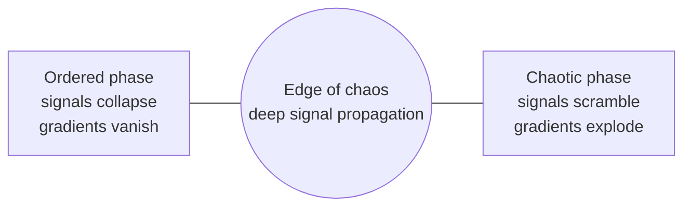

# Non-linearity and dynamical systems

Without non-linearity, a deep network is just one matrix. With it, networks become **nonlinear dynamical systems**, capable of the full richness, and the full unpredictability, that phrase implies: attractors, bifurcations, and chaos. This page connects deep learning to the mathematics of dynamics.

## Why non-linearity is essential (established)

Compositions of linear maps are linear: $W_L \cdots W_2 W_1 \mathbf{x} = W\mathbf{x}$. Inserting an elementwise nonlinearity $\sigma$ between layers is what allows depth to build increasingly complex functions, and what makes [universal approximation](../02-deep-learning/neural-networks-and-backprop.md#universal-approximation) possible.

Even *deep linear networks* are instructive: Saxe, McClelland & Ganguli (2013) solved their gradient-descent dynamics exactly and found nonlinear learning dynamics, with long plateaus followed by rapid transitions, despite the network computing a linear function. Non-linearity lives in training dynamics as well as in the function.

## Networks as dynamical systems

| Object | Dynamical system view |
|---|---|
| Recurrent network | Discrete map $\mathbf{h}_{t+1} = F(\mathbf{h}_t, \mathbf{x}_t)$ iterated over time |
| Deep (residual) network | Map iterated over **depth**: $\mathbf{h}_{\ell+1} = \mathbf{h}_\ell + f(\mathbf{h}_\ell)$ |
| Gradient descent | Map iterated over **training steps**: $\theta_{t+1} = \theta_t - \eta \nabla L(\theta_t)$ |

### Order, chaos, and the edge between

**Sompolinsky, Crisanti & Sommers (1988)** showed that large random recurrent networks undergo a transition from stable dynamics to **chaos** as the gain of their connections increases.

The same picture holds across depth in feed-forward networks. **Poole et al. (2016)** used mean-field theory to show that random deep networks have an *ordered* phase, where inputs converge and information is lost, and a *chaotic* phase, where nearby inputs diverge exponentially. **Schoenholz et al. (2016)** showed that information, and gradients, propagate through the deepest networks precisely near the boundary, the **edge of chaos**, which yields principled initialization schemes.



The quantity that decides the phase is a Lyapunov-like exponent: the average rate at which small perturbations grow or shrink,

```math
\lambda = \lim_{T\to\infty} \frac{1}{T} \log \frac{\lVert \delta \mathbf{h}_T \rVert}{\lVert \delta \mathbf{h}_0 \rVert}
```

$\lambda < 0$ is ordered; $\lambda > 0$ is chaotic. Exploding and vanishing gradients in RNNs (Pascanu, Mikolov & Bengio 2013) are the training-time face of the same phenomenon.

## Continuous-depth networks: Neural ODEs (established)

A residual update is an Euler step. Taking the step size to zero gives an **ordinary differential equation** (Chen et al. 2018):

```math
\frac{d\mathbf{h}(t)}{dt} = f_\theta\big(\mathbf{h}(t), t\big), \qquad \mathbf{h}(T) = \mathbf{h}(0) + \int_0^T f_\theta(\mathbf{h}(t), t)\, dt
```

The output is computed by an ODE solver, gradients by the adjoint method with memory cost constant in depth. **Liquid time-constant networks** (Hasani et al. 2021) are continuous-time RNNs whose time constants depend on the input.

## Reservoir computing: harnessing chaos (established)

What if you don't train the dynamics at all? **Echo state networks** (Jaeger & Haas 2004) and **liquid state machines** (Maass, Natschläger & Markram 2002) drive a fixed, random, nonlinear recurrent system, the *reservoir*, with the input, and train only a linear readout. The reservoir projects the input history into a high-dimensional space where it becomes linearly separable.

Reservoirs are remarkably good at modelling chaotic systems: Pathak et al. (2018) predicted the evolution of the spatiotemporally chaotic Kuramoto–Sivashinsky equation for several Lyapunov times. Because any sufficiently rich physical system can serve as the reservoir, this idea is central to **physical computing** with lasers and optics (see [Photonic computing](photonic-computing.md#reservoir-computing-in-optics)).

## Learning the equations of nature (established)

Machine learning increasingly *discovers* dynamics rather than merely approximating them:

- **SINDy** (Brunton, Proctor & Kutz 2016) uses sparse regression over a library of candidate terms to recover governing equations, such as the Lorenz system, from data.
- **Physics-informed neural networks** (Raissi, Perdikaris & Karniadakis 2019) put the residual of a differential equation into the loss, so solutions respect known physics.
- **Koopman operator theory** (Koopman 1931) represents nonlinear dynamics as *linear* dynamics on a space of observables; Lusch, Kutz & Brunton (2018) used deep networks to learn such linearizing coordinates.

The Lorenz system (Lorenz 1963), the classic example of deterministic chaos, is a standard benchmark:

```math
\dot x = \sigma(y - x), \qquad \dot y = x(\rho - z) - y, \qquad \dot z = xy - \beta z
```

## Memory as attractors (established)

**Hopfield networks** (Hopfield 1982) store memories as fixed-point attractors of an energy function; recall is the dynamics settling into the nearest basin. **Ramsauer et al. (2020)** showed that modern continuous Hopfield networks with exponential storage capacity have an update rule equivalent to transformer attention, which links attention to associative-memory dynamics.

## Training dynamics at the edge (active research)

- **Edge of stability** (Cohen et al. 2021): with full-batch gradient descent, the top Hessian eigenvalue rises until it hovers around $2/\eta$, where classical analysis predicts divergence, yet loss continues to decrease non-monotonically over long time scales.
- **Fractal trainability boundaries** (Sohl-Dickstein 2024): the boundary between convergent and divergent hyperparameters is fractal (see [Fractal structure](fractal-and-self-similar-structure.md#4-fractal-geometry-in-training-established-recent)).
- **Grokking and phase transitions** (Power et al. 2022): abrupt qualitative changes during training resemble bifurcations.
- **SGD as a diffusion**: with small learning rates, minibatch SGD behaves like a stochastic differential equation whose temperature is set by the learning rate over the batch size; see [SGD as a stochastic differential equation](sgd-as-a-stochastic-differential-equation.md).

## Speculative directions

> [!WARNING]
> **Speculative.** The ideas below are open hypotheses.

- **Criticality as a design target.** Biological neural circuits have been hypothesized to operate near criticality; whether deliberately tuning large models or physical substrates to criticality improves learning at scale is an open question.
- **Nonlinear physical substrates as learners.** If optical, electronic, or mechanical systems with rich nonlinear dynamics can be trained directly (as in Wright et al. 2022), the boundary between "simulating" a neural network and "being" one blurs.
- **Dynamical interpretability.** Describing what a model computes in terms of attractors, slow manifolds, and bifurcations might complement circuit-level interpretability.

## Next topics for this page

- Mean-field theory and the neural tangent kernel in more depth
- Continuous attractors and working memory in RNNs
- Stochastic differential equation views of SGD (now its own page: [SGD as a stochastic differential equation](sgd-as-a-stochastic-differential-equation.md))
