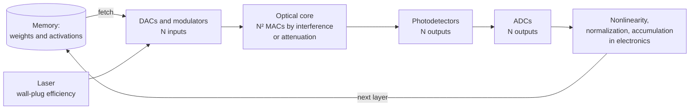
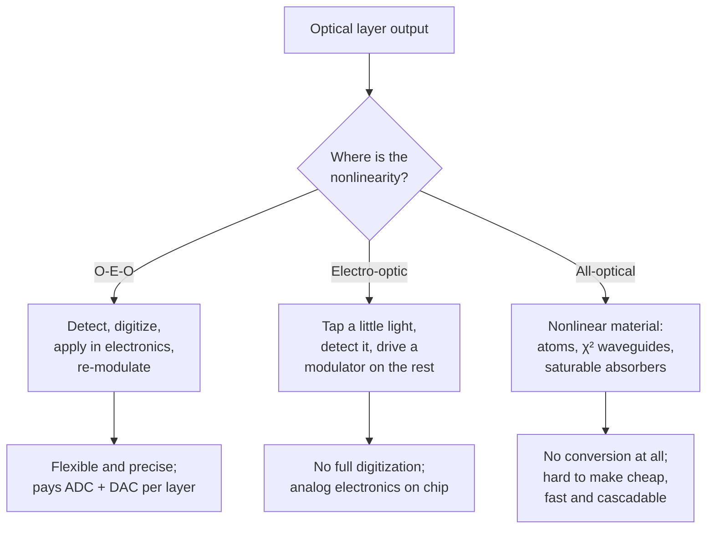

# Energy per MAC: the accounting of optical neural networks, and the nonlinearity problem

Claims about optical AI hardware are often stated as a single number: so many femtojoules, or so many photons, per multiply-accumulate (MAC). That number can mean very different things. It may count only the light that reaches the detectors, or the electrical power the laser draws from the wall, or the whole system: converters, memory, and control. The gap between these can be several orders of magnitude.

This page builds the accounting from the ground up. It shows where the energy goes, why optics can in principle win only on *large* matrices, what physics sets the floor, and why the hardest remaining problem is not multiplying but the **nonlinearity** between layers.

> **In one sentence.** An optical matrix-vector product converts $O(N)$ numbers in and out but performs $O(N^2)$ multiplications, so per-MAC conversion and optical costs fall like $1/N$, while costs that are paid *per weight*, such as fetching weights from memory, do not fall at all.

## 1. What digital hardware pays (established)

The reference point is digital electronics. Horowitz's widely reproduced ISSCC 2014 keynote tabulated approximate energies for basic operations in a 45 nm process:

| Operation (45 nm, approximate) | Energy |
|---|---|
| 8-bit integer add | 0.03 pJ |
| 8-bit integer multiply | 0.2 pJ |
| 32-bit floating-point multiply | 3.7 pJ |
| 64-bit read from an 8 KB SRAM | about 10 pJ |
| 64-bit DRAM access | about 1.3 to 2.6 nJ |

Two lessons follow, and both shape the optical story. First, **arithmetic is cheap and data movement is expensive**: one DRAM access costs as much as thousands of 8-bit multiplies. Second, **precision is expensive**: a multiplier's energy grows roughly with the square of its bit width. Newer process nodes have shrunk every entry, but the ordering has held, and it is the reason [compilers for ML](../04-systems/ml-compilers.md) work so hard on fusion and tiling.

For whole accelerators, Anderson et al. (2023) used **300 fJ/MAC** as their reference figure for state-of-the-art digital processors when comparing against optics.

## 2. Anatomy of an optical MAC (established)

An optical matrix-vector multiply $y = Wx$ with $W \in \mathbb{R}^{N \times N}$ has four stages, and each costs energy differently.



1. **Encoding.** $N$ input values are converted by digital-to-analog converters (DACs) and written onto light by modulators. If the weights are also encoded optically on every use, as in the photoelectric multiplication scheme of Hamerly et al. (2019), they need converters too.
2. **The optical core.** Light passes through a mesh of interferometers, a bank of microring resonators, or free-space optics. The $N^2$ multiplications happen in transit. The core itself is passive or nearly so; its cost is the optical power fed into it, plus any power to hold phase shifters at their settings.
3. **Detection.** $N$ photodetectors sum the contributions that arrive at each output, so accumulation is free: photocurrents add.
4. **Readout.** $N$ analog-to-digital converters (ADCs) turn photocurrents back into numbers for the electronic parts of the network.

Nahmias et al. (2020) give a detailed device-level comparison of photonic and electronic MACs along these lines.

## 3. The scaling argument (established)

Let $E_\text{DAC}$ and $E_\text{ADC}$ be the energy per conversion, $E_\text{opt}$ the optical energy per output, and $E_\text{mem}$ the memory energy per MAC. For one $N \times N$ product,

```math
E_\text{MAC} \;\approx\; \underbrace{\frac{N E_\text{DAC} + N E_\text{ADC}}{N^2}}_{\text{conversion}} \;+\; \underbrace{\frac{N E_\text{opt}}{N^2}}_{\text{optics}} \;+\; \underbrace{E_\text{mem}}_{\text{per weight}}
\;=\; \frac{E_\text{DAC} + E_\text{ADC} + E_\text{opt}}{N} + E_\text{mem}.
```

The first two terms fall as $1/N$: each conversion and each detected photon is shared by $N$ multiplications. This is the whole case for optical matrix multiplication, and it is why McMahon (2023) argues that the speed of light is *not* the key advantage of optics. What matters is that optics can perform very wide operations, paying per *vector element* rather than per *multiplication*.

The third term does not fall. If every weight must be read from memory and converted for every use, the system pays at least one memory access per MAC, just like a digital accelerator. Optical schemes therefore try to make weights **stationary** (held in phase shifters or non-volatile phase-change cells) or to **reuse** them across a large batch, or to **broadcast** them so that many devices share one fetch. Netcast (Sludds et al. 2022) takes the last route: a server streams weights over optical fiber to edge devices, which then never fetch weights from local memory at all.

Anderson et al. (2023) carried the argument to Transformers. In simulations validated by small optical experiments, they found that the optical energy per MAC scales as $1/d$, where $d$ is the model width, an asymptotic advantage over digital systems. Their projection, explicitly conditional on well-engineered large-scale optical hardware, was a possible advantage of about $100\times$ for some of the largest current Transformers, growing with model scale.

## 4. The physical floor: shot noise (established)

Light arrives in photons, and the count in any interval fluctuates. For a mean of $n$ detected photons, the standard deviation is $\sqrt{n}$ (Poisson statistics), so the signal-to-noise ratio is

```math
\text{SNR} = \frac{n}{\sqrt{n}} = \sqrt{n}.
```

To resolve an output to roughly $b$ bits we need $\text{SNR} \approx 2^b$, so each output detector needs about $n \approx 4^b$ photons. Since one output sums $N$ products, the photons needed **per MAC** are about $4^b / N$, which can be far less than one when $N$ is large. Hamerly et al. (2019) called the resulting bound the **standard quantum limit** for optical neural networks and estimated it can be as low as about 50 zJ per MAC in their architecture, below the Landauer limit for irreversible digital computation. (The comparison is suggestive rather than direct, since the optical system is analog and its computation is not a sequence of irreversible bit operations.)

> **A photon's worth of energy.** At the telecom wavelength of 1550 nm, one photon carries $hc/\lambda \approx 1.28 \times 10^{-19}$ J, about 0.13 aJ.

Experiments have approached this regime:

- **Below one photon per multiplication.** Wang et al. (2022) built a free-space optical processor performing up to about half a million scalar multiplications in parallel. It reached 99% accuracy on handwritten-digit classification with about 3.2 detected photons per multiplication, and about 90% with about 0.64 photons (about $2.4 \times 10^{-19}$ J of optical energy) per multiplication. The authors stress that this is optical energy only, and that with careful design of the surrounding electronics the total could reach about $10^{-16}$ J per multiplication.
- **Over deployed fiber.** Netcast (Sludds et al. 2022) achieved 98.8% accurate image recognition with 40 aJ of optical energy per multiply, operated below one photon per multiply with single-photon detectors, and classified images over 86 km of deployed fiber in the Boston area.

The neural network's own robustness is what makes this possible. Networks trained with noise tolerate low-SNR products, which connects to the noise-aware training ideas in [Photonic and optical computing](photonic-computing.md#training-physical-networks).

## 5. A worked budget, with code (illustrative)

The sketch below turns the formula into numbers. Every parameter is **illustrative**, chosen to show the shape of the trade-off, not measured from any device: 6-bit outputs, 1 pJ per DAC conversion, 2 pJ per ADC conversion, 5 fJ of memory energy per MAC, a 10% efficient laser, and 10 dB of optical loss.

```python
import numpy as np

H, C = 6.62607015e-34, 2.99792458e8          # Planck constant (J s), speed of light (m/s)

def energy_per_mac(n, bits, e_dac, e_adc, e_mem_per_mac, wavelength=1.55e-6,
                   laser_eff=0.1, link_loss_db=10.0):
    """Back-of-envelope energy per MAC (J) for one n x n optical matrix-vector product.

    Electronics: n DAC conversions in, n ADC conversions out, plus memory traffic.
    Optics: each of the n outputs needs ~4**bits detected photons for
    shot-noise-limited SNR ~ 2**bits; the light is shared by n MACs per output.
    """
    macs = n * n
    photon = H * C / wavelength
    detected = n * 4.0**bits * photon                    # optical energy at the detectors
    optical = detected * 10**(link_loss_db / 10) / laser_eff   # back out loss and wall-plug
    conversions = n * e_dac + n * e_adc
    total = optical + conversions + e_mem_per_mac * macs
    return {"optical": optical / macs, "conversion": conversions / macs,
            "memory": e_mem_per_mac, "total": total / macs}

for n in [64, 256, 1024, 4096]:
    e = energy_per_mac(n, bits=6, e_dac=1e-12, e_adc=2e-12, e_mem_per_mac=5e-15)
    print(f"n={n:5d}  " + "  ".join(f"{k}={v*1e15:8.3f} fJ" for k, v in e.items()))
```

Output:

```text
n=   64  optical=   0.820 fJ  conversion=  46.875 fJ  memory=   5.000 fJ  total=  52.695 fJ
n=  256  optical=   0.205 fJ  conversion=  11.719 fJ  memory=   5.000 fJ  total=  16.924 fJ
n= 1024  optical=   0.051 fJ  conversion=   2.930 fJ  memory=   5.000 fJ  total=   7.981 fJ
n= 4096  optical=   0.013 fJ  conversion=   0.732 fJ  memory=   5.000 fJ  total=   5.745 fJ
```

Three things stand out, and they hold for any reasonable choice of parameters:

- **The light is rarely the problem.** Even after a 10% efficient laser and 10 dB of loss, the optical term is the smallest. Headline "photons per MAC" figures describe this term only.
- **Conversions dominate small matrices.** At $N = 64$ the converters cost about ten times the memory term. Optical cores need to be wide, or the converters need to be shared across several products.
- **Memory sets the floor.** At large $N$ the total approaches $E_\text{mem}$, the one cost optics does not reduce. Weight-stationary designs and batching attack exactly this term.

Precision enters through $4^b$: each extra output bit quadruples the optical energy. That is why optical hardware favors low-precision inference, and why quantization research (see [Inference and efficiency](../04-systems/inference-and-efficiency.md)) matters so much to it.

## 6. The nonlinearity problem (established, with active research)

A deep network alternates linear maps with nonlinear activations. Optics is excellent at the first and poor at the second: in ordinary materials light is linear at low power, and the effects that make it nonlinear (the Kerr effect, saturable absorption, second-order $\chi^{(2)}$ processes) typically need high intensities or long interaction lengths.

The design choice is where to put the nonlinearity, and each option changes the energy budget.



**Optical-electrical-optical (O-E-O).** Most systems, including the [landmark demonstrations](photonic-computing.md#landmark-demonstrations), return to electronics between layers. This is flexible and precise, but it pays the full conversion cost of Section 3 at every layer, which is why it caps the achievable advantage.

**Electro-optic activations.** Williamson et al. (2020) proposed converting a small portion of each optical signal into an electrical signal that then intensity-modulates the remaining light, with no full digitization and no extra light source between layers. In simulation, adding this activation raised MNIST test accuracy from 85% to 94%. Bandyopadhyay et al. (2024) integrated programmable nonlinear optical function units of this kind on a single chip with coherent matrix units: a three-layer network trained in situ reached 92.7% accuracy on a vowel-classification test set, identical to a digital model with the same number of weights.

**All-optical activations.** Zuo et al. (2019) realized optical activations with electromagnetically induced transparency in laser-cooled atoms, combining them with linear layers made from spatial light modulators and Fourier lenses. Li et al. (2023) demonstrated an all-optical ReLU in a periodically poled thin-film lithium niobate waveguide, at energies of femtojoules per activation with near-instantaneous response. Wang et al. (2023) built multilayer optical networks with optical-to-optical nonlinearity and used them as optical front-ends that preprocess images before the light reaches an electronic sensor.

The remaining challenge is to make an all-optical activation that is simultaneously **low-energy, fast, compact, cascadable** (its output strong enough to drive the next layer without regeneration), and **manufacturable** alongside the linear core. No current approach does all five.

## 7. Where the field stands in 2025 (active research)

Two Nature papers published together in April 2025 show integrated photonics moving from benchmark demonstrations to complete systems:

- **Ahmed et al. (2025)** introduced a photonic processor that runs ResNet, BERT, and the Atari deep reinforcement-learning algorithm, reporting near-electronic precision for many workloads.
- **Hua et al. (2025)** reported an integrated accelerator with more than 16,000 photonic components, co-packaged with an electronics chip for logic, memory, and control, running at up to 1 GHz with latency as low as 3 ns per cycle, and used it to speed up heuristic solvers for Ising problems.

Both are hybrid systems: the optics performs the matrix products, while electronics handles memory, control, and nonlinear steps. That is the configuration the accounting above predicts will dominate until cheap, cascadable optical nonlinearities exist.

## 8. Reading energy claims critically

When a paper or press release quotes an energy per operation, ask:

1. **What is counted?** Detected optical energy, laser wall-plug energy, or the whole system including converters, memory, and control?
2. **At what precision?** Energy grows roughly as $4^b$ with output bits in the shot-noise regime; a 4-bit result is not comparable to an 8-bit one.
3. **At what size?** Per-MAC figures improve with matrix width, so check that the quoted $N$ matches the workload.
4. **Where are the weights?** Re-loading weights from memory on every use sets a floor that optics cannot lower.
5. **Where is the nonlinearity?** Every return to electronics between layers adds a full set of conversions.
6. **What is the baseline?** Compare against a current digital accelerator at the same precision, not against a general-purpose CPU.

McMahon (2023) lists 11 features of optics that could, in combination, deliver an advantage, and a number of pitfalls; it is the best single reference for this checklist.

## Speculative directions

> [!WARNING]
> **Speculative.** These are hypotheses and design ideas, not demonstrated results.

- **Compilers that budget energy as well as time.** A compiler for hybrid hardware could use the formula in Section 3 as a cost model: route only products wide enough to amortize conversions to the optical core, fuse consecutive linear layers to avoid intermediate readouts, and pick per-layer output precision from an explicit noise budget. Whether such cost models predict measured energy well is an open question.
- **Precision only where it is needed.** If some layers tolerate fewer output bits than others, and each bit costs a factor of four in optical energy, per-layer precision allocation could save more energy in optics than in digital hardware. This parallels the speculative use of layer spectra discussed in [Heavy-tailed weight spectra](heavy-tailed-weight-spectra.md).
- **Architectures shaped for optics.** Networks with fewer, wider linear maps and cheaper or rarer nonlinearities would suit optical accounting better. Whether such architectures can match the quality of today's Transformers is unknown.

## Further reading

- McMahon (2023), *The physics of optical computing*: why and when optics can beat electronics.
- Miller (2017), *Attojoule optoelectronics for low-energy information processing and communications*: the device-energy targets that optical interconnect and computing must meet.
- Nahmias et al. (2020), *Photonic multiply-accumulate operations for neural networks*: a device-level comparison of photonic and electronic MACs.

## References

All entries are listed in [REFERENCES.md](../../REFERENCES.md#frontiers-optical-energy-accounting-and-nonlinearity).

- Ahmed, S. R., et al. (2025). *Universal photonic artificial intelligence acceleration*. Nature 640, 368–374. [doi:10.1038/s41586-025-08854-x](https://doi.org/10.1038/s41586-025-08854-x)
- Anderson, M. G., Ma, S.-Y., Wang, T., Wright, L. G., McMahon, P. L. (2023). *Optical transformers*. [arXiv:2302.10360](https://arxiv.org/abs/2302.10360)
- Bandyopadhyay, S., et al. (2024). *Single-chip photonic deep neural network with forward-only training*. Nature Photonics 18, 1335–1343. [doi:10.1038/s41566-024-01567-z](https://doi.org/10.1038/s41566-024-01567-z) ([arXiv:2208.01623](https://arxiv.org/abs/2208.01623))
- Hamerly, R., Bernstein, L., Sludds, A., Soljačić, M., Englund, D. (2019). *Large-scale optical neural networks based on photoelectric multiplication*. Physical Review X 9, 021032. [doi:10.1103/PhysRevX.9.021032](https://doi.org/10.1103/PhysRevX.9.021032)
- Horowitz, M. (2014). *1.1 Computing's energy problem (and what we can do about it)*. ISSCC, 10–14. [doi:10.1109/ISSCC.2014.6757323](https://doi.org/10.1109/ISSCC.2014.6757323)
- Hua, S., et al. (2025). *An integrated large-scale photonic accelerator with ultralow latency*. Nature 640, 361–367. [doi:10.1038/s41586-025-08786-6](https://doi.org/10.1038/s41586-025-08786-6)
- Li, G. H. Y., Sekine, R., Nehra, R., Gray, R. M., Ledezma, L., Guo, Q., Marandi, A. (2023). *All-optical ultrafast ReLU function for energy-efficient nanophotonic deep learning*. Nanophotonics 12, 847–855. [doi:10.1515/nanoph-2022-0137](https://doi.org/10.1515/nanoph-2022-0137) ([arXiv:2201.03787](https://arxiv.org/abs/2201.03787))
- McMahon, P. L. (2023). *The physics of optical computing*. Nature Reviews Physics 5, 717–734. [doi:10.1038/s42254-023-00645-5](https://doi.org/10.1038/s42254-023-00645-5) ([arXiv:2308.00088](https://arxiv.org/abs/2308.00088))
- Miller, D. A. B. (2017). *Attojoule optoelectronics for low-energy information processing and communications*. Journal of Lightwave Technology 35(3), 346–396. [doi:10.1109/JLT.2017.2647779](https://doi.org/10.1109/JLT.2017.2647779)
- Nahmias, M. A., de Lima, T. F., Tait, A. N., Peng, H.-T., Shastri, B. J., Prucnal, P. R. (2020). *Photonic multiply-accumulate operations for neural networks*. IEEE Journal of Selected Topics in Quantum Electronics 26(1). [doi:10.1109/JSTQE.2019.2941485](https://doi.org/10.1109/JSTQE.2019.2941485)
- Sludds, A., et al. (2022). *Delocalized photonic deep learning on the internet's edge*. Science 378, 270–276. [doi:10.1126/science.abq8271](https://doi.org/10.1126/science.abq8271) ([arXiv:2203.05466](https://arxiv.org/abs/2203.05466))
- Wang, T., Ma, S.-Y., Wright, L. G., Onodera, T., Richard, B. C., McMahon, P. L. (2022). *An optical neural network using less than 1 photon per multiplication*. Nature Communications 13, 123. [doi:10.1038/s41467-021-27774-8](https://doi.org/10.1038/s41467-021-27774-8)
- Wang, T., et al. (2023). *Image sensing with multilayer nonlinear optical neural networks*. Nature Photonics 17, 408–415. [doi:10.1038/s41566-023-01170-8](https://doi.org/10.1038/s41566-023-01170-8)
- Williamson, I. A. D., Hughes, T. W., Minkov, M., Bartlett, B., Pai, S., Fan, S. (2020). *Reprogrammable electro-optic nonlinear activation functions for optical neural networks*. IEEE Journal of Selected Topics in Quantum Electronics 26(1). [doi:10.1109/JSTQE.2019.2930455](https://doi.org/10.1109/JSTQE.2019.2930455) ([arXiv:1903.04579](https://arxiv.org/abs/1903.04579))
- Zuo, Y., et al. (2019). *All-optical neural network with nonlinear activation functions*. Optica 6(9), 1132. [doi:10.1364/OPTICA.6.001132](https://doi.org/10.1364/OPTICA.6.001132)
