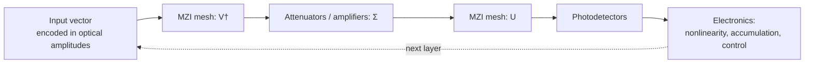

# Photonic and optical computing

Modern AI is limited less by ideas than by the cost of moving and multiplying numbers. **Light** offers a different physics for the same mathematics: interference performs linear combinations naturally, many wavelengths can travel through one waveguide at once, and propagation through passive optics consumes little energy. Photonic computing asks whether optics can take over the matrix multiplications at the heart of neural networks.

## Why light? (established physics)

| Property | Relevance to AI |
|---|---|
| **Interference is linear superposition** | A mesh of beam splitters and phase shifters applies a matrix to optical amplitudes as light passes through |
| **Bandwidth** | Optical signals can be modulated at very high rates, and many wavelengths can be multiplexed in one waveguide |
| **Low-loss propagation** | Moving data optically over distance costs far less energy than charging electrical wires |
| **Parallelism** | Free-space optics processes a whole 2-D field at once |

The difficulties are equally physical: converting between electronics and optics (modulators, detectors, ADCs/DACs) costs energy and area, optical components are large compared with transistors, analog noise and drift limit precision, and optics provides little cheap **nonlinearity** or **memory**.

## How a photonic chip multiplies a matrix (established)

Any unitary matrix can be decomposed into a mesh of 2×2 **Mach–Zehnder interferometers** (MZIs), each set by two phase shifts (Reck et al. 1994). Clements et al. (2016) gave a more compact, loss-balanced rectangular layout. Combined with the [singular value decomposition](../00-foundations/linear-algebra.md#singular-value-decomposition-svd), $W = U\Sigma V^\dagger$, an arbitrary weight matrix is realized as **unitary mesh → attenuators → unitary mesh**.



A single 2×2 MZI with internal phase $\theta$ and external phase $\phi$ implements (up to convention)

```math
T(\theta, \phi) = i e^{i\theta/2}\begin{pmatrix} e^{i\phi}\sin\frac{\theta}{2} & \cos\frac{\theta}{2} \\ e^{i\phi}\cos\frac{\theta}{2} & -\sin\frac{\theta}{2} \end{pmatrix}
```

## Landmark demonstrations

- **Coherent nanophotonic circuits** (Shen et al. 2017): a programmable silicon-photonic MZI mesh performed the matrix operations of a small neural network for vowel recognition.
- **Diffractive deep neural networks** (Lin et al. 2018): stacked 3-D-printed diffractive layers performed classification as terahertz light passed through them, entirely passively.
- **Photonic tensor core with frequency combs** (Feldmann et al. 2021): an integrated photonic processor using phase-change memory and wavelength multiplexing performed parallel convolutions.
- **Convolutional accelerator with microcombs** (Xu et al. 2021): time-, wavelength- and space-interleaved optical convolution at high throughput.
- **On-chip end-to-end photonic DNN** (Ashtiani, Geers & Aflatouni 2022): an integrated photonic network classified images directly from optical inputs, without digitization or a clock, using on-chip opto-electronic nonlinear activations.
- **In situ backpropagation** (Hughes et al. 2018 proposed; Pai et al. 2023 demonstrated): gradients of a photonic mesh measured optically, so the hardware trains itself.
- **Silicon-photonic weight banks** (Tait et al. 2017): microring resonators weighting many wavelengths, forming a neuromorphic photonic network.

Reviews: Wetzstein et al. (2020) on deep optics and photonics for inference; Shastri et al. (2021) on photonics for AI and neuromorphic computing.

## Reservoir computing in optics

Optical systems with delayed feedback make natural [reservoirs](nonlinearity-and-dynamical-systems.md#reservoir-computing-harnessing-chaos-established). Brunner et al. (2013) used a single semiconductor laser with delayed feedback, whose transient states served as a virtual network of nodes, to process information at gigabyte-per-second rates. This approach embraces the analog, nonlinear nature of photonics instead of fighting it.

## Training physical networks

Because physical hardware is imperfect, a digital model of it never matches exactly. **Physics-aware training** (Wright et al. 2022) runs the forward pass on the real physical system (optical, mechanical, or electronic) and uses a differentiable digital model only to estimate gradients for the backward pass, training the hardware despite its imperfections.

## The software problem

Hardware alone is not enough. A usable photonic accelerator needs a compiler and runtime stack that can:

1. **Partition** a model graph between CPU, GPU, and photonic regions according to cost.
2. **Tile** large matrices onto a fixed-size optical core.
3. **Manage precision**: scaling, bit-slicing, saturation, and explicit error budgets for analog computation.
4. **Track calibration**: phase settings drift with temperature; the compiler must know which calibration is valid and remap around faulty cells.
5. **Simulate and verify**: compare against a CPU reference with seeded noise models before trusting results.

How digital ML compilers already solve the partitioning, tiling, and code-generation parts of this problem is covered in [Compilers for machine learning](../04-systems/ml-compilers.md#compiling-for-unconventional-hardware).

## Open challenges (active research)

- **Nonlinearity**: all-optical activations remain weak or power-hungry; most systems return to electronics between layers. See [Energy per MAC and the nonlinearity problem](optical-energy-and-nonlinearity.md#6-the-nonlinearity-problem-established-with-active-research).
- **Precision**: analog noise and drift typically limit effective precision to a few bits, which suits quantized inference better than training.
- **I/O overhead**: energy saved in the optical core can be lost in electro-optic conversion if data does not stay in the optical domain long enough. The arithmetic is worked through in [Energy per MAC](optical-energy-and-nonlinearity.md#3-the-scaling-argument-established).
- **Scale and integration**: fitting large meshes on chip, packaging with lasers and electronics, and manufacturing at volume.
- **Memory**: there is no dense, fast optical equivalent of SRAM; weights and activations live electronically.

## Speculative directions

> [!WARNING]
> **Speculative.** The ideas below are hypotheses, not demonstrated at scale.

- **Optical interconnect as the first win.** Photonics may first transform AI through moving data between chips and racks, with optical compute following.
- **Hybrid analog–digital transformers.** If attention and MLP matrix multiplies run optically at low precision while digital electronics handles softmax, normalization, and accumulation, overall energy per token could fall substantially. Whether real systems achieve this end to end is unproven.
- **Quantum photonics convergence.** The same programmable interferometer meshes are used in photonic quantum computing, suggesting shared hardware and software stacks (see [Quantum ML](quantum-machine-learning.md)).

## Next topics for this page

- Wavelength-division multiplexing in more detail (energy-per-MAC accounting and optical nonlinearities now have [their own page](optical-energy-and-nonlinearity.md))
- Phase-change materials for non-volatile optical weights
- Error models and calibration in MZI meshes in more detail
