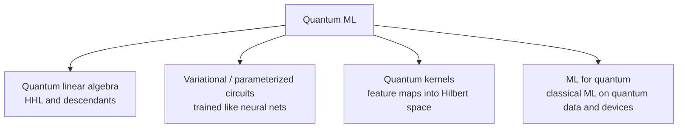

# Quantum machine learning

Quantum computers manipulate amplitudes in an exponentially large Hilbert space. Machine learning manipulates high-dimensional vectors. The overlap is tempting, but the honest summary of the field is: **a few provable advantages exist for special problems, many claimed advantages have evaporated under scrutiny, and practical benefit on today's hardware is unproven.**

## Quantum basics in one screen

A system of $n$ qubits has state $\lvert \psi \rangle = \sum_{x \in \{0,1\}^n} \alpha_x \lvert x \rangle$ with $\sum_x |\alpha_x|^2 = 1$, a vector of $2^n$ complex amplitudes. Gates are unitary matrices; measurement returns outcome $x$ with probability $|\alpha_x|^2$ and destroys the superposition.

Two caveats drive everything else:

1. **Readout is limited.** You cannot read all $2^n$ amplitudes; each measurement gives $n$ bits.
2. **Loading is costly.** Encoding $N$ classical numbers into amplitudes generally requires substantial resources, which can cancel any speed-up.

Feynman (1982) proposed quantum computers precisely to simulate quantum physics, which remains the most natural application.

## Families of approaches



### Quantum linear algebra (established theory, caveated)

**HHL** (Harrow, Hassidim & Lloyd 2009) prepares a quantum state proportional to the solution of $A\mathbf{x} = \mathbf{b}$ in time polylogarithmic in the dimension, under strong conditions: sparse, well-conditioned $A$, efficient state preparation for $\mathbf{b}$, and the need only for global properties of $\mathbf{x}$, not its entries. Many proposed quantum ML speed-ups built on such subroutines.

**Dequantization.** Tang (2019) gave a *classical* algorithm for recommendation systems that, given comparable sampling access to the data, runs only polynomially slower than the quantum algorithm it targeted, removing its claimed exponential advantage. Similar "quantum-inspired" results followed for other problems. Lesson: fair comparisons must give classical algorithms equivalent data access.

### Variational quantum circuits (active research)

A parameterized circuit $U(\boldsymbol\theta)$ is run on a quantum device; a classical optimizer adjusts $\boldsymbol\theta$ to minimize a measured cost, as in the **variational quantum eigensolver** (Peruzzo et al. 2014). Used as a "quantum neural network", the model output is an expectation value:

```math
f_{\boldsymbol\theta}(\mathbf{x}) = \langle 0 \rvert\, U^\dagger(\mathbf{x}, \boldsymbol\theta)\, O \, U(\mathbf{x}, \boldsymbol\theta) \,\lvert 0 \rangle
```

**Barren plateaus** (McClean et al. 2018) are a central obstacle: for sufficiently random deep circuits, gradients vanish exponentially in the number of qubits, so training becomes infeasible. Cerezo et al. (2021) review variational algorithms and their limitations.

### Quantum kernels (active research)

Encode data into quantum states with a feature map $\mathbf{x} \mapsto \lvert \phi(\mathbf{x}) \rangle$ and use the overlap $k(\mathbf{x}, \mathbf{x}') = |\langle \phi(\mathbf{x}) \vert \phi(\mathbf{x}') \rangle|^2$ in a classical [kernel method](../01-classical-ml/supervised-learning.md#support-vector-machines-and-kernels) (Schuld & Killoran 2019; Havlíček et al. 2019). An advantage requires kernels that are hard to compute classically *and* useful for the data, a combination that has been shown for carefully constructed problems but not for typical real-world datasets.

### Machine learning *for* quantum (established, growing)

Classical ML is already valuable for quantum technology: calibrating devices, decoding error-correcting codes, characterizing noise, and representing quantum states. This direction has the clearest near-term payoff.

## The hardware reality

Preskill (2018) coined **NISQ**, Noisy Intermediate-Scale Quantum, for devices with tens to hundreds of qubits and no full error correction. Noise limits circuit depth, and depth limits the models that can be run. Fault-tolerant machines would change the picture, but require large overheads in physical qubits per logical qubit.

Photonic platforms are one route to quantum hardware, using the same programmable interferometer meshes as [classical photonic computing](photonic-computing.md).

## Overview: Biamonte et al. (2017)

The *Nature* review by Biamonte et al. (2017) remains a widely cited overview of the original vision; reading it alongside the dequantization and barren-plateau literature gives a balanced view.

## Speculative directions

> [!WARNING]
> **Speculative.** These are open hypotheses.

- **Quantum data, quantum models.** Learning problems whose inputs are themselves quantum states (from sensors or simulations) are where quantum advantages appear most plausible.
- **Fault-tolerant era algorithms.** If large error-corrected machines arrive, quantum linear algebra might accelerate specific scientific ML workloads, provided data loading and readout costs are overcome.
- **Quantum-inspired classical methods.** Ideas from quantum algorithms, such as tensor networks and sampling techniques, may yield more practical value on classical hardware than on quantum hardware in the near term.

## Next topics for this page

- Tensor networks as machine learning models
- Quantum error-correction decoders with neural networks
- Rigorous separations between classical and quantum learners
