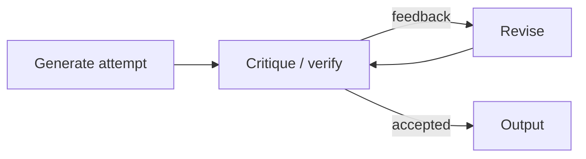

# Recursion and self-improvement

Recursion, a process that refers to or operates on itself, runs through AI at every level: recursive definitions in reinforcement learning, recursive structure in language, networks applied to their own outputs, and the long-standing idea of systems that improve their own design.

## 1. Recursion inside models (established)

### Recursive definitions

The Bellman equation defines value in terms of value ([Reinforcement learning](../01-classical-ml/reinforcement-learning.md)). Backpropagation computes gradients layer by layer from the gradients of the layer above. Recurrent networks compute $\mathbf{h}_t = f(\mathbf{h}_{t-1}, \mathbf{x}_t)$, the same function applied repeatedly.

### Recursive structure in data

Language is recursive: phrases contain phrases. **Recursive neural networks** (Socher et al. 2013) composed word vectors up a parse tree to compute sentence meaning. Transformers have no explicit tree, but probing studies find that they encode syntactic structure in their representations.

### Weight sharing across depth

**Universal Transformers** (Dehghani et al. 2018) apply the *same* transformer block repeatedly, with **adaptive computation time** (Graves 2016) deciding how many iterations each position needs. This makes depth a runtime choice and gives the model a recurrent inductive bias.

The computational side of looping a shared block, including what repeated layers and chain-of-thought steps add to a transformer's power, is covered in [What transformers can and cannot compute](what-transformers-can-and-cannot-compute.md#4-buying-power-with-steps-established).

## 2. Models that improve their own outputs (established, rapidly developing)



- **Self-Refine** (Madaan et al. 2023): the same model drafts, critiques, and revises its own output.
- **Reflexion** (Shinn et al. 2023): an agent writes verbal reflections on failures into memory and uses them on the next attempt.
- **Tree of Thoughts** (Yao et al. 2023): search over reasoning steps with self-evaluation.

These loops improve outputs **at inference time**; the model's weights do not change. Gains are largest when feedback is reliable (tests, compilers, verifiers) and can be small or negative when the model must judge itself without external signal.

## 3. Models that improve their own training data (active research)

- **STaR** (Zelikman et al. 2022): generate rationales, keep those that reach correct answers, fine-tune on them, and repeat.
- **LLMs can self-improve** (Huang et al. 2022): fine-tune on high-confidence, self-consistent answers to unlabelled questions.
- **Self-rewarding language models** (Yuan et al. 2024): the model acts as its own judge to create preference data for iterative DPO training.
- **Self-play** (Silver et al. 2017, 2018): AlphaGo Zero and AlphaZero generated their entire curriculum by playing against themselves.

A common thread: self-improvement works best where outcomes can be **verified** (a game is won, a proof checks, code passes tests).

### Model collapse

The loop has a failure mode. **Shumailov et al. (2024)** showed that when generative models are trained recursively on data produced by previous generations, the tails of the original distribution progressively disappear and models degrade, an effect they call **model collapse**. Mixing in fresh real data, or filtering synthetic data with strong verifiers, mitigates it. Recursion without grounding drifts.

## 4. Learning to learn (established)

**Meta-learning** optimizes the learning process itself:

- **MAML** (Finn, Abbeel & Levine 2017) finds initial weights from which a few gradient steps adapt well to new tasks:

```math
\min_\theta \sum_{\mathcal{T}} \mathcal{L}_{\mathcal{T}}\big(\theta - \alpha \nabla_\theta \mathcal{L}_{\mathcal{T}}(\theta)\big)
```

- **Learned optimizers** (Andrychowicz et al. 2016) train a network to output parameter updates for another network.
- **Neural architecture search** (Zoph & Le 2016) uses a controller trained with reinforcement learning to design network architectures.
- **Fast-weight programmers and self-referential weight matrices** let a network rewrite weights, including its own, while it runs; linear attention turns out to be one of them. See [Fast-weight programmers and self-referential networks](fast-weight-programmers.md).

## 5. AI that discovers algorithms (established, recent)

- **FunSearch** (Romera-Paredes et al. 2024) paired an LLM that proposes programs with an automated evaluator in an evolutionary loop, and found new constructions for the cap set problem in extremal combinatorics.
- **The AI Scientist** (Lu et al. 2024) is an attempt to automate the full research loop (idea, code, experiment, paper draft) with LLMs. Its outputs are early-stage, and quality and novelty remain open questions.

## 6. Recursive self-improvement (speculative)

> [!WARNING]
> **Speculative.** This section discusses hypotheses that have not been demonstrated.

**I. J. Good (1965)** argued that an "ultraintelligent machine" able to design better machines would trigger an "intelligence explosion". **Schmidhuber (2003)** formalized a **Gödel machine**: a self-referential program that rewrites any part of its own code once it has *proved* the rewrite will improve its expected utility.

Open questions that determine whether such a loop could run away or saturate:

- **Returns to intelligence**: does each improvement make the next one easier, or harder?
- **Bottlenecks outside the model**: compute, energy, data, and real-world experiments do not speed up just because the designer gets smarter.
- **Verification**: a system improving itself must evaluate candidate successors; as noted above, loops without reliable verification tend to drift or collapse.
- **Goal stability**: whether a system's objectives are preserved through self-modification is a core concern of [alignment](../05-alignment-safety-interpretability/alignment.md#inner-alignment).

Current evidence supports a narrower claim: **AI is increasingly part of the loop that builds AI** (writing code, generating and filtering data, searching architectures and algorithms) under human direction and with external verification.

## Next topics for this page

- Fixed points and self-consistency in iterative refinement
- Formal limits from computability (Rice's theorem, Löb's theorem) applied to self-modifying agents
