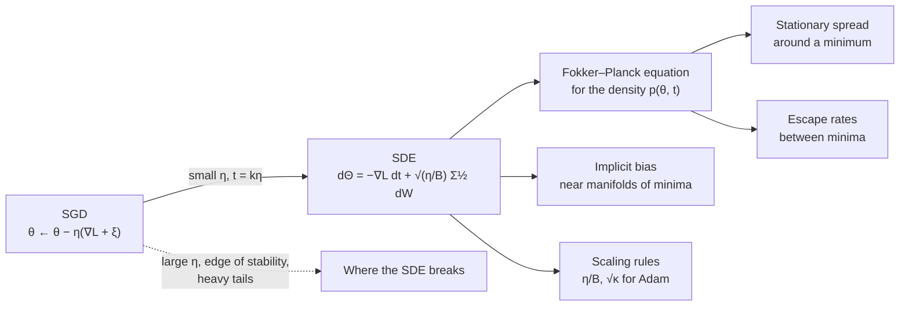

# SGD as a stochastic differential equation

Every step of stochastic gradient descent uses a gradient computed on a small random batch, so every step is slightly wrong in a random direction. Take many small steps and the errors stop looking like mistakes and start looking like **heat**: the parameters jitter around the loss landscape like a particle in a warm fluid, drifting downhill while being kicked by noise whose strength is set by the learning rate and the batch size. Writing that picture down as a stochastic differential equation (SDE) turns folklore about "good noise" into predictions you can check, and explains rules practitioners use every day, such as scaling the learning rate with the batch size.

> The core idea in one sentence: **for small learning rates, SGD behaves like a diffusion whose drift is the full-batch gradient and whose temperature is roughly the learning rate divided by the batch size, so the shape of the noise, not just its size, decides which minima training finds and how long it stays in them.**

This page sits between [optimization](../00-foundations/optimization.md#stochastic-gradient-descent-sgd), where SGD is introduced, and [non-linearity and dynamical systems](nonlinearity-and-dynamical-systems.md), where training is treated as a dynamical system. It is also the theory behind the "gradient noise" that appears in the [heavy-tailed spectra](heavy-tailed-weight-spectra.md) page.

## 1. From a noisy update to a diffusion (established)

Write the training loss as an average over $N$ examples, $L(\theta) = \frac{1}{N}\sum_{i=1}^{N} \ell_i(\theta)$. A minibatch of $B$ examples sampled with replacement gives an unbiased gradient estimate, so the SGD update can be split into a deterministic part and a zero-mean noise:

```math
\theta_{k+1} = \theta_k - \eta\,\big(\nabla L(\theta_k) + \xi_k\big),
\qquad
\mathbb{E}[\xi_k] = 0,
\qquad
\operatorname{Cov}[\xi_k] = \frac{1}{B}\,\Sigma(\theta_k),
```

where $\Sigma(\theta)$ is the covariance of the per-example gradients $\nabla \ell_i(\theta)$. The noise added to the parameters in one step therefore has covariance $\eta^2 \Sigma / B$. Now measure time in units of the learning rate, $t = k\eta$. Over a short time $\Delta t$ there are $\Delta t/\eta$ steps, the drift adds up to $-\nabla L\,\Delta t$, and the noise variance adds up to $(\eta/B)\,\Sigma\,\Delta t$. A process with exactly those two properties is the Itô SDE

```math
d\Theta_t = -\nabla L(\Theta_t)\,dt + \sqrt{\tfrac{\eta}{B}}\;\Sigma(\Theta_t)^{1/2}\,dW_t,
```

with $W_t$ a standard Brownian motion. SGD is then, approximately, the Euler–Maruyama discretization of this equation with step $\eta$.

Li, Tai and E (2015, published 2017) made this precise as the method of **stochastic modified equations**. They proved the approximation holds in the *weak* sense: expectations of smooth functions of the parameters (losses, moments) computed under SGD and under the SDE differ by $O(\eta)$ over a fixed time horizon, and a refined SDE with drift $-\nabla\big(L + \tfrac{\eta}{4}\lVert\nabla L\rVert^2\big)$ is accurate to $O(\eta^2)$. Their 2018 follow-up extended the foundations to momentum SGD and Nesterov's method. The approximation is about *distributions*, not individual trajectories: it says nothing about matching one particular run step for step.



The density $p(\theta, t)$ of the SDE obeys the **Fokker–Planck equation**

```math
\partial_t p = \nabla\cdot\big(p\,\nabla L\big) + \frac{\eta}{2B}\sum_{i,j}\partial_i\partial_j\big(\Sigma_{ij}\,p\big),
```

which is the tool most of the results below are built on.

## 2. Temperature, and why η/B is the knob (established)

If the noise were isotropic, $\Sigma = s^2 I$, the SDE would be overdamped Langevin dynamics, $d\Theta = -\nabla L\,dt + \sqrt{2T}\,dW$, with temperature

```math
T = \frac{\eta\, s^2}{2B},
```

and its stationary density would be the Gibbs distribution $p(\theta) \propto e^{-L(\theta)/T}$. Even without isotropy, the noise strength enters only through the ratio $\eta/B$. That is the theoretical content of several results that were first found empirically:

- **The ratio governs the minima found.** Jastrzębski et al. (2017) argued from the SDE that learning rate, batch size and gradient covariance are the three factors that shape the final minimum, that the ratio $\eta/B$ is the key determinant, and that higher ratios lead to wider minima and often better generalization. They showed that a learning-rate schedule can be replaced by a batch-size schedule.
- **The noise scale.** Smith and Le (2017) derived the noise scale $g = \epsilon\,(N/B - 1) \approx \epsilon N / B$ for learning rate $\epsilon$ and training-set size $N$, and predicted and confirmed that the best batch size at fixed learning rate grows in proportion to both, $B_{\text{opt}} \propto \epsilon N$.
- **The linear scaling rule.** Goyal et al. (2017) trained ResNet-50 on ImageNet with batches of 8,192 images on 256 GPUs in one hour, matching small-batch accuracy, by multiplying the learning rate by $k$ whenever the batch grows by $k$ (plus a warm-up phase). Holding $\eta/B$ fixed is exactly what keeps the SDE unchanged.
- **Batch size instead of decay.** Smith, Kindermans, Ying and Le (2017) showed that increasing the batch size during training gives the same learning curves as decaying the learning rate, with fewer parameter updates, and trained ResNet-50 on ImageNet to 76.1% validation accuracy in under 30 minutes.

The large-batch "generalization gap" reported by Keskar et al. (2016), who found that large batches tend to converge to sharp minima and small batches to flat ones, fits the same picture: at a fixed learning rate, a larger batch is a colder system.

## 3. Life near a minimum: an Ornstein–Uhlenbeck process (established)

Close to a minimum $\theta^\star$, approximate the loss by its quadratic expansion $L \approx \tfrac12 (\theta-\theta^\star)^\top H (\theta-\theta^\star)$ with Hessian $H$, and freeze the noise covariance at $\Sigma = \Sigma(\theta^\star)$. The SDE becomes a multivariate **Ornstein–Uhlenbeck process**, and its stationary distribution is Gaussian with covariance $C$ solving the Lyapunov equation

```math
H C + C H = \frac{\eta}{B}\,\Sigma .
```

The discrete SGD recursion can be solved exactly in the same setting. Its stationary covariance satisfies $C = (I-\eta H)\,C\,(I-\eta H) + \eta^2 \Sigma / B$, which rearranges to

```math
H C + C H - \eta\, H C H = \frac{\eta}{B}\,\Sigma ,
```

so the SDE answer is the leading term and the correction grows with $\eta H$. Mandt, Hoffman and Blei (2017) used this picture to treat constant-learning-rate SGD as approximate Bayesian inference: they showed how to tune the learning rate, batch size and a preconditioner so that the stationary distribution best matches a posterior in KL divergence, and gave a short proof of why Polyak (iterate) averaging is optimal.

A useful special case: for least squares with label noise of variance $\sigma^2$, the per-example gradient at the optimum is $-x\,\varepsilon$, so $\Sigma = \sigma^2 H$. Substituting gives

```math
C = \frac{\eta\,\sigma^2}{2B}\, I,
\qquad
\mathbb{E}\big[L(\theta) - L(\theta^\star)\big] = \tfrac12 \operatorname{tr}(H C) = \frac{\eta\,\sigma^2}{4B}\,\operatorname{tr}(H).
```

The jitter is the same size in every direction, so the loss it costs is proportional to the **trace of the Hessian**: SGD noise taxes sharp minima more than flat ones. That is one concrete, checkable form of the claim that noise "prefers" flatness.

### A tested sketch

The NumPy script below runs minibatch SGD on a two-parameter least-squares problem with one sharp direction (curvature about 9.15) and one flat one (about 0.25), and compares the measured spread of the iterates with the SDE prediction and with the exact discrete formula. Every run keeps $\eta/B = 0.00125$, so the SDE predicts the same answer each time.

```python
import numpy as np

def lyap_c(A, Q):   # solve A C + C A^T = Q
    n = A.shape[0]; I = np.eye(n)
    return np.linalg.solve(np.kron(I, A) + np.kron(A, I), Q.ravel()).reshape(n, n)

def lyap_d(A, Q):   # solve C = A C A^T + Q
    n = A.shape[0]
    return np.linalg.solve(np.eye(n * n) - np.kron(A, A), Q.ravel()).reshape(n, n)

rng = np.random.default_rng(0)
N, d, sigma = 4096, 2, 0.5
X = rng.normal(size=(N, d)) * np.array([3.0, 0.5])      # sharp and flat directions
y = X @ np.array([1.0, -2.0]) + sigma * rng.normal(size=N)
w_star = np.linalg.lstsq(X, y, rcond=None)[0]
H = X.T @ X / N
Sigma = np.cov((X * (X @ w_star - y)[:, None]).T, bias=True)   # per-example gradient covariance

def sgd_cov(eta, B, steps=200_000, burn=20_000):
    w, acc = w_star.copy(), np.zeros((d, d))
    for t in range(steps):
        i = rng.integers(0, N, size=B)
        w = w - eta * X[i].T @ (X[i] @ w - y[i]) / B
        if t >= burn:
            e = w - w_star; acc += np.outer(e, e)
    return acc / (steps - burn)

sd = lambda M: np.sqrt(np.diag(M)).round(4)
for eta, B in [(0.005, 4), (0.01, 8), (0.02, 16), (0.04, 32), (0.08, 64), (0.16, 128)]:
    print(eta, B, sd(sgd_cov(eta, B)),
          sd(lyap_c(H, eta / B * Sigma)),                       # SDE (Ornstein-Uhlenbeck)
          sd(lyap_d(np.eye(d) - eta * H, eta**2 / B * Sigma)))  # exact discrete recursion
```

Results from one run (standard deviation of each coordinate around the optimum; the sharp coordinate first):

| η | B | ηλ_max | SGD, measured | SDE prediction | Exact discrete |
|---|---|---|---|---|---|
| 0.005 | 4 | 0.05 | 0.0128, 0.0120 | 0.0126, 0.0123 | 0.0127, 0.0123 |
| 0.01 | 8 | 0.09 | 0.0130, 0.0129 | 0.0126, 0.0123 | 0.0129, 0.0123 |
| 0.02 | 16 | 0.18 | 0.0133, 0.0121 | 0.0126, 0.0123 | 0.0132, 0.0124 |
| 0.04 | 32 | 0.37 | 0.0140, 0.0122 | 0.0126, 0.0123 | 0.0139, 0.0124 |
| 0.08 | 64 | 0.73 | 0.0159, 0.0125 | 0.0126, 0.0123 | 0.0158, 0.0124 |
| 0.16 | 128 | 1.46 | 0.0248, 0.0126 | 0.0126, 0.0123 | 0.0243, 0.0125 |

Three things show up. First, the spread is nearly equal in both directions, about $\sqrt{\eta\sigma^2/2B} \approx 0.0125$, as the $\Sigma = \sigma^2 H$ calculation predicts, even though the curvatures differ by a factor of 37. Second, the linear scaling rule holds while $\eta\lambda_{\max}$ is small: a 16-fold change in learning rate and batch size together keeps the flat coordinate within 8% of the prediction. Third, it fails in the sharp direction as $\eta$ approaches the stability limit $2/\lambda_{\max} \approx 0.22$: at $\eta = 0.16$ the measured spread is almost twice the SDE prediction, while the exact discrete formula still matches. In a version of the script that also records the loss, the measured excess loss at $\eta = 0.01, B = 8$ was $7.79\times 10^{-4}$, against $7.43\times 10^{-4}$ from the SDE and $7.34\times 10^{-4}$ from the $\eta\sigma^2\operatorname{tr}(H)/4B$ formula. These are Monte Carlo estimates from a single seed, so differences of a few percent are within noise.

## 4. Escaping minima, and why the noise shape matters (established in models, active research for deep networks)

For Langevin dynamics with isotropic noise, the classical Kramers result says the mean time to escape a basin grows like $e^{\Delta L / T}$, where $\Delta L$ is the height of the barrier. SGD noise is not isotropic, and that changes the answer:

- **Anisotropy helps escape sharp minima.** Zhu et al. (2018) derived an indicator of escaping efficiency based on how well the noise covariance aligns with the curvature of the loss, and showed that SGD's anisotropic noise escapes sharp minima more effectively than full-batch gradient descent with isotropic noise of matched size.
- **Exponentially versus polynomially.** Xie, Sato and Sugiyama (2020) built a density diffusion theory of minima selection and showed that, because SGD's noise covariance depends on the Hessian, SGD favours flat minima *exponentially* more than sharp ones, while gradient descent with injected white noise favours them only *polynomially*. They also found that the number of iterations needed to escape grows exponentially in the ratio of batch size to learning rate, which they offered as an explanation for why large-batch training struggles to find flat minima in realistic time.
- **Not in equilibrium.** Chaudhari and Soatto (2017) proved that SGD minimizes an average potential plus an entropic term, but that the potential is generally **not the original loss**, and that for deep networks the most likely trajectories do not settle like Brownian motion around a critical point but trace closed loops. They attribute this to highly non-isotropic noise, reporting minibatch gradient covariances with rank as small as 1% of the parameter dimension. A Gibbs distribution over the training loss is therefore the wrong mental picture for real networks.

## 5. Implicit bias: what SGD minimizes besides the loss (active research)

Even without noise, finite steps change the dynamics. Backward error analysis shows that gradient descent with step $\eta$ follows gradient flow on a modified loss more closely than on the original one. Barrett and Dherin (2020) called this **implicit gradient regularization**:

```math
\tilde L(\theta) = L(\theta) + \frac{\eta}{4}\,\lVert \nabla L(\theta)\rVert^2 ,
```

the same correction that appears in the second-order stochastic modified equation. Smith, Dherin, Barrett and De (2021) extended it to SGD with random shuffling: over an epoch of $m$ minibatches, the mean iterate stays close to gradient flow on

```math
\tilde L_{\text{SGD}}(\theta) = L(\theta) + \frac{\eta}{4m}\sum_{k=0}^{m-1}\big\lVert \nabla \hat L_k(\theta)\big\rVert^2 ,
```

which penalizes the norms of the *minibatch* gradients. For small batches the strength of this term is proportional to $\eta/B$, and adding it explicitly improved test accuracy at small learning rates in their experiments.

In over-parameterized models the minima form a connected manifold, and the long-run behaviour is a slow drift *along* it. Li, Wang and Arora (2021) gave a general framework, built on Katzenberger's theory of processes forced onto a manifold, that derives an SDE for this slow motion from the loss and the noise covariance. It recovers the earlier finding that SGD with label noise reduces the sharpness $\operatorname{tr}(\nabla^2 L)$, extends it to arbitrary noise covariance, and shows that label-noise SGD can learn a $\kappa$-sparse linear model from $O(\kappa \ln d)$ samples where gradient descent from the kernel regime needs $\Omega(d)$. HaoChen, Wei, Lee and Ma (2020) had already shown that the **shape** of the noise covariance decides the bias: with parameter-dependent label noise SGD recovers sparse ground truth, while spherical Gaussian noise does not. Kunin et al. (2020) add a complementary lens: symmetries of a network imply conservation laws under gradient flow, and finite learning rates, weight decay and noise break them in predictable ways.

## 6. Scaling rules for adaptive optimizers and modern pre-training (active research)

Most large models are trained with Adam rather than SGD, and Adam's update is not linear in the gradient, so the linear scaling rule does not carry over. Malladi, Lyu, Panigrahi and Arora (2022) derived SDE approximations for RMSprop and Adam with guarantees, and from them a **square-root scaling rule**: when the batch size is multiplied by $\kappa$, multiply the learning rate by $\sqrt{\kappa}$ and rescale the moment decay rates (and $\epsilon$) to match. Compagnoni et al. (2024) proposed SDEs for SignSGD, RMSprop(W) and Adam(W) that track the real optimizers more accurately than earlier ones in experiments with MLPs, CNNs, ResNets and transformers, and used them to contrast how SignSGD and SGD respond to noise, including heavy-tailed noise.

The same "what is held fixed in continuous time" reasoning now guides pre-training recipes:

| Result | What it says | Source |
|---|---|---|
| **Gradient noise scale** | A simple statistic, roughly $\operatorname{tr}(\Sigma)/\lVert\nabla L\rVert^2$, predicts the largest useful batch size across supervised learning, RL (Atari, Dota) and generative models, and grows as the loss falls | McCandlish et al. 2018 |
| **Critical batch size scales with data** | In language models from 85M to 1.2B parameters, the batch size beyond which parallelism gives diminishing returns scales mainly with data size, not model size | Zhang et al. 2024 |
| **AdamW as a moving average** | AdamW's weights behave like an exponential moving average of recent updates, and the best averaging timescale, measured in epochs, stays roughly constant across model and data size | Wang & Aitchison 2024 |
| **Timescale laws** | The AdamW timescale $\tau = B/(\eta\lambda D)$ explains why the best weight decay scales linearly with batch size at fixed model and data size; across scales the best $\tau$ follows a power law in tokens per parameter | Bergsma et al. 2025 |
| **Small batches revisited** | Language models train stably down to batch size one if Adam's second-moment half-life is held fixed in tokens, and small batches match or beat large ones per FLOP | Marek et al. 2025 |

## 7. Where the SDE picture breaks (active research)

The SDE is a small-learning-rate approximation, and modern training is often not in that regime.

- **Large learning rates.** Li, Malladi and Arora (2021) noted that formal guarantees covered only tiny learning rates and that checking the approximation directly looked computationally infeasible. They introduced **SVAG**, a simulation that provably converges to the Itô SDE, and a testable *necessary* condition for the SDE approximation and the linear scaling rule to hold. Their experiments found that the SDE can meaningfully capture training and generalization of common deep networks, but the condition can fail, and when it does the linear scaling rule breaks. The sketch above shows the simplest version: the discrete correction $\eta H C H$ dominates as $\eta\lambda_{\max}$ approaches 2.
- **Edge of stability.** Full-batch gradient descent on neural networks drives the top Hessian eigenvalue up to about $2/\eta$ and keeps training there (Cohen et al. 2021); Damian, Nichani and Lee (2022) explain this as **self-stabilization**, a discrete-time mechanism with no counterpart in a small-step SDE.
- **Heavy-tailed noise.** Şimşekli, Sagun and Gürbüzbalaban (2019) argued that gradient noise in deep networks is heavy-tailed and proposed replacing Brownian motion with an α-stable Lévy process, which escapes basins by jumps rather than by climbing. Whether the noise is Gaussian or heavy-tailed depends on architecture and batch size, and is discussed on the [heavy-tailed spectra](heavy-tailed-weight-spectra.md#5-where-the-heavy-tails-come-from-active-research) page.
- **Strange worst cases.** Ziyin, Li, Simon and Ueda (2021) constructed landscapes on which SGD with a constant large learning rate converges to local maxima, escapes saddles arbitrarily slowly, and prefers sharp minima over flat ones, a reminder that "noise finds flat minima" is a tendency in typical settings, not a theorem.

## 8. Noise on purpose: Langevin sampling (established)

If SGD is almost a Langevin sampler, one can make it a real one. **Stochastic gradient Langevin dynamics** (Welling & Teh 2011) adds Gaussian noise matched to the step size to each minibatch step and anneals the step size, so the iterates move from optimization to sampling from the Bayesian posterior. Ma, Chen and Fox (2015) gave a complete recipe for building such samplers from continuous Markov processes specified by two matrices, covering the stochastic-gradient MCMC family. Here the SDE is not an approximation of the algorithm but the target it is designed to discretize.

## 9. What we know and what we don't

| Claim | Status |
|---|---|
| SGD with a small learning rate is weakly approximated by an Itô SDE with temperature set by η/B | Proved (weak approximation, fixed horizon) |
| Holding η/B fixed keeps SGD dynamics roughly unchanged (linear scaling rule) | Established empirically up to a problem-dependent batch size; fails at large η or large B |
| Near a minimum, SGD's stationary spread follows a Lyapunov equation with discrete corrections | Established for quadratic models; reproduced above |
| SGD's Hessian-shaped noise favours flat minima more strongly than isotropic noise | Supported by theory in simplified models and by experiments |
| SGD samples a Gibbs distribution over the training loss | False in general for deep networks (non-isotropic, out-of-equilibrium noise) |
| Finite steps add an implicit gradient-norm penalty | Derived by backward error analysis; explicit versions help in some experiments |
| Adam's batch-size scaling follows a square-root rule | Derived from SDEs and validated on vision and language tasks |
| Gradient noise in deep learning is Gaussian | Contested; depends on batch size and architecture |

## 10. Physical noise as part of the SDE (speculative)

> [!WARNING]
> **Speculative.** This section is a hypothesis connecting the results above to analog and optical hardware. We know of no published study that tests it in this form.

On [analog and optical accelerators](photonic-computing.md), every matrix multiplication carries physical noise such as [shot noise](optical-energy-and-nonlinearity.md#4-the-physical-floor-shot-noise-established), drift and quantization. If training runs on such hardware, that noise enters the gradient and adds its own diffusion term to the SDE, alongside minibatch noise. Two testable consequences follow. First, the total temperature is what matters, so a known level of hardware noise might be offset by raising the batch size or lowering the learning rate to keep the effective $\eta/B$-like temperature on target, turning "noisy hardware" into a hyperparameter rather than a defect. Second, the results of Zhu et al. and Xie et al. suggest that the *shape* of the noise matters as much as its size: hardware noise that is roughly isotropic in weight space, unlike Hessian-shaped minibatch noise, would be expected to give a weaker preference for flat minima at the same temperature. Measuring the covariance of hardware-induced gradient noise, and checking whether it aligns with the loss curvature, would be a direct way to test both ideas.

## Further reading

- Robbins, H., Monro, S. (1951). *A stochastic approximation method*. Annals of Mathematical Statistics. [doi:10.1214/aoms/1177729586](https://doi.org/10.1214/aoms/1177729586)
- Welling, M., Teh, Y. W. (2011). *Bayesian learning via stochastic gradient Langevin dynamics*. ICML. [PDF](https://icml.cc/2011/papers/398_icmlpaper.pdf)
- Ma, Y.-A., Chen, T., Fox, E. B. (2015). *A complete recipe for stochastic gradient MCMC*. NeurIPS. [arXiv:1506.04696](https://arxiv.org/abs/1506.04696)
- Li, Q., Tai, C., E, W. (2015). *Stochastic modified equations and adaptive stochastic gradient algorithms*. ICML 2017. [arXiv:1511.06251](https://arxiv.org/abs/1511.06251)
- Li, Q., Tai, C., E, W. (2018). *Stochastic modified equations and dynamics of stochastic gradient algorithms I: Mathematical foundations*. [arXiv:1811.01558](https://arxiv.org/abs/1811.01558)
- Keskar, N. S., Mudigere, D., Nocedal, J., Smelyanskiy, M., Tang, P. T. P. (2016). *On large-batch training for deep learning: Generalization gap and sharp minima*. ICLR 2017. [arXiv:1609.04836](https://arxiv.org/abs/1609.04836)
- Mandt, S., Hoffman, M. D., Blei, D. M. (2017). *Stochastic gradient descent as approximate Bayesian inference*. JMLR. [arXiv:1704.04289](https://arxiv.org/abs/1704.04289)
- Goyal, P., Dollár, P., Girshick, R., Noordhuis, P., Wesolowski, L., Kyrola, A., Tulloch, A., Jia, Y., He, K. (2017). *Accurate, large minibatch SGD: Training ImageNet in 1 hour*. [arXiv:1706.02677](https://arxiv.org/abs/1706.02677)
- Smith, S. L., Le, Q. V. (2017). *A Bayesian perspective on generalization and stochastic gradient descent*. ICLR 2018. [arXiv:1710.06451](https://arxiv.org/abs/1710.06451)
- Chaudhari, P., Soatto, S. (2017). *Stochastic gradient descent performs variational inference, converges to limit cycles for deep networks*. [arXiv:1710.11029](https://arxiv.org/abs/1710.11029)
- Smith, S. L., Kindermans, P.-J., Ying, C., Le, Q. V. (2017). *Don't decay the learning rate, increase the batch size*. ICLR 2018. [arXiv:1711.00489](https://arxiv.org/abs/1711.00489)
- Jastrzębski, S., Kenton, Z., Arpit, D., Ballas, N., Fischer, A., Bengio, Y., Storkey, A. (2017). *Three factors influencing minima in SGD*. [arXiv:1711.04623](https://arxiv.org/abs/1711.04623)
- Zhu, Z., Wu, J., Yu, B., Wu, L., Ma, J. (2018). *The anisotropic noise in stochastic gradient descent: Its behavior of escaping from sharp minima and regularization effects*. ICML 2019. [arXiv:1803.00195](https://arxiv.org/abs/1803.00195)
- McCandlish, S., Kaplan, J., Amodei, D., OpenAI Dota Team (2018). *An empirical model of large-batch training*. [arXiv:1812.06162](https://arxiv.org/abs/1812.06162)
- Şimşekli, U., Sagun, L., Gürbüzbalaban, M. (2019). *A tail-index analysis of stochastic gradient noise in deep neural networks*. ICML. [arXiv:1901.06053](https://arxiv.org/abs/1901.06053)
- Xie, Z., Sato, I., Sugiyama, M. (2020). *A diffusion theory for deep learning dynamics: Stochastic gradient descent exponentially favors flat minima*. ICLR 2021. [arXiv:2002.03495](https://arxiv.org/abs/2002.03495)
- HaoChen, J. Z., Wei, C., Lee, J. D., Ma, T. (2020). *Shape matters: Understanding the implicit bias of the noise covariance*. COLT 2021. [arXiv:2006.08680](https://arxiv.org/abs/2006.08680)
- Barrett, D. G. T., Dherin, B. (2020). *Implicit gradient regularization*. ICLR 2021. [arXiv:2009.11162](https://arxiv.org/abs/2009.11162)
- Kunin, D., Sagastuy-Brena, J., Ganguli, S., Yamins, D. L. K., Tanaka, H. (2020). *Neural mechanics: Symmetry and broken conservation laws in deep learning dynamics*. ICLR 2021. [arXiv:2012.04728](https://arxiv.org/abs/2012.04728)
- Smith, S. L., Dherin, B., Barrett, D. G. T., De, S. (2021). *On the origin of implicit regularization in stochastic gradient descent*. ICLR. [arXiv:2101.12176](https://arxiv.org/abs/2101.12176)
- Li, Z., Malladi, S., Arora, S. (2021). *On the validity of modeling SGD with stochastic differential equations (SDEs)*. NeurIPS. [arXiv:2102.12470](https://arxiv.org/abs/2102.12470)
- Cohen, J. M., Kaur, S., Li, Y., Kolter, J. Z., Talwalkar, A. (2021). *Gradient descent on neural networks typically occurs at the edge of stability*. ICLR. [arXiv:2103.00065](https://arxiv.org/abs/2103.00065)
- Ziyin, L., Li, B., Simon, J. B., Ueda, M. (2021). *SGD with a constant large learning rate can converge to local maxima*. [arXiv:2107.11774](https://arxiv.org/abs/2107.11774)
- Li, Z., Wang, T., Arora, S. (2021). *What happens after SGD reaches zero loss? A mathematical framework*. ICLR 2022. [arXiv:2110.06914](https://arxiv.org/abs/2110.06914)
- Malladi, S., Lyu, K., Panigrahi, A., Arora, S. (2022). *On the SDEs and scaling rules for adaptive gradient algorithms*. NeurIPS. [arXiv:2205.10287](https://arxiv.org/abs/2205.10287)
- Damian, A., Nichani, E., Lee, J. D. (2022). *Self-stabilization: The implicit bias of gradient descent at the edge of stability*. ICLR 2023. [arXiv:2209.15594](https://arxiv.org/abs/2209.15594)
- Wang, X., Aitchison, L. (2024). *How to set AdamW's weight decay as you scale model and dataset size*. ICML 2025. [arXiv:2405.13698](https://arxiv.org/abs/2405.13698)
- Zhang, H., Morwani, D., Vyas, N., Wu, J., Zou, D., Ghai, U., Foster, D., Kakade, S. (2024). *How does critical batch size scale in pre-training?* ICLR 2025. [arXiv:2410.21676](https://arxiv.org/abs/2410.21676)
- Compagnoni, E. M., Liu, T., Islamov, R., Proske, F. N., Orvieto, A., Lucchi, A. (2024). *Adaptive methods through the lens of SDEs: Theoretical insights on the role of noise*. ICLR 2025. [arXiv:2411.15958](https://arxiv.org/abs/2411.15958)
- Bergsma, S., Dey, N., Gosal, G., Gray, G., Soboleva, D., Hestness, J. (2025). *Power lines: Scaling laws for weight decay and batch size in LLM pre-training*. NeurIPS 2025. [arXiv:2505.13738](https://arxiv.org/abs/2505.13738)
- Marek, M., Lotfi, S., Somasundaram, A., Wilson, A. G., Goldblum, M. (2025). *Small batch size training for language models: When vanilla SGD works, and why gradient accumulation is wasteful*. NeurIPS 2025. [arXiv:2507.07101](https://arxiv.org/abs/2507.07101)
