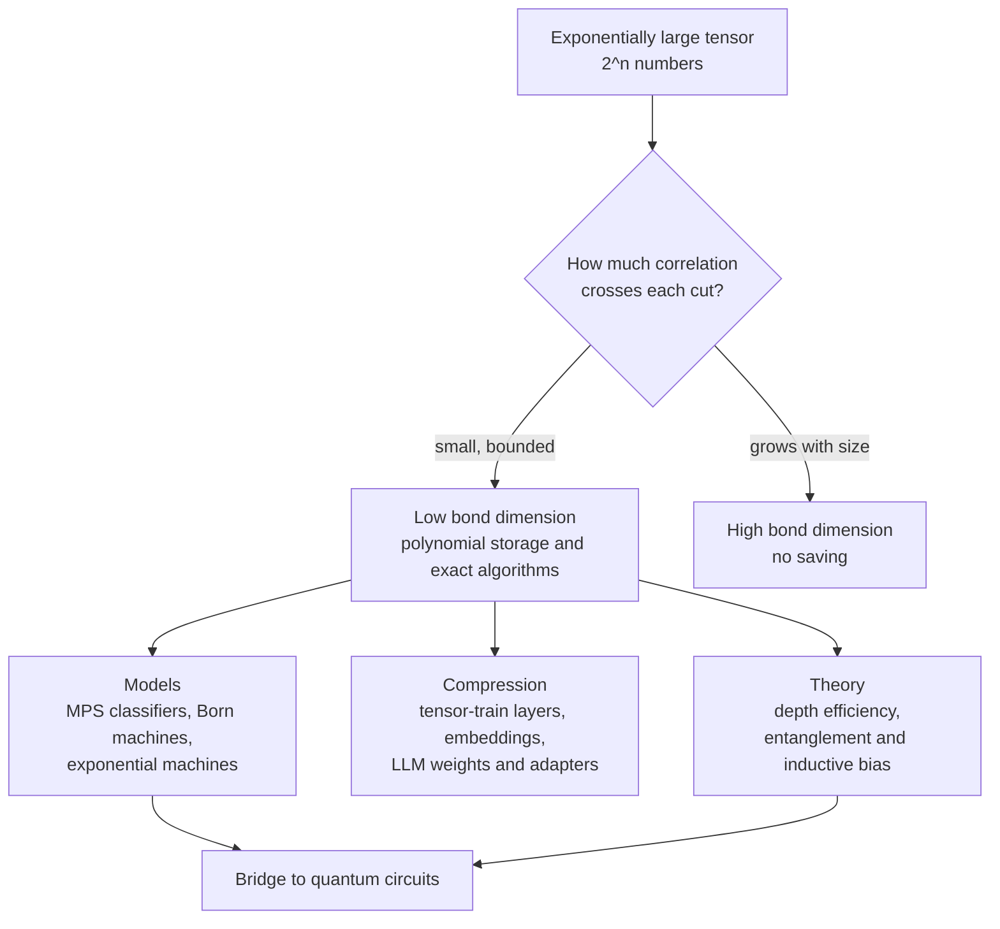

# Tensor networks as machine learning models

A function of 20 binary inputs has $2^{20}$, about a million, possible input patterns. A function of 784 binary pixels has $2^{784}$, more than the number of atoms in the observable universe. Physicists hit exactly this wall in the 1990s when they tried to write down the quantum state of a chain of interacting spins, and they climbed over it with **tensor networks**: ways of writing an exponentially large table of numbers as a chain or tree of small tables, glued together along shared indices. The same tools turn out to describe classifiers, generative models, compressed neural-network layers, and even the reason deep networks beat shallow ones. This page covers the mathematics, the three ways machine learning uses tensor networks, a tested NumPy sketch, and an honest account of where the idea pays off and where it does not.

> **The core idea.** A tensor network stores a huge tensor as a network of small ones. Its cost is set by the **bond dimensions**, the sizes of the indices that connect the small tensors. A bond dimension is a hard budget on how much correlation can flow across that cut of the network. When the data's correlations across every cut are modest, the exponential table collapses to something polynomial. When they are not, no clever contraction saves you.



## 1. Tensors, diagrams and contraction (established)

A tensor is a multi-dimensional array: a vector has one index, a matrix two, and a tensor $T_{i_1 i_2 \dots i_n}$ has $n$. If each index takes $d$ values, the tensor holds $d^n$ numbers. That exponential count is the **curse of dimensionality** in its purest form.

Tensor-network notation draws each small tensor as a node and each index as a line. A line joining two nodes is a summed (contracted) index; a dangling line is a free index. A matrix product $C_{ik} = \sum_j A_{ij} B_{jk}$ is two nodes joined by one line. Kolda and Bader (2009) survey the classical decompositions that came before the network view:

| Format | What it writes $T_{i_1 \dots i_n}$ as | Parameters (rank $r$) | Stable to compute? |
|---|---|---|---|
| CP (canonical polyadic) | a sum of $r$ outer products of vectors | $n d r$ | no: best rank-$r$ approximation can fail to exist |
| Tucker | a core tensor multiplied by a matrix on each index | $r^n + n d r$ | yes, but the core is still exponential |
| Tensor train / MPS | a chain of 3-index cores, one per input | about $n d r^2$ | yes: a sequence of SVDs |
| Tree tensor network / hierarchical Tucker | a binary tree of cores | about $n d r^2 + n r^3$ | yes |
| PEPS | a 2-D grid of cores | about $n d r^4$ | exact contraction is hard in general |

## 2. The tensor train, or matrix product state (established)

The workhorse is the **tensor train** (TT), introduced to numerical analysis by Oseledets (2011) and known in physics, where it was found earlier, as the **matrix product state** (MPS):

$$
T_{i_1 i_2 \dots i_n} \;=\; G_1[i_1]\, G_2[i_2] \cdots G_n[i_n],
$$

where each $G_k[i_k]$ is an $r_{k-1} \times r_k$ matrix picked out by the value of $i_k$, and $r_0 = r_n = 1$ so the product is a number. The $r_k$ are the **TT ranks** or **bond dimensions**. Storage is $\sum_k d\, r_{k-1} r_k$, linear in $n$ when the ranks are bounded.

The ranks are not arbitrary. Reshape $T$ into a matrix whose rows are indexed by $(i_1, \dots, i_k)$ and columns by $(i_{k+1}, \dots, i_n)$; this is the **unfolding** at cut $k$. Oseledets (2011) proved that the minimal TT rank at cut $k$ equals the ordinary matrix rank of that unfolding, and gave the **TT-SVD** algorithm: sweep left to right, take a truncated SVD at each cut, and pass the remainder on. If each truncation discards singular values of total squared size at most $\varepsilon_k^2$, the overall error obeys

$$
\| T - T_{\text{TT}} \|_F^2 \;\le\; \sum_{k=1}^{n-1} \varepsilon_k^2 ,
$$

so the approximation is quasi-optimal and its error is controlled in advance. Oseledets and Tyrtyshnikov (2010) added **TT-cross**, which builds the train from a small number of sampled entries without ever forming the full tensor. Khoromskij (2011) showed that reshaping a vector of $2^n$ samples into an $n$-index tensor with two values per index, the **quantized tensor train** (QTT), compresses many smooth functions to logarithmic size.

### The physics behind it

White (1992) invented the **density-matrix renormalization group** (DMRG), which turned out to be a variational optimization over matrix product states, sweeping through the chain and updating one or two cores at a time. Vidal (2003) showed that quantum computations whose states stay "slightly entangled" can be simulated efficiently on a classical computer by exactly this representation, and Schollwöck (2011) and Orús (2014) give the standard modern introductions.

Why do physical states compress? For a quantum state written as an MPS, the bond dimension at a cut bounds the **Schmidt rank** across that cut, and so bounds the entanglement entropy at $\log r$. Ground states of gapped one-dimensional systems obey an **area law**: their entanglement across a cut does not grow with the size of the system (Eisert, Cramer & Plenio, 2010). That is the deep reason a modest, fixed bond dimension suffices for them.

## 3. Correlation is the currency (established for quantum states, active research for data)

The same accounting applies to data. Take the square root of a probability distribution over $n$ bits and unfold it at a cut. Its rank is the minimum bond dimension an MPS with those (non-negative) amplitudes needs at that cut to represent the distribution exactly as a **Born machine** (section 4.2); other sign choices can occasionally do better, but the count is a good guide. Distributions with strong long-range dependence across the cut need large bonds.

Two studies measured this on real data. Convy et al. (2022) showed that the mutual information between two parts of the input lower-bounds the entanglement a probabilistic tensor-network classifier needs, and found clear boundary-law (area-law-like) scaling in the Tiny Images dataset. Lu et al. (2025, preprint 2021) estimated how mutual information grows with the size of a region and found that for **text** it grows as a power law close to a **volume law**, meaning one-dimensional tensor networks cannot describe text efficiently, while for **images** it is close to an area law, suggesting two-dimensional networks such as PEPS could suffice. This offers one plausible explanation of why attention-based models, not tensor trains, took over language: in text, correlations cross every cut.

## 4. Three ways machine learning uses tensor networks

### 4.1 Tensor networks as the model (active research)

Stoudenmire and Schwab (2016) mapped each pixel through a small feature map, for example $\phi(x) = (\cos \tfrac{\pi x}{2}, \sin \tfrac{\pi x}{2})$, took the tensor product of all 784 maps (a vector of dimension $2^{784}$), and classified with a weight tensor of the same size stored as an MPS:

$$
f^{\ell}(\mathbf{x}) \;=\; W^{\ell} \cdot \Phi(\mathbf{x}), \qquad \Phi(\mathbf{x}) = \phi(x_1) \otimes \phi(x_2) \otimes \cdots \otimes \phi(x_{784}).
$$

The model is linear in an exponentially large feature space, yet evaluation costs only a chain of small matrix products. Trained with a DMRG-style sweep, it reached less than 1% test error on MNIST. Novikov, Trofimov and Oseledets (2016) used the same trick in **Exponential Machines**, which model interactions of every order among features with a TT-format weight tensor and were fit with Riemannian optimization on tensors with $2^{160}$ entries. Wang et al. (2020) used a tensor-network linear map in an exponentially large space for one-class anomaly detection and report beating deep and classical baselines on tabular data. Stoudenmire (2018) added multi-scale tree networks that coarse-grain features before the classifier sees them.

### 4.2 Born machines and probabilistic models (active research)

Han et al. (2018) defined a generative model in which the probability of a configuration is the squared amplitude of an MPS, as in quantum mechanics:

$$
p(\mathbf{x}) \;=\; \frac{|\psi(\mathbf{x})|^2}{Z}, \qquad \psi(\mathbf{x}) = G_1[x_1] \cdots G_n[x_n], \qquad Z = \sum_{\mathbf{x}} |\psi(\mathbf{x})|^2 .
$$

Unlike most energy-based models, $Z$ is computed exactly by contracting the chain with its own copy, so the likelihood is exact, and samples are drawn **perfectly**, one variable at a time from exact conditionals, with no Markov chain. The bond dimension can also grow and shrink during training. Cheng et al. (2019) moved to tree tensor networks and found them better than MPS at keeping the correlations between pixels in natural images, with better log-likelihoods on binarized MNIST. Miller, Rabusseau and Terilla (2021) made the cores identical along the chain (uniform MPS) and showed that a trained model can sample from conditionals defined by regular expressions, which neural generative models do not do directly.

Glasser et al. (2019) gave the cleanest theory of these models. Non-negative tensor trains correspond exactly to hidden Markov models; Born machines are naturally related to local quantum circuits; and there are distributions for which the resources needed by one factorization are unboundedly larger than another's. Allowing complex rather than real tensors can reduce the parameter count by an arbitrarily large factor, and their **locally purified states** are provably more expressive than all the other forms they consider.

### 4.3 Tensor networks as a theory of deep networks (established theorems for restricted models)

Cohen, Sharir and Shashua (2016) studied **convolutional arithmetic circuits**, networks whose layers multiply rather than apply ReLUs, and showed they are exactly tensor decompositions: a shallow network is a CP decomposition and a deep one is a hierarchical Tucker decomposition. Except on a set of measure zero, a function computed by a polynomial-size deep network needs exponential size in a shallow one. This was among the first proofs of **depth efficiency** that respects locality, weight sharing and pooling. Levine et al. (2017) went further and showed that the number of channels in each layer controls which correlations between input regions the network can model, through the **min-cut** of the equivalent tensor network, the same quantity that bounds entanglement in a quantum state. Their theory applies exactly to multiplicative circuits; they validate the predictions empirically on ordinary ReLU convolutional networks.

## 5. Compression of neural networks (established, with caveats at LLM scale)

The most widespread use is compressing weights. A $1024 \times 1024$ matrix can be viewed as a 10-index tensor with four values per index, the row and column indices interleaved, and stored as a **TT-matrix** (a matrix product operator). Multiplying by it is then a chain of small contractions.

| Work | What was tensorized | Reported result |
|---|---|---|
| Lebedev et al. (2014) | convolution kernels, CP decomposition | faster convolutions after fine-tuning |
| Novikov et al. (2015) | fully connected layers of VGG, TT-matrix | one dense layer compressed up to 200,000 times; whole network up to 7 times |
| Garipov et al. (2016) | convolutional and fully connected layers | 80 times network compression with a 1.1% accuracy drop on CIFAR-10 |
| Yang, Krompass & Tresp (2017) | input-to-hidden matrix of an RNN on video | competitive accuracy with orders of magnitude fewer parameters |
| Hrinchuk et al. (2019) | word embedding tables | large compression with negligible loss or slight gain |
| Ma et al. (2019) | self-attention, block-term decomposition | compressed models that also improved language-modelling scores in their tests |
| Tomut et al. (2024), CompactifAI | LLaMA-7B layers, combined with quantization | authors report 93% less memory, 70% fewer parameters, and a 2–3% accuracy drop |
| Yang et al. (2024), LoRETTA; Anjum et al. (2024), TT-LoRA | fine-tuning updates, tensor-train adapters | comparable fine-tuning quality with up to 100 times fewer trainable parameters than common methods (LoRETTA, LLaMA-2-7B) |

Two cautions keep this honest. First, **trained weights are not automatically low-rank**. Solgi et al. (2025) note that the high-rank nature of pre-trained LLM weights makes post-training tensor compression hard, which is why their Saten method adds a sparse correction to the tensor network, and why the large compression ratios in the table usually come with retraining or fine-tuning. Second, **fewer parameters are not the same as faster inference**. A long chain of small contractions can run worse on a GPU than one large matrix product. The 2026 survey by Tarasov et al. makes this explicit with a metric, $\rho_{\text{gap}}$, for the gap between theoretical memory reduction and measured system-level speedup.

## 6. The bridge to quantum computing (active research)

Because an MPS or tree network with bond dimension $2^k$ can be turned into a circuit acting on $k$ qubits at a time, Huggins et al. (2019) proposed training tree and MPS classifiers classically and then moving them onto quantum hardware, with qubit counts that grow only logarithmically with the input size or not at all. Grant et al. (2018) built hierarchical quantum classifiers from tree-network circuits. Rieser, Köster and Raulf (2023) review this line.

The bridge runs the other way too. Tensor networks are among the strongest **classical** simulators of quantum devices. Kim et al. (2023) used a 127-qubit processor with error mitigation to study a kicked Ising model and presented it as evidence of quantum utility before fault tolerance. Tindall et al. (2024) then simulated the same experiment classically with a tensor network shaped like the device's lattice, contracted approximately with belief propagation, and obtained results they describe as more accurate and precise than the processor's. And neural networks have joined the toolkit for quantum states: Carleo and Troyer (2017) showed that a restricted Boltzmann machine can represent many-body wave functions variationally, a neural alternative to the MPS ansatz. The practical lesson for [quantum machine learning](quantum-machine-learning.md) is that a claimed quantum advantage must beat tensor-network simulation, not just brute force.

## 7. A tested sketch: ranks, Born machines and compression

The script below (NumPy only, about 9 seconds on a multi-core CPU) checks three claims from this page. It is reproduced in full in the [appendix](#appendix-the-script).

**Smooth functions have tiny QTT ranks; noise does not.** Each signal is sampled at $2^{20} = 1{,}048{,}576$ points, reshaped into a 20-index tensor of 2s, and compressed by TT-SVD at a relative error of $10^{-8}$.

| Signal | Largest TT rank | Parameters | Compression | Relative error |
|---|---|---|---|---|
| $e^{-3x}$ | 1 | 40 | 26,214× | $1.6 \times 10^{-14}$ |
| $\sin 40x$ | 2 | 152 | 6,899× | $1.1 \times 10^{-14}$ |
| $\sin 40x + e^{-3x}$ | 3 | 300 | 3,495× | $1.3 \times 10^{-9}$ |
| cubic polynomial | 4 | 302 | 3,472× | $1.5 \times 10^{-9}$ |
| $1/(1 + 25(x - 0.5)^2)$ | 8 | 634 | 1,654× | $1.9 \times 10^{-9}$ |
| Gaussian noise | 1,024 | 2,796,200 | 0.4× | $9.8 \times 10^{-15}$ |

The ranks match what algebra predicts: an exponential factorizes across bits (rank 1), a sinusoid is a sum of two exponentials (rank 2), and a polynomial of degree $p$ needs rank at most $p + 1$. Noise has no structure, its ranks rise to the maximum $2^{10}$ at the middle cut, and the "compressed" form is 2.7 times larger than the original.

**A Born machine for parity with bond dimension 2.** The uniform distribution over 16-bit strings with an even number of ones is an MPS whose two-dimensional bond simply carries the running parity. Contracting the chain gives $Z = 32{,}768 = 2^{15}$ exactly. Drawing 20,000 perfect samples from exact conditionals, every one has even parity (fraction 1.0000), while each individual bit is a fair coin (empirical means between 0.494 and 0.507). The middle-cut Schmidt rank of the non-negative amplitude $\sqrt{p}$ is 2 for parity, but 256, the maximum, both for a distribution that copies the first eight bits into the last eight and for a random distribution. Copying is simple to describe but correlates every bit with one across the cut, which is exactly what bond dimension charges for.

**Compressing a dense layer only works if the layer has structure.** A $1024 \times 1024$ matrix is reshaped into a TT-matrix with five $16$-valued cores and truncated at a maximum rank.

| Rank cap | Parameters | Compression | Random Gaussian matrix, relative error | Sum of 3 Kronecker products + 1% noise, relative error |
|---|---|---|---|---|
| 3 | 528 | 1,986× | 1.000 | 0.0100 |
| 16 | 12,800 | 82× | 0.990 | 0.0099 |
| 64 | 98,816 | 11× | 0.926 | 0.0093 |

The structured matrix is captured at rank 3, with the error sitting at the 1% noise floor, while the random matrix loses almost everything even at 11× compression. Trained network weights sit between these extremes, which is why tensorized layers are usually trained in the compressed format, or fine-tuned after compression, rather than truncated once.

## 8. Status at a glance

| Claim | Status |
|---|---|
| TT/MPS compression is quasi-optimal with a controllable error bound | Established (Oseledets, 2011) |
| Low-entanglement quantum states are efficiently simulable with MPS | Established (Vidal, 2003; area laws for gapped 1-D systems) |
| MPS classifiers and Born machines work on small benchmarks such as MNIST | Established on small data; not competitive with deep networks at scale |
| Exact likelihoods and perfect sampling for MPS and tree Born machines | Established |
| Text correlations follow a near-volume law that defeats 1-D tensor networks | Active research (one main study, Lu et al.) |
| Deep multiplicative networks are exponentially more efficient than shallow ones | Established for convolutional arithmetic circuits; extension to ReLU networks partial |
| TT layers compress CNN and RNN layers by large factors with small accuracy loss | Established, mostly with training in the compressed format |
| Tensor-network compression of pre-trained LLMs without retraining | Active research; reported results are largely from method authors |
| Fewer tensor-network parameters translate into wall-clock speedups | Often not; depends on kernels and hardware |
| Tensor networks set the bar any claimed quantum advantage must clear | Established in practice (for example Tindall et al., 2024) |

## 9. Speculative: tensor networks as a hardware contract

> [!WARNING]
> **Speculative.** The ideas in this section are open hypotheses, not established results.

- **Small cores for small physical units.** A TT-matrix replaces one large matrix product with a sequence of small, fixed-size contractions. Hardware whose natural unit is a small, fixed-size linear operation, such as an analog crossbar tile or a programmable optical mesh of limited port count, might execute such chains more naturally than one large dense layer. Whether the extra passes, conversions and data movement erase the benefit is untested and is exactly the compression-realization gap of section 5.
- **Bond dimension as a precision budget.** In noisy analog hardware, every bond carries signal plus noise. It is plausible, but unmeasured, that noise injected at a bond acts like an effective cap on bond dimension, so that a network's correlation budget and its hardware noise budget are the same quantity seen two ways. This would be falsified if analog-executed tensor trains degrade in ways unrelated to the singular value spectra at their cuts.
- **Unitary cores.** Canonical-form MPS cores are isometries, and interferometer meshes implement unitaries. Training models whose cores are constrained to be unitary would make them natural candidates for optical or quantum execution, at an unknown cost in expressivity on real data.

## Appendix: the script

```python
import numpy as np
rng = np.random.default_rng(0)

def tt_svd(T, shape, eps):
    """Oseledets' TT-SVD: sequential truncated SVDs. Returns cores and ranks."""
    d = len(shape); delta = eps / np.sqrt(d - 1) * np.linalg.norm(T)
    cores, r, C = [], 1, T.reshape(-1)
    for k in range(d - 1):
        C = C.reshape(r * shape[k], -1)
        U, s, Vt = np.linalg.svd(C, full_matrices=False)
        tail = np.sqrt(np.cumsum(s[::-1] ** 2))[::-1]          # tail[i] = ||s[i:]||
        rk = max(1, int(np.sum(tail > delta)))
        cores.append(U[:, :rk].reshape(r, shape[k], rk))
        C = s[:rk, None] * Vt[:rk]; r = rk
    cores.append(C.reshape(r, shape[-1], 1))
    return cores

def tt_full(cores):
    X = cores[0]
    for G in cores[1:]:
        X = np.tensordot(X, G, axes=(X.ndim - 1, 0))
    return X.reshape(-1)

# 1. Quantized tensor train: a vector of 2^20 samples viewed as a 2x2x...x2 tensor
d = 20; x = np.arange(2 ** d) / 2 ** d
signals = {
    'exp(-3x)': np.exp(-3 * x),
    'sin(40x)': np.sin(40 * x),
    'sin(40x)+exp(-3x)': np.sin(40 * x) + np.exp(-3 * x),
    'x^3 polynomial': 1 - 2 * x + 0.5 * x ** 3,
    '1/(1+25(x-0.5)^2)': 1 / (1 + 25 * (x - 0.5) ** 2),
    'random noise': rng.standard_normal(2 ** d),
}
print('1. QTT ranks of 2^20-sample signals at relative error 1e-8')
for name, v in signals.items():
    cores = tt_svd(v, [2] * d, 1e-8)
    ranks = [G.shape[2] for G in cores[:-1]]
    params = sum(G.size for G in cores)
    err = np.linalg.norm(tt_full(cores) - v) / np.linalg.norm(v)
    print(f'  {name:20s} max rank {max(ranks):5d}  params {params:9d}  '
          f'ratio {2**d/params:10.1f}x  rel err {err:.1e}')

# 2. A Born machine: parity as an MPS with bond dimension 2, perfect sampling
n = 16
A = np.zeros((2, 2, 2))                       # A[left parity, bit, right parity]
for p in range(2):
    for b in range(2):
        A[p, b, p ^ b] = 1.0
left = np.array([1.0, 0.0]); right = np.array([1.0, 0.0])   # start even, end even
def amp(bits):
    v = left
    for b in bits: v = v @ A[:, b, :]
    return v @ right
# normalisation Z = sum_x psi(x)^2 by transfer matrices: E = sum_b A_b (x) A_b
E_ = sum(np.kron(A[:, b, :], A[:, b, :]) for b in range(2))
Z = np.kron(left, left) @ np.linalg.matrix_power(E_, n) @ np.kron(right, right)
print(f'\n2. parity Born machine, n={n}: Z = {Z:.0f} (expected 2^{n-1} = {2**(n-1)})')
# right environments for exact conditional sampling
R = [None] * (n + 1); R[n] = np.outer(right, right)
for k in range(n - 1, -1, -1):
    R[k] = sum(A[:, b, :] @ R[k + 1] @ A[:, b, :].T for b in range(2))
def sample():
    v, bits = left, []
    for k in range(n):
        p = np.array([(v @ A[:, b, :]) @ R[k + 1] @ (v @ A[:, b, :]) for b in range(2)])
        b = rng.choice(2, p=p / p.sum()); bits.append(b); v = v @ A[:, b, :]
    return bits
S = np.array([sample() for _ in range(20000)])
print(f'  20,000 exact samples: fraction with even parity = {np.mean(S.sum(1) % 2 == 0):.4f}; '
      f'mean of each bit in [{S.mean(0).min():.3f}, {S.mean(0).max():.3f}]')
print(f'  amplitude check: psi(0101..)={amp([0,1]*8):.0f}, psi(1000..)={amp([1]+[0]*15):.0f}')

# Schmidt rank across the middle cut = smallest bond dimension any MPS can use there
def middle_rank(p, n, tol=1e-10):
    M = np.sqrt(p).reshape(2 ** (n // 2), -1)
    s = np.linalg.svd(M, compute_uv=False)
    return int(np.sum(s > tol * s[0]))
allx = ((np.arange(2 ** n)[:, None] >> np.arange(n)[::-1]) & 1)
par = (allx.sum(1) % 2 == 0).astype(float); par /= par.sum()
rnd = rng.random(2 ** n); rnd /= rnd.sum()
# "match": first half equals second half (long-range correlation across the cut)
match = (allx[:, :n // 2] == allx[:, n // 2:]).all(1).astype(float); match /= match.sum()
print(f'  middle-cut Schmidt rank: parity {middle_rank(par, n)}, '
      f'copy-first-half-to-second {middle_rank(match, n)}, random distribution {middle_rank(rnd, n)}')

# 3. TT-matrix layer: a 1024x1024 weight matrix as a (4x4)^5 tensor
def tt_matrix_error(W, rank_cap):
    T = W.reshape([4] * 10).transpose([0, 5, 1, 6, 2, 7, 3, 8, 4, 9]).reshape(-1)
    shape = [16] * 5; C = T; r = 1; cores = []
    for k in range(4):
        C = C.reshape(r * 16, -1)
        U, s, Vt = np.linalg.svd(C, full_matrices=False)
        rk = min(rank_cap, len(s))
        cores.append(U[:, :rk].reshape(r, 16, rk)); C = s[:rk, None] * Vt[:rk]; r = rk
    cores.append(C.reshape(r, 16, 1))
    approx = tt_full(cores)
    return np.linalg.norm(approx - T) / np.linalg.norm(T), sum(G.size for G in cores)
N = 1024
Wrand = rng.standard_normal((N, N)) / np.sqrt(N)
# structured: sum of 3 Kronecker products of five 4x4 factors, plus 1% noise
def kron_term():
    K = np.ones((1, 1))
    for _ in range(5): K = np.kron(K, rng.standard_normal((4, 4)))
    return K
Wstruct = sum(kron_term() for _ in range(3)); Wstruct /= np.linalg.norm(Wstruct) / np.sqrt(N)
Wstruct_noisy = Wstruct + 0.01 * rng.standard_normal((N, N)) * np.linalg.norm(Wstruct) / N
print('\n3. TT-matrix compression of a 1024x1024 layer (1,048,576 numbers)')
for cap in [3, 16, 64]:
    e1, p1 = tt_matrix_error(Wrand, cap); e2, p2 = tt_matrix_error(Wstruct_noisy, cap)
    print(f'  rank cap {cap:3d}: params {p1:8d} ({N*N/p1:7.1f}x)  '
          f'random W rel err {e1:.3f}   structured W rel err {e2:.4f}')
```

## Further reading

- Anjum, A., Eren, M. E., Boureima, I., Alexandrov, B., Bhattarai, M. (2024). *Tensor train low-rank approximation (TT-LoRA): Democratizing AI with accelerated LLMs*. [arXiv:2408.01008](https://arxiv.org/abs/2408.01008)
- Carleo, G., Troyer, M. (2017). *Solving the quantum many-body problem with artificial neural networks*. Science 355, 602–606. [doi:10.1126/science.aag2302](https://doi.org/10.1126/science.aag2302) (preprint: [arXiv:1606.02318](https://arxiv.org/abs/1606.02318))
- Cheng, S., Wang, L., Xiang, T., Zhang, P. (2019). *Tree tensor networks for generative modeling*. Physical Review B 99, 155131. [doi:10.1103/PhysRevB.99.155131](https://doi.org/10.1103/PhysRevB.99.155131) (preprint: [arXiv:1901.02217](https://arxiv.org/abs/1901.02217))
- Cohen, N., Sharir, O., Shashua, A. (2016). *On the expressive power of deep learning: A tensor analysis*. COLT 2016. [arXiv:1509.05009](https://arxiv.org/abs/1509.05009)
- Convy, I., Huggins, W., Liao, H., Whaley, K. B. (2022). *Mutual information scaling for tensor network machine learning*. Machine Learning: Science and Technology 3, 015017. [doi:10.1088/2632-2153/ac44a9](https://doi.org/10.1088/2632-2153/ac44a9) (preprint: [arXiv:2103.00105](https://arxiv.org/abs/2103.00105))
- Efthymiou, S., Hidary, J., Leichenauer, S. (2019). *TensorNetwork for machine learning*. [arXiv:1906.06329](https://arxiv.org/abs/1906.06329)
- Eisert, J., Cramer, M., Plenio, M. B. (2010). *Colloquium: Area laws for the entanglement entropy*. Reviews of Modern Physics 82, 277. [doi:10.1103/RevModPhys.82.277](https://doi.org/10.1103/RevModPhys.82.277) (preprint: [arXiv:0808.3773](https://arxiv.org/abs/0808.3773))
- Garipov, T., Podoprikhin, D., Novikov, A., Vetrov, D. (2016). *Ultimate tensorization: Compressing convolutional and FC layers alike*. [arXiv:1611.03214](https://arxiv.org/abs/1611.03214)
- Glasser, I., Sweke, R., Pancotti, N., Eisert, J., Cirac, J. I. (2019). *Expressive power of tensor-network factorizations for probabilistic modeling*. NeurIPS 2019. [arXiv:1907.03741](https://arxiv.org/abs/1907.03741)
- Grant, E., Benedetti, M., Cao, S., Hallam, A., Lockhart, J., Stojevic, V., Green, A. G., Severini, S. (2018). *Hierarchical quantum classifiers*. npj Quantum Information 4, 65. [doi:10.1038/s41534-018-0116-9](https://doi.org/10.1038/s41534-018-0116-9) (preprint: [arXiv:1804.03680](https://arxiv.org/abs/1804.03680))
- Han, Z.-Y., Wang, J., Fan, H., Wang, L., Zhang, P. (2018). *Unsupervised generative modeling using matrix product states*. Physical Review X 8, 031012. [doi:10.1103/PhysRevX.8.031012](https://doi.org/10.1103/PhysRevX.8.031012) (preprint: [arXiv:1709.01662](https://arxiv.org/abs/1709.01662))
- Hrinchuk, O., Khrulkov, V., Mirvakhabova, L., Orlova, E., Oseledets, I. (2019). *Tensorized embedding layers for efficient model compression*. [arXiv:1901.10787](https://arxiv.org/abs/1901.10787)
- Huggins, W., Patel, P., Whaley, K. B., Stoudenmire, E. M. (2019). *Towards quantum machine learning with tensor networks*. Quantum Science and Technology 4, 024001. [doi:10.1088/2058-9565/aaea94](https://doi.org/10.1088/2058-9565/aaea94) (preprint: [arXiv:1803.11537](https://arxiv.org/abs/1803.11537))
- Khoromskij, B. N. (2011). *O(d log N)-quantics approximation of N-d tensors in high-dimensional numerical modeling*. Constructive Approximation 34, 257–280. [doi:10.1007/s00365-011-9131-1](https://doi.org/10.1007/s00365-011-9131-1)
- Kim, Y., Eddins, A., Anand, S., Wei, K. X., van den Berg, E., et al. (2023). *Evidence for the utility of quantum computing before fault tolerance*. Nature 618, 500–505. [doi:10.1038/s41586-023-06096-3](https://doi.org/10.1038/s41586-023-06096-3)
- Kolda, T. G., Bader, B. W. (2009). *Tensor decompositions and applications*. SIAM Review 51(3), 455–500. [doi:10.1137/07070111X](https://doi.org/10.1137/07070111X)
- Lebedev, V., Ganin, Y., Rakhuba, M., Oseledets, I., Lempitsky, V. (2014). *Speeding-up convolutional neural networks using fine-tuned CP-decomposition*. ICLR 2015. [arXiv:1412.6553](https://arxiv.org/abs/1412.6553)
- Levine, Y., Yakira, D., Cohen, N., Shashua, A. (2017). *Deep learning and quantum entanglement: Fundamental connections with implications to network design*. [arXiv:1704.01552](https://arxiv.org/abs/1704.01552)
- Lu, S., Kanász-Nagy, M., Kukuljan, I., Cirac, J. I. (2025). *Tensor networks and efficient descriptions of classical data*. Physical Review A 111, 032409. [doi:10.1103/PhysRevA.111.032409](https://doi.org/10.1103/PhysRevA.111.032409) (preprint: [arXiv:2103.06872](https://arxiv.org/abs/2103.06872))
- Ma, X., Zhang, P., Zhang, S., Duan, N., Hou, Y., Song, D., Zhou, M. (2019). *A tensorized transformer for language modeling*. NeurIPS 2019. [arXiv:1906.09777](https://arxiv.org/abs/1906.09777)
- Miller, J., Rabusseau, G., Terilla, J. (2021). *Tensor networks for probabilistic sequence modeling*. [arXiv:2003.01039](https://arxiv.org/abs/2003.01039)
- Novikov, A., Podoprikhin, D., Osokin, A., Vetrov, D. (2015). *Tensorizing neural networks*. NIPS 2015. [arXiv:1509.06569](https://arxiv.org/abs/1509.06569)
- Novikov, A., Trofimov, M., Oseledets, I. (2016). *Exponential machines*. [arXiv:1605.03795](https://arxiv.org/abs/1605.03795)
- Orús, R. (2014). *A practical introduction to tensor networks: Matrix product states and projected entangled pair states*. Annals of Physics 349, 117–158. [doi:10.1016/j.aop.2014.06.013](https://doi.org/10.1016/j.aop.2014.06.013) (preprint: [arXiv:1306.2164](https://arxiv.org/abs/1306.2164))
- Oseledets, I. V. (2011). *Tensor-train decomposition*. SIAM Journal on Scientific Computing 33(5), 2295–2317. [doi:10.1137/090752286](https://doi.org/10.1137/090752286)
- Oseledets, I., Tyrtyshnikov, E. (2010). *TT-cross approximation for multidimensional arrays*. Linear Algebra and its Applications 432(1), 70–88. [doi:10.1016/j.laa.2009.07.024](https://doi.org/10.1016/j.laa.2009.07.024)
- Pestun, V., Vlassopoulos, Y. (2017). *Tensor network language model*. [arXiv:1710.10248](https://arxiv.org/abs/1710.10248)
- Rieser, H.-M., Köster, F., Raulf, A. P. (2023). *Tensor networks for quantum machine learning*. Proceedings of the Royal Society A. [doi:10.1098/rspa.2023.0218](https://doi.org/10.1098/rspa.2023.0218) (preprint: [arXiv:2303.11735](https://arxiv.org/abs/2303.11735))
- Schollwöck, U. (2011). *The density-matrix renormalization group in the age of matrix product states*. Annals of Physics 326, 96–192. [doi:10.1016/j.aop.2010.09.012](https://doi.org/10.1016/j.aop.2010.09.012) (preprint: [arXiv:1008.3477](https://arxiv.org/abs/1008.3477))
- Sengupta, R., Adhikary, S., Oseledets, I., Biamonte, J. (2022). *Tensor networks in machine learning*. [arXiv:2207.02851](https://arxiv.org/abs/2207.02851)
- Solgi, R., Zhen, K., Swaminathan, R. V., Susanj, N., Mouchtaris, A., Kunzmann, S., Zhang, Z. (2025). *Saten: Sparse augmented tensor networks for post-training compression of large language models*. [arXiv:2505.14871](https://arxiv.org/abs/2505.14871)
- Stoudenmire, E. M. (2018). *Learning relevant features of data with multi-scale tensor networks*. Quantum Science and Technology 3, 034003. [doi:10.1088/2058-9565/aaba1a](https://doi.org/10.1088/2058-9565/aaba1a) (preprint: [arXiv:1801.00315](https://arxiv.org/abs/1801.00315))
- Stoudenmire, E. M., Schwab, D. J. (2016). *Supervised learning with quantum-inspired tensor networks*. NIPS 2016. [arXiv:1605.05775](https://arxiv.org/abs/1605.05775)
- Tarasov, M., Ahmadi-Asl, S., de Almeida, A. L. F., Cichocki, A. (2026). *Tensor methods for language models: From token representation to training, adaptation, inference, compression, and interpretability*. [arXiv:2608.30505](https://arxiv.org/abs/2608.30505)
- Tindall, J., Fishman, M., Stoudenmire, E. M., Sels, D. (2024). *Efficient tensor network simulation of IBM's Eagle kicked Ising experiment*. PRX Quantum 5, 010308. [doi:10.1103/PRXQuantum.5.010308](https://doi.org/10.1103/PRXQuantum.5.010308) (preprint: [arXiv:2306.14887](https://arxiv.org/abs/2306.14887))
- Tomut, A., Jahromi, S. S., Sarkar, A., Kurt, U., Singh, S., Ishtiaq, F., Muñoz, C., Bajaj, P. S., Elborady, A., et al. (2024). *CompactifAI: Extreme compression of large language models using quantum-inspired tensor networks*. ESANN 2025. [arXiv:2401.14109](https://arxiv.org/abs/2401.14109)
- Vidal, G. (2003). *Efficient classical simulation of slightly entangled quantum computations*. Physical Review Letters 91, 147902. [doi:10.1103/PhysRevLett.91.147902](https://doi.org/10.1103/PhysRevLett.91.147902) (preprint: [arXiv:quant-ph/0301063](https://arxiv.org/abs/quant-ph/0301063))
- Wang, J., Roberts, C., Vidal, G., Leichenauer, S. (2020). *Anomaly detection with tensor networks*. [arXiv:2006.02516](https://arxiv.org/abs/2006.02516)
- White, S. R. (1992). *Density matrix formulation for quantum renormalization groups*. Physical Review Letters 69, 2863–2866. [doi:10.1103/PhysRevLett.69.2863](https://doi.org/10.1103/PhysRevLett.69.2863)
- Yang, Y., Krompass, D., Tresp, V. (2017). *Tensor-train recurrent neural networks for video classification*. ICML 2017. [arXiv:1707.01786](https://arxiv.org/abs/1707.01786)
- Yang, Y., Zhou, J., Wong, N., Zhang, Z. (2024). *LoRETTA: Low-rank economic tensor-train adaptation for ultra-low-parameter fine-tuning of large language models*. [arXiv:2402.11417](https://arxiv.org/abs/2402.11417)
