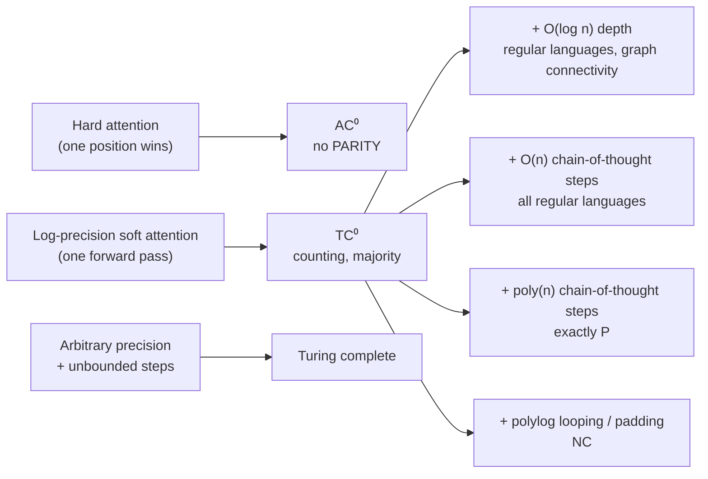

# What transformers can and cannot compute

A transformer that writes fluent code can still fail to say whether a string of bits contains an even or odd number of ones. That is not a quirk of training. It follows from what a fixed stack of attention layers can compute in one forward pass, and it is one of the cleanest results connecting modern AI to the classical theory of computation. This page asks what problems transformers can solve *in principle*, how the answer changes when a model is allowed to write a chain of thought, loop, or pad its input, and how much of that theory survives contact with training.

> **The core idea.** With realistic numeric precision, one forward pass of a transformer is a constant-depth, highly parallel circuit. That makes it fast, and it also caps what it can do: problems that need many *sequential* steps (tracking state, composing permutations, evaluating deep formulas) are out of reach unless the model is given extra steps, such as a chain of thought. Parallelism and expressive power trade off against each other.



## 1. The vocabulary of complexity (established)

The results below are stated in terms of **circuit complexity classes**, families of Boolean circuits whose size grows polynomially with the input length $n$:

| Class | Allowed gates | Depth | A typical problem it contains |
|---|---|---|---|
| $\mathsf{AC}^0$ | AND, OR, NOT with unbounded fan-in | constant | Is there any 1? |
| $\mathsf{TC}^0$ | adds MAJORITY (threshold) gates | constant | Are more than half the bits 1? Addition, multiplication of $n$-bit numbers |
| $\mathsf{NC}^1$ | bounded fan-in gates | $O(\log n)$ | Evaluating a Boolean formula, composing permutations of five elements |
| $\mathsf{NC}$ | bounded fan-in gates | polylog $n$ | Problems that parallelize well |
| $\mathsf{P}$ | anything a Turing machine does in polynomial time | polynomial | Problems that are efficiently solvable but may be inherently sequential |

Known facts: $\mathsf{AC}^0 \subsetneq \mathsf{TC}^0 \subseteq \mathsf{NC}^1 \subseteq \mathsf{NC} \subseteq \mathsf{P}$. PARITY is the classic problem outside $\mathsf{AC}^0$ but inside $\mathsf{TC}^0$. Whether $\mathsf{TC}^0 \neq \mathsf{NC}^1$ is open, but it is widely believed, in roughly the way $\mathsf{P} \neq \mathsf{NP}$ is. Many "no transformer can do X" results are therefore conditional: *if* $\mathsf{TC}^0 \neq \mathsf{NC}^1$, then no fixed-depth log-precision transformer solves an $\mathsf{NC}^1$-complete problem such as composing permutations.

**Uniformity** is a technical condition saying that the circuit for length $n$ can itself be built by a simple procedure. A transformer is uniform in this sense for free: the same weights handle every length.

## 2. Turing complete, with a catch (established)

Recurrent networks have been known to be Turing complete since Siegelmann and Sontag (1995), who showed that a finite network with rational weights and unbounded precision can simulate any Turing machine. Pérez, Marinković and Barceló (2019) proved the same for transformers with hard attention, arbitrary-precision arithmetic, and an unbounded number of decoding steps.

The catch is in the assumptions. These proofs store an unbounded tape in the digits of a single number, which needs precision that grows without limit, and they let the decoder run for as many steps as the computation takes. Real models have 16- or 32-bit numbers and are often judged on one forward pass. The interesting theory starts when those assumptions are removed.

## 3. Limits of a single forward pass (established)

### 3.1 Hard attention cannot count parity

Hahn (2020) studied attention that picks a single position (hard attention) and proved that a fixed number of layers and heads cannot recognize PARITY or the balanced-bracket language Dyck-2 for all input lengths. Hao, Angluin and Frank (2022) sharpened this: transformers with unique hard attention recognize only languages in $\mathsf{AC}^0$. Because PARITY is famously outside $\mathsf{AC}^0$, the impossibility follows from forty-year-old circuit lower bounds. Yang, Chiang and Angluin (2024) gave an exact characterization of one variant: masked hard-attention transformers recognize exactly the **star-free** regular languages, the ones definable without counting modulo a number.

### 3.2 Soft attention and the 1/n problem

Soft attention averages. Hahn's second argument is about **sensitivity**: if the attention scores are bounded, flipping one input bit can change each attention output by only $O(1/n)$, because that bit receives about a $1/n$ share of the weight. PARITY flips its answer whenever *any* bit flips, so a bounded soft-attention model must separate the two answers by a margin that shrinks as the input grows. The model's confidence in its own answer is pushed toward one half.

That is a statement about margins, not a flat impossibility. Chiang and Cholak (2022) built a transformer that computes PARITY exactly at every length, and showed that layer normalization can restore a usable margin. What the construction cannot escape is the need to resolve differences of size $1/n$, which brings us to precision.

### 3.3 Log precision puts transformers in TC⁰

Merrill, Sabharwal and Smith (2022) showed that saturated attention, a limit of soft attention that averages over the tied top positions, can be simulated by constant-depth threshold circuits, placing it in $\mathsf{TC}^0$. Merrill and Sabharwal (2023) extended this to soft attention with $O(\log n)$ bits of precision, enough to point to any position in the input, and showed the result holds even with uniformity. They call the consequence the **parallelism tradeoff**: the property that makes transformers fast to train (every position is processed in parallel by a fixed number of layers) is the same property that caps their power at $\mathsf{TC}^0$. Assuming $\mathsf{TC}^0 \neq \mathsf{NC}^1$, no such transformer can solve linear equalities, check membership in arbitrary context-free grammars, or compose permutations at every length.

A companion paper (Merrill & Sabharwal, 2023) gives a logic for the same class: anything a log-precision transformer computes can be written as a first-order logic sentence with **majority quantifiers** ("for most positions $i$, …"). That gives a readable upper bound on what one forward pass can express.

Li, Liu, Zhou and Ma (2024) showed that with *constant* precision and no chain of thought, the class drops further, to $\mathsf{AC}^0$.

### 3.4 Recurrent and state-space models are not an escape

It is tempting to think a recurrent model, which carries state forward one token at a time, avoids these limits. Merrill, Petty and Sabharwal (2024) showed that the linear state-space models used in many long-context architectures are also in $\mathsf{TC}^0$ when their recurrence is diagonal or similarly restricted, so they cannot track state in permutation-composition problems either: the "state" in the name is partly an illusion. A 2026 follow-up (Merrill, Jiang, Li, Lin & Sabharwal, to appear at ICML 2026) maps the finer structure: linear RNNs whose transition matrices are permutation-diagonal are $\mathsf{NC}^1$-complete, diagonal-plus-low-rank ones are $\mathsf{PNC}^1$-complete, and nonlinear RNNs can solve $\mathsf{L}$-complete problems, at the cost of being harder to parallelize. The authors argue this explains why some linear RNN layers can be computed in parallel while nonlinear ones cannot. That theory fed directly into a 7-billion-parameter hybrid model mixing attention with gated delta-rule recurrent layers, which the same group reports outperforming its attention-only predecessor and scaling more efficiently (Merrill et al., 2026). The [fast-weight programmers](fast-weight-programmers.md) page covers the delta rule itself.

## 4. Buying power with steps (established)

If one forward pass is a shallow circuit, the obvious fix is to run more of them. A model that writes a **chain of thought** feeds each output token back as input, so $T$ steps of decoding compose $T$ shallow circuits into a deep one.

| Extra resource | What it buys | Source |
|---|---|---|
| $O(\log n)$ chain-of-thought steps | Only slightly more than none | Merrill & Sabharwal (2024) |
| $O(n)$ chain-of-thought steps | Every regular language (finite-state tracking) | Merrill & Sabharwal (2024) |
| Polynomially many chain-of-thought steps | Exactly the class $\mathsf{P}$ | Merrill & Sabharwal (2024) |
| $T$ chain-of-thought steps, constant precision | Any Boolean circuit of size $T$ | Li et al. (2024) |
| Chain of thought | Arithmetic expressions and dynamic programming that bounded-depth models cannot do directly (assuming $\mathsf{TC}^0 \neq \mathsf{NC}^1$) | Feng et al. (2023) |
| Chain of thought | Word RAM algorithms with polylogarithmic overhead | Li, Svete, Sabharwal & Merrill (2026) |
| $O(\log n)$ depth (layers growing slowly with length) | Regular languages and graph connectivity | Merrill & Sabharwal (2025a) |
| Polynomial padding tokens | Exactly (FO-uniform) $\mathsf{TC}^0$ | Merrill & Sabharwal (2025b) |
| Padding plus $O(\log^d n)$ looping of the layers | $\mathsf{TC}^d$; polylog looping gives $\mathsf{NC}$ | Merrill & Sabharwal (2025b) |

The pattern is consistent. Extra *sequential* steps, whether written out as text or run silently as repeated layers, are what move a model up the hierarchy. Extra parallel space (padding) helps much less. A careful 2026 revisit (Svete, Merrill, Cotterell & Sabharwal) examines which architectural details these padding results actually depend on.

Two older lines of work fit the same picture. The **Universal Transformer** (Dehghani et al., 2018) shares one block across a variable number of steps, and **looped transformers** (Giannou et al., 2023) show that a fixed 13-layer network run in a loop can emulate a small instruction-set computer. Schuurmans (2023) showed that a large language model with an external read-write memory and a fixed prompt can simulate a universal Turing machine, making the combined system computationally universal. The [recursion and self-improvement](recursion-and-self-improvement.md) page discusses weight sharing across depth from the learning side.

## 5. A tested sketch: margin, precision, and steps

The script below makes three claims of the previous sections concrete with plain NumPy. It is a toy, not a trained model.

1. **Sensitivity.** A random single-layer soft-attention block with bounded weights, applied to bit strings of length $n$. Flip one random bit and measure how much the output moves.
2. **One pass, limited precision.** A hand-built one-pass parity solver: a uniform attention head computes the fraction of ones $k/n$, and a readout multiplies by $n$ and takes the result modulo 2. This is the essence of the exact constructions in section 3.2, and it only works if the arithmetic can tell $k/n$ from $(k+1)/n$.
3. **Chain of thought.** At step $t$ a sharp attention head fetches bit $t$, and the model XORs it with its previous output. Each step only needs to distinguish 0 from 1.

```python
import numpy as np
rng = np.random.default_rng(0)

# 1) Sensitivity of one bounded soft-attention layer: flipping one bit
#    moves the output by O(1/n) when attention scores are bounded.
def layer(x, Wq, Wk, Wv, pos):
    E = np.stack([x, 1 - x], 1) @ np.eye(2, 8) + pos[: len(x)]   # bit embedding + position
    q = E[-1] @ Wq; K = E @ Wk; V = E @ Wv
    s = K @ q; p = np.exp(s - s.max()); p /= p.sum()
    return p @ V
d = 8
Wq, Wk, Wv = (rng.uniform(-1, 1, (d, d)) for _ in range(3))
for n in [16, 64, 256, 1024, 4096]:
    pos = rng.uniform(-0.5, 0.5, (n, d))
    deltas = []
    for _ in range(200):
        x = rng.integers(0, 2, n).astype(float)
        i = rng.integers(n); y = x.copy(); y[i] = 1 - y[i]
        deltas.append(np.abs(layer(x, Wq, Wk, Wv, pos) - layer(y, Wq, Wk, Wv, pos)).max())
    print(f"sens n={n:5d} mean|dout|={np.mean(deltas):.2e}  n*mean={n*np.mean(deltas):.2f}")

# 2) One pass: uniform attention gives k/n; parity needs resolving 1/n.
def parity_one_pass(x, dtype):
    n = len(x)
    p = np.full(n, 1.0 / n, dtype=dtype)             # uniform attention weights
    frac = (p * x.astype(dtype)).sum(dtype=dtype)     # attention output, in `dtype`
    k = np.rint(np.float64(frac) * n)                 # exact readout of the count
    return int(k) % 2

# 3) Chain of thought: step t attends sharply to bit t, then XORs with its last output.
def parity_cot(x, dtype, beta=40.0):
    n = len(x); state = 0; idx = np.arange(n)
    for t in range(n):
        s = np.where(idx == t, beta, 0.0).astype(dtype)
        p = np.exp(s - s.max()); p = p / p.sum(dtype=dtype)
        bit = int(np.rint(np.float64((p * x.astype(dtype)).sum(dtype=dtype))))
        state ^= bit
    return state

for n in [64, 512, 2048, 4096, 16384, 65536]:
    for dt in [np.float16, np.float32]:
        acc = np.mean([parity_one_pass(x, dt) == x.sum() % 2
                       for x in rng.integers(0, 2, (200, n))])
        print(f"onepass n={n:6d} {dt.__name__}: {acc:.3f}")
for n in [64, 512, 4096]:
    acc = np.mean([parity_cot(x, np.float16) == x.sum() % 2
                   for x in rng.integers(0, 2, (100, n))])
    print(f"cot n={n:5d} float16: {acc:.3f}")
```

Results from one run (seed 0):

| Length $n$ | Mean output change from one bit flip | $n \times$ change |
|---|---|---|
| 16 | $1.27 \times 10^{-1}$ | 2.03 |
| 64 | $3.60 \times 10^{-2}$ | 2.30 |
| 256 | $7.70 \times 10^{-3}$ | 1.97 |
| 1,024 | $1.80 \times 10^{-3}$ | 1.84 |
| 4,096 | $3.81 \times 10^{-4}$ | 1.56 |

| Length $n$ | One pass, float16 | One pass, float32 | Chain of thought, float16 |
|---|---|---|---|
| 64 | 1.000 | 1.000 | 1.000 |
| 512 | 1.000 | 1.000 | 1.000 |
| 2,048 | 1.000 | 1.000 | not run |
| 4,096 | 0.725 | 1.000 | 1.000 |
| 16,384 | 0.435 | 1.000 | not run |
| 65,536 | 0.460 | 1.000 | not run |

What the numbers show:

- **The $1/n$ law is visible.** As the input grows 256-fold, the effect of one bit falls about 330-fold, and $n$ times the effect stays between about 1.6 and 2.3. A bounded soft-attention layer barely notices any single bit, which is exactly what parity cannot afford.
- **Precision decides whether the one-pass construction works.** Half-precision floats carry 11 significant bits, so near one half they cannot represent steps finer than $2^{-11} = 1/2048$. Up to $n = 2048$ the parity readout is perfect; at $n = 4096$ neighbouring counts start to collide and accuracy drops to 72.5%, and by $n = 16{,}384$ it is at chance. Single precision (24 bits) has no trouble in this range but would fail the same way at around $n = 2^{24}$. This is why the theorems in section 3 assume $O(\log n)$ bits: the precision must grow with the input, however slowly.
- **Steps replace precision.** The chain-of-thought version is exact at every tested length in half precision, because each step only has to tell 0 from 1. The price is $n$ sequential steps instead of one parallel pass, the parallelism tradeoff in miniature.

## 6. From what is expressible to what is learned (active research)

Expressivity results say a solution *exists* in weight space. They do not say gradient descent will find it, or that it will work on inputs longer than those seen in training.

- **Programs as a lens.** RASP (Weiss, Goldberg & Yahav, 2021) is a small programming language whose primitives (select, aggregate, elementwise maps) correspond to attention and MLP layers. Tracr (Lindner et al., 2023) compiles RASP programs into actual transformer weights, which gives interpretability researchers models with a known ground-truth algorithm.
- **The RASP generalization conjecture.** Zhou et al. (2023) proposed that transformers tend to length-generalize on a task when it has a *short* program in a restricted variant they call RASP-L, and found that this predicted success and failure across several algorithmic tasks. It remains a conjecture.
- **Length generalization is fragile.** Anil et al. (2022) found that fine-tuning and scale alone gave poor length generalization on simple algorithmic tasks. Zhou et al. (2024) reached 2.5 times the training length on decimal addition with the right number format and position encoding, but results varied strongly across random seeds.
- **Formal-language experiments.** Bhattamishra, Ahuja and Goyal (2020) and Delétang et al. (2022), who trained 20,910 models on 15 tasks, found that transformers often fail to generalize to longer inputs on tasks that need counting or a stack, while recurrent and memory-augmented models do better on some of them.
- **Shortcuts.** Liu et al. (2022) showed that shallow transformers can simulate finite automata over long sequences using logarithmic-depth "shortcut" solutions, but these shortcuts can be brittle out of distribution.
- **Sensitive functions are hard to learn, not only to express.** Hahn and Rofin (2024) argued that transformers trained by gradient descent are biased toward low-sensitivity functions, because high-sensitivity solutions need very sharp, brittle minima. Barak et al. (2022) showed that SGD learns sparse parities, but needs a number of steps close to the computational limit, with long periods of hidden progress before the loss drops.
- **Compositional tasks.** Dziri et al. (2023) found that large models solve multi-step tasks like multi-digit multiplication largely by matching patterns from training, with accuracy collapsing as the number of composition steps grows.
- **Next-token prediction as a learner.** Malach (2023) showed that even simple linear next-token predictors, trained on chain-of-thought data, can in principle learn to approximate any function computable by a Turing machine, pointing at the training *data* (intermediate steps) as the source of power.
- **Separations by task.** Sanford, Hsu and Telgarsky (2023) proved both strengths and limits: some sparse averaging tasks need only logarithmic width in a transformer but polynomial size in recurrent and feedforward networks, while a triple-detection task needs a large transformer.

A broad survey of the formal-language side is Strobl et al. (2024).

## 7. Status at a glance

| Claim | Status |
|---|---|
| Transformers with unbounded precision and unbounded decoding steps are Turing complete | Proved (Pérez et al., 2019); relies on unrealistic precision |
| Unique-hard-attention transformers are in $\mathsf{AC}^0$ and cannot compute PARITY | Proved |
| Log-precision transformers, in one forward pass, are in uniform $\mathsf{TC}^0$ | Proved |
| They cannot solve $\mathsf{NC}^1$-complete problems such as composing permutations | Proved *conditionally* on $\mathsf{TC}^0 \neq \mathsf{NC}^1$, which is open but widely believed |
| Diagonal state-space models share the $\mathsf{TC}^0$ limit | Proved for the studied architectures; richer transition matrices escape it |
| Polynomially many chain-of-thought steps give exactly $\mathsf{P}$ | Proved under the paper's precision and decoding assumptions |
| Single-bit influence in bounded soft attention shrinks like $1/n$ | Proved (Hahn, 2020); visible in the sketch above |
| Trained models find the expressible solutions and length-generalize | Often not; depends on task, format, position encoding and seed |
| The theory predicts which architectures work better in practice | Early evidence, e.g. hybrid recurrent-attention models designed from the theory; not yet a general rule |

## 8. Speculative: what precision-limited hardware does to the theory

> **Speculative.** The ideas in this section are hypotheses for discussion, not established results.

Every result above rests on a precision assumption: unbounded for Turing completeness, $O(\log n)$ bits for the $\mathsf{TC}^0$ bound, constant for the $\mathsf{AC}^0$ bound. Analog hardware, such as the [memristive crossbars](memristive-crossbars-in-memory-computing.md) and [photonic processors](photonic-computing.md) covered elsewhere in this section, does not have a fixed number of bits at all. It has noise, which sets an effective precision that is often well below 8 bits and does not grow with the input. Three questions follow, each testable in simulation.

1. **Does noisy analog attention behave like constant precision?** If the effective number of bits is fixed, the theory suggests a one-pass model on such hardware might drift toward the weaker constant-precision class, and the sketch's one-pass parity would fail at much smaller $n$ than in float16. Measuring where that failure point falls as a function of signal-to-noise ratio would turn a vague worry into a number.
2. **Can chain of thought rescue it?** In the sketch, each chain-of-thought step only needs to separate 0 from 1, which is the easiest possible precision demand. If that carries over, models that reason in many short, discrete steps could be the natural fit for low-precision physical hardware, with digital rounding of each emitted token acting as error correction between steps. This is a guess; error accumulation over long chains could just as easily dominate.
3. **Is noise ever helpful?** Random perturbation is known to smooth optimization. Whether it could also push training toward the low-sensitivity solutions that Hahn and Rofin describe, improving robustness, or away from the sharp solutions some algorithmic tasks require, is open.

## Further reading

- Anil, C., Wu, Y., Andreassen, A., Lewkowycz, A., Misra, V., Ramasesh, V., Slone, A., Gur-Ari, G., Dyer, E., Neyshabur, B. (2022). *Exploring length generalization in large language models*. NeurIPS 2022. [arXiv:2207.04901](https://arxiv.org/abs/2207.04901)
- Barak, B., Edelman, B. L., Goel, S., Kakade, S., Malach, E., Zhang, C. (2022). *Hidden progress in deep learning: SGD learns parities near the computational limit*. NeurIPS 2022. [arXiv:2207.08799](https://arxiv.org/abs/2207.08799)
- Bhattamishra, S., Ahuja, K., Goyal, N. (2020). *On the ability and limitations of transformers to recognize formal languages*. EMNLP 2020. [arXiv:2009.11264](https://arxiv.org/abs/2009.11264)
- Chiang, D., Cholak, P. (2022). *Overcoming a theoretical limitation of self-attention*. ACL 2022. [arXiv:2202.12172](https://arxiv.org/abs/2202.12172)
- Dehghani, M., Gouws, S., Vinyals, O., Uszkoreit, J., Kaiser, Ł. (2018). *Universal transformers*. ICLR 2019. [arXiv:1807.03819](https://arxiv.org/abs/1807.03819)
- Delétang, G., Ruoss, A., Grau-Moya, J., Genewein, T., Wenliang, L. K., Catt, E., Cundy, C., Hutter, M., Legg, S., Veness, J., Ortega, P. A. (2022). *Neural networks and the Chomsky hierarchy*. [arXiv:2207.02098](https://arxiv.org/abs/2207.02098)
- Dziri, N., Lu, X., Sclar, M., Li, X. L., Jiang, L., Lin, B. Y., et al. (2023). *Faith and fate: Limits of transformers on compositionality*. NeurIPS 2023. [arXiv:2305.18654](https://arxiv.org/abs/2305.18654)
- Feng, G., Zhang, B., Gu, Y., Ye, H., He, D., Wang, L. (2023). *Towards revealing the mystery behind chain of thought: A theoretical perspective*. NeurIPS 2023. [arXiv:2305.15408](https://arxiv.org/abs/2305.15408)
- Giannou, A., Rajput, S., Sohn, J., Lee, K., Lee, J. D., Papailiopoulos, D. (2023). *Looped transformers as programmable computers*. [arXiv:2301.13196](https://arxiv.org/abs/2301.13196)
- Hahn, M. (2020). *Theoretical limitations of self-attention in neural sequence models*. TACL 8. [arXiv:1906.06755](https://arxiv.org/abs/1906.06755)
- Hahn, M., Rofin, M. (2024). *Why are sensitive functions hard for transformers?* ACL 2024. [arXiv:2402.09963](https://arxiv.org/abs/2402.09963)
- Hao, Y., Angluin, D., Frank, R. (2022). *Formal language recognition by hard attention transformers: Perspectives from circuit complexity*. TACL. [arXiv:2204.06618](https://arxiv.org/abs/2204.06618)
- Li, Z., Liu, H., Zhou, D., Ma, T. (2024). *Chain of thought empowers transformers to solve inherently serial problems*. ICLR 2024. [arXiv:2402.12875](https://arxiv.org/abs/2402.12875)
- Li, Y., Svete, A., Sabharwal, A., Merrill, W. (2026). *Efficiently representing algorithms with chain-of-thought transformers*. [arXiv:2606.19697](https://arxiv.org/abs/2606.19697)
- Lindner, D., Kramár, J., Farquhar, S., Rahtz, M., McGrath, T., Mikulik, V. (2023). *Tracr: Compiled transformers as a laboratory for interpretability*. NeurIPS 2023. [arXiv:2301.05062](https://arxiv.org/abs/2301.05062)
- Liu, B., Ash, J. T., Goel, S., Krishnamurthy, A., Zhang, C. (2022). *Transformers learn shortcuts to automata*. [arXiv:2210.10749](https://arxiv.org/abs/2210.10749)
- Malach, E. (2023). *Auto-regressive next-token predictors are universal learners*. [arXiv:2309.06979](https://arxiv.org/abs/2309.06979)
- Merrill, W., Sabharwal, A., Smith, N. A. (2022). *Saturated transformers are constant-depth threshold circuits*. TACL. [arXiv:2106.16213](https://arxiv.org/abs/2106.16213)
- Merrill, W., Sabharwal, A. (2023). *The parallelism tradeoff: Limitations of log-precision transformers*. TACL. [arXiv:2207.00729](https://arxiv.org/abs/2207.00729)
- Merrill, W., Sabharwal, A. (2023). *A logic for expressing log-precision transformers*. NeurIPS 2023. [arXiv:2210.02671](https://arxiv.org/abs/2210.02671)
- Merrill, W., Sabharwal, A. (2024). *The expressive power of transformers with chain of thought*. ICLR 2024. [arXiv:2310.07923](https://arxiv.org/abs/2310.07923)
- Merrill, W., Petty, J., Sabharwal, A. (2024). *The illusion of state in state-space models*. ICML 2024. [arXiv:2404.08819](https://arxiv.org/abs/2404.08819)
- Merrill, W., Sabharwal, A. (2025a). *A little depth goes a long way: The expressive power of log-depth transformers*. NeurIPS 2025. [arXiv:2503.03961](https://arxiv.org/abs/2503.03961)
- Merrill, W., Sabharwal, A. (2025b). *Exact expressive power of transformers with padding*. NeurIPS 2025. [arXiv:2505.18948](https://arxiv.org/abs/2505.18948)
- Merrill, W., Jiang, H., Li, Y., Lin, T., Sabharwal, A. (2026). *Why are linear RNNs more parallelizable?* To appear at ICML 2026. [arXiv:2603.03612](https://arxiv.org/abs/2603.03612)
- Merrill, W., Li, Y., Romero, T., Svete, A., et al. (2026). *Olmo Hybrid: From theory to practice and back*. [arXiv:2604.03444](https://arxiv.org/abs/2604.03444)
- Pérez, J., Marinković, J., Barceló, P. (2019). *On the Turing completeness of modern neural network architectures*. ICLR 2019. [arXiv:1901.03429](https://arxiv.org/abs/1901.03429)
- Sanford, C., Hsu, D., Telgarsky, M. (2023). *Representational strengths and limitations of transformers*. [arXiv:2306.02896](https://arxiv.org/abs/2306.02896)
- Schuurmans, D. (2023). *Memory augmented large language models are computationally universal*. [arXiv:2301.04589](https://arxiv.org/abs/2301.04589)
- Siegelmann, H. T., Sontag, E. D. (1995). *On the computational power of neural nets*. Journal of Computer and System Sciences 50(1), 132–150. [doi:10.1006/jcss.1995.1013](https://doi.org/10.1006/jcss.1995.1013)
- Strobl, L., Merrill, W., Weiss, G., Chiang, D., Angluin, D. (2024). *What formal languages can transformers express? A survey*. TACL 12, 543–561. [arXiv:2311.00208](https://arxiv.org/abs/2311.00208)
- Svete, A., Merrill, W., Cotterell, R., Sabharwal, A. (2026). *Revisiting padded transformer expressivity: Which architectural choices matter and which don't*. [arXiv:2605.30523](https://arxiv.org/abs/2605.30523)
- Weiss, G., Goldberg, Y., Yahav, E. (2021). *Thinking like transformers*. ICML 2021. [arXiv:2106.06981](https://arxiv.org/abs/2106.06981)
- Yang, A., Chiang, D., Angluin, D. (2024). *Masked hard-attention transformers recognize exactly the star-free languages*. NeurIPS 2024. [arXiv:2310.13897](https://arxiv.org/abs/2310.13897)
- Zhou, H., Bradley, A., Littwin, E., Razin, N., Saremi, O., Susskind, J., Bengio, S., Nakkiran, P. (2023). *What algorithms can transformers learn? A study in length generalization*. [arXiv:2310.16028](https://arxiv.org/abs/2310.16028)
- Zhou, Y., Alon, U., Chen, X., Wang, X., Agarwal, R., Zhou, D. (2024). *Transformers can achieve length generalization but not robustly*. [arXiv:2402.09371](https://arxiv.org/abs/2402.09371)
