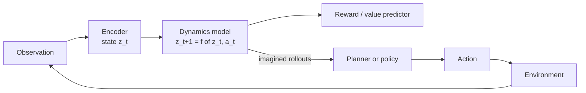

# World models

A **world model** is an internal model of how an environment works: given the current state and an action, what happens next? With one, an agent can *imagine* consequences before acting, plan, and learn from simulated experience. Many researchers see world models as a missing ingredient between today's pattern-completing systems and robust, general agents.

## The idea in RL (established)

- **Dyna** (Sutton 1991) integrated learning, planning, and reacting: real experience trains both the policy and a model, and the model generates extra simulated experience.
- **World Models** (Ha & Schmidhuber 2018) compressed frames with a VAE, predicted the future in latent space with a recurrent network, and trained a small controller entirely "inside the dream" of the learned model.
- **MuZero** (Schrittwieser et al. 2020) learned a latent model that predicts only what matters for planning (reward, value, policy) without reconstructing observations, and matched or exceeded AlphaZero in Go, chess and shogi while also mastering Atari.
- **DreamerV3** (Hafner et al. 2023) learned behaviours by imagining trajectories in a learned latent world model and, with fixed hyperparameters across many domains, collected diamonds in Minecraft from scratch without human data.

## Learning from prediction, not reconstruction (active research)

**LeCun (2022)** proposed an architecture for autonomous machine intelligence centred on a world model trained with **joint-embedding predictive architectures (JEPA)**: predict the *representation* of missing or future parts of the input rather than its pixels, so the model can ignore unpredictable detail. **I-JEPA** (Assran et al. 2023) applied this to images, predicting representations of masked image regions.

## Do language models have world models? (active research, debated)

Evidence that sequence models learn internal world representations:

- **Othello-GPT** (Li et al. 2023): a transformer trained only on legal move sequences developed an internal representation of the board that could be probed and causally edited.
- Mechanistic studies more broadly (see [Interpretability](../05-alignment-safety-interpretability/interpretability.md)) find structured internal representations of the entities and relations in the data.

Critics note that such representations may be partial, task-specific, and brittle, and that predicting text about the world is different from modelling the world's causal dynamics. The question is open.

## Generative models as simulators (active research)

**Genie** (Bruce et al. 2024) learned, from unlabelled internet videos, a generative model of interactive environments with a latent action space, so users can "play" generated worlds frame by frame. Video generation models are increasingly evaluated on whether they respect physical consistency, which is a test of their implicit world models.

## Why world models matter

| Capability | How a world model helps |
|---|---|
| **Sample efficiency** | Learn from imagined experience instead of costly real interaction |
| **Planning** | Search over action sequences before committing |
| **Safety** | Predict consequences of actions, including harmful ones, before taking them |
| **Generalization** | Causal models transfer to new situations better than surface correlations |
| **Robotics** | Physical trial and error is slow and risky; simulation is not |

## Speculative directions

> [!WARNING]
> **Speculative.** These are open hypotheses.

- **World models as the path to general agents.** If an agent can learn accurate, controllable models of its environment at many levels of abstraction, it could plan flexibly in novel situations. Whether scaling current approaches gets there is unknown.
- **Hierarchical, multi-timescale models.** Planning over long horizons may require world models that predict at several temporal resolutions, from milliseconds to days, an idea linked to [self-similar structure](fractal-and-self-similar-structure.md).
- **Self-modelling.** An agent that models not only the world but itself, its own capabilities and likely errors, connects world models to [recursion and self-improvement](recursion-and-self-improvement.md).

## Next topics for this page

- Model-based RL error compounding and how planners cope
- Causal representation learning
- Evaluating physical consistency of video generators
