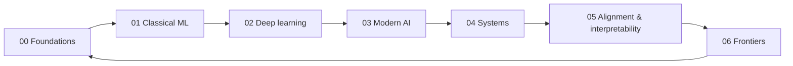

# Daily updates

Understanding AI is a living document. It is extended on a **daily cadence**: each day adds or deepens one focused piece of the map and records it in the [changelog](../CHANGELOG.md).

## What a daily update looks like

A daily update is small, sourced, and self-contained. Typical forms:

| Type | Example |
|---|---|
| **New page** | A new frontier topic such as optical nonlinearities for photonic neural networks |
| **Deepening** | A worked derivation added to an existing page (e.g. the softmax-attention gradient) |
| **Paper note** | A concise summary of an important paper, linked from the relevant section |
| **Correction** | Fixing an error, an outdated statement, or a broken link |
| **Diagram** | A Mermaid figure that makes a hard idea visual |

## Rules for every update

1. **Sourced.** New claims cite real papers or textbooks, added to [`REFERENCES.md`](../REFERENCES.md) with a working arXiv or DOI link.
2. **Honest about uncertainty.** Speculative ideas carry the *Speculative* callout.
3. **Logged.** One line in [`CHANGELOG.md`](../CHANGELOG.md) under the date (`YYYY-MM-DD`), newest first.
4. **Linked.** The new material is reachable from its section's `README.md` and, when notable, from the *What's new* list on the main [`README`](../README.md).

## Rotation

Updates rotate through the map so that no area goes stale:

Frontier topics (recursion, self-similarity, nonlinear dynamics, photonic and neuromorphic computing, quantum ML, world models) receive extra attention because they change fastest.

## Backlog

The open backlog of planned topics lives at the bottom of the [changelog](../CHANGELOG.md#backlog).
